# **THIẾT KẾ VÀ TRIỂN KHAI DATA LAKEHOUSE PHỤC VỤ XỬ LÝ VÀ PHÂN TÍCH DỮ LIỆU CHO WEBSITE THƯƠNG MẠI ĐIỆN TỬ THỜI TRANG**

---

# **CHƯƠNG 1. TỔNG QUAN ĐỀ TÀI**

## **1.1. Tính cấp thiết của đề tài**

Trong bối cảnh chuyển đổi số và sự phát triển của thương mại điện tử (TMĐT), các doanh nghiệp bán lẻ thời trang phải quản lý và khai thác một khối dữ liệu lớn, phát sinh liên tục. Dữ liệu này đa dạng về cấu trúc: dữ liệu giao dịch có cấu trúc chặt chẽ (đơn hàng, thanh toán, tồn kho theo biến thể màu sắc và kích cỡ) và dữ liệu nhật ký hành vi người dùng bán cấu trúc (xem sản phẩm, tìm kiếm, thêm vào giỏ, đặt hàng).

Khai thác hiệu quả nguồn dữ liệu hỗn hợp này là thách thức với các kiến trúc truyền thống. Kho dữ liệu (Data Warehouse) bảo đảm tính nhất quán giao dịch (ACID) và tối ưu cho truy vấn phân tích (OLAP), nhưng chi phí lưu trữ cao khi mở rộng với dữ liệu bán cấu trúc và kém linh hoạt khi tiếp nhận dữ liệu streaming. Ngược lại, Hồ dữ liệu (Data Lake) lưu dữ liệu thô với chi phí thấp trên lưu trữ đối tượng (Object Storage), nhưng thiếu cơ chế kiểm soát giao dịch, dễ trở thành "vũng lầy dữ liệu" (Data Swamp), làm giảm chất lượng dữ liệu và hiệu năng truy vấn.

Kiến trúc **Data Lakehouse** kết hợp chi phí thấp và khả năng mở rộng của Data Lake với năng lực quản trị, độ tin cậy và giao dịch ACID của Data Warehouse. Nghiên cứu, thiết kế và triển khai một Data Lakehouse cho bài toán bán lẻ thời trang đa kênh (bán trực tuyến và bán tại cửa hàng POS) có ý nghĩa thực tiễn: hợp nhất dữ liệu, quản lý tồn kho chính xác hơn, phân tích hành vi mua sắm và hỗ trợ các cấp quản lý ra quyết định dựa trên số liệu đối soát được với nguồn.

## **1.2. Mục tiêu nghiên cứu**

Đề tài hướng tới hai nhóm mục tiêu:

1. **Mục tiêu tổng quát**:
   * Nghiên cứu, thiết kế và xây dựng một hệ thống Data Lakehouse đầu cuối (End-to-End) cho lĩnh vực TMĐT thời trang, gồm thu thập, lưu trữ phân tầng, xử lý, quản trị quyền truy cập và trực quan hóa các chỉ số kinh doanh.

2. **Mục tiêu cụ thể**:
   * Xây dựng hệ thống giao dịch nguồn: API nghiệp vụ FastAPI cho bán hàng trực tuyến, bán hàng tại quầy (POS), kho, giao vận và đổi trả, dùng chung một cơ sở dữ liệu PostgreSQL 16 gồm 28 bảng.
   * Thiết kế và triển khai Data Lakehouse phân tầng Medallion (Staging – Bronze – Silver – Gold) trên định dạng bảng mở Apache Iceberg, lưu trữ MinIO S3 và catalog Apache Polaris (Iceberg REST Catalog).
   * Xây dựng bốn đường ống Airflow: nạp toàn bộ (init), nạp gia tăng hằng ngày (incremental), đồng bộ dòng bị xoá và thay đổi lược đồ (sync), xoá cứng chủ động (purge). Thiết kế theo khóa và mốc tiến độ để hỗ trợ chạy lại.
   * Xây dựng mô hình dữ liệu phân tích Star Schema bằng dbt trên Trino, gồm 7 bảng Dimension, 6 bảng Fact và 14 Data Mart, kèm đối soát với nguồn và kiểm tra chất lượng dữ liệu.
   * Tự quản trị quyền truy cập Lakehouse: mỗi workload một danh tính Polaris, credential lưu trữ tạm cấp theo từng bảng, Trino tách quyền đọc/ghi; trực quan hóa bằng Apache Superset.

## **1.3. Nhiệm vụ nghiên cứu**

* **Nhiệm vụ 1: Khảo sát nghiệp vụ và cơ sở lý thuyết**: Tìm hiểu quy trình bán hàng thời trang đa kênh, vòng đời đơn hàng, hạch toán doanh thu – giá vốn, quản lý tồn kho đa điểm và hệ thống KPI. Nghiên cứu Iceberg, MinIO, Polaris, PyIceberg, dbt, Airflow, Trino và Superset cho OLTP Lakehouse, cùng Kafka và Flink cho phương án access log.
* **Nhiệm vụ 2: Xây dựng hệ thống giao dịch nguồn**: Thiết kế cơ sở dữ liệu PostgreSQL 28 bảng sinh từ ORM SQLAlchemy, phát triển API FastAPI với xác thực, phân quyền và middleware ghi nhật ký truy cập có che dữ liệu cá nhân; xây dựng Console Streamlit mô phỏng mua hàng qua API.
* **Nhiệm vụ 3: Thiết kế và triển khai Data Lakehouse**: Thiết lập lưu trữ đối tượng, catalog Polaris, các namespace phân tầng và mô hình phân quyền theo workload.
* **Nhiệm vụ 4: Xây dựng đường ống dữ liệu và kiểm soát chất lượng**: Trích xuất theo bảng bằng PyIceberg trong Airflow, dựng Silver và Gold bằng dbt, đối soát với nguồn và kiểm chứng các kịch bản đồng bộ, retry, chạy bù.
* **Nhiệm vụ 5: Sinh dữ liệu mô phỏng, trực quan hóa và kiểm thử**: Xây dựng bộ sinh dữ liệu `datagen` có căn cứ thống kê từ dữ liệu công khai, dashboard Superset và kiểm thử pipeline trên dữ liệu mô phỏng.

## **1.4. Đối tượng và phạm vi nghiên cứu**

* **Đối tượng nghiên cứu**:
  * Kiến trúc Data Lakehouse, định dạng bảng mở Apache Iceberg và catalog chuẩn mở Apache Polaris.
  * Quy trình thu thập, xử lý và tích hợp hai loại dữ liệu: dữ liệu giao dịch có cấu trúc (OLTP) và dữ liệu sự kiện nhật ký bán cấu trúc (Access Log).
  * Mô hình hóa đa chiều Kimball Star Schema và Data Mart phục vụ khai thác kinh doanh.
  * Các KPI kinh doanh, kho vận, giao vận và phễu tương tác trong TMĐT.

* **Phạm vi nghiên cứu**:
  * *Phạm vi nghiệp vụ*: chu trình bán lẻ thời trang gồm danh mục sản phẩm theo biến thể (màu, size), giỏ hàng, đặt hàng trực tuyến, bán tại quầy POS, tồn kho đa vị trí, giao hàng COD, đổi trả – hoàn tiền và theo dõi tương tác người dùng.
  * *Phạm vi kỹ thuật*: triển khai ứng dụng nguồn, pipeline OLTP, quản trị quyền và BI trên một máy chủ bằng Docker Compose. Access log có hai đầu ra hiện hữu là JSON từ API và tệp Parquet mô phỏng. Nạp access log vào Lakehouse bằng streaming là hướng phát triển của khóa luận: thiết kế đã hoàn thành và được giữ lại (mục 4.4.3, 4.8.3). Phân cụm chịu lỗi cao (High Availability), tự động co giãn và học máy thuộc phạm vi mở rộng.

## **1.5. Tổng quan các công trình liên quan**

Các triển khai ban đầu dựa trên Data Warehouse tập trung (Inmon hay Kimball): toàn vẹn dữ liệu cao, hỗ trợ ACID và truy vấn phân tích được tối ưu, nhưng chi phí lưu trữ trên hệ thống chuyên dụng đắt đỏ, khó theo kịp khối lượng dữ liệu nhật ký clickstream [1], [7].

Hadoop và phong trào Data Lake trên lưu trữ đối tượng (S3, HDFS) giải quyết bài toán chi phí lưu trữ quy mô lớn. Tuy nhiên Data Lake thiếu quản lý giao dịch, dẫn đến rủi ro đọc dữ liệu dở dang khi ghi đồng thời, khó cập nhật/xoá dữ liệu (đặc biệt với yêu cầu quyền riêng tư như GDPR) và hiệu năng truy vấn báo cáo thấp.

Data Lakehouse ra đời cùng các định dạng bảng mở Apache Iceberg, Delta Lake và Apache Hudi. Apache Iceberg nổi bật với quản lý bảng theo snapshot, time-travel, tiến hóa lược đồ (schema evolution) an toàn và tách biệt lưu trữ với công cụ tính toán [9]. Các triển khai gần đây thường tổ chức dữ liệu theo kiến trúc Medallion (Bronze – Silver – Gold) [7], [11].

Phần lớn công trình dừng ở lý thuyết, dùng tập dữ liệu tĩnh (TPC-DS, TPC-H) hoặc triển khai rời rạc từng thành phần. Đề tài hiện thực một giải pháp liền mạch: từ ứng dụng nguồn phát sinh giao dịch, bộ sinh dữ liệu có căn cứ, pipeline tự động chạy lại an toàn, đồng bộ thay đổi nguồn, đến quản trị quyền tự vận hành và trực quan hóa.

## **1.6. Kết quả dự kiến đạt được**

1. **Sản phẩm phần mềm ứng dụng**:
   * API nghiệp vụ FastAPI cho mua hàng trực tuyến (giỏ hàng, checkout VietQR/COD), POS, kho, nhập hàng, giao vận, đổi trả và đánh giá.
   * Console Streamlit (Platform Console) gồm màn hình mô phỏng mua hàng qua API thật và màn hình quản trị quyền Lakehouse.
   * Middleware ghi JSON theo hợp đồng `ecommerce.access` v1.0.0 ra stdout và che dữ liệu nhạy cảm.

2. **Sản phẩm hạ tầng và nền tảng dữ liệu**:
   * Data Lakehouse bốn namespace (`staging`, `bronze`, `silver`, `gold`) trên MinIO S3 và Apache Iceberg, quản lý bởi Polaris.
   * Bốn DAG Airflow: `lakehouse_oltp_init`, `lakehouse_oltp_incremental`, `lakehouse_oltp_sync`, `lakehouse_oltp_purge`; mỗi bảng và mỗi model dbt là một task riêng.
   * Quản trị quyền tự vận hành với ba workload Polaris: `batch-airflow`, `trino-reader` và `trino-writer`. Polaris cấp credential lưu trữ tạm theo bảng.

3. **Sản phẩm phân tích và báo cáo (BI)**:
   * Mô hình Star Schema gồm 7 dimension, 6 fact và 14 mart, cùng 2 seed (`delivery_sla`, `calendar_events`).
   * Bốn dashboard Apache Superset, gồm 27 biểu đồ và 16 định nghĩa dataset trên 14 mart Gold.

4. **Sản phẩm tài liệu kỹ thuật**:
   * Báo cáo đồ án, tài liệu kiến trúc, hợp đồng dữ liệu, cài đặt, vận hành và thiết kế trong thư mục `docs/`.

---

# **CHƯƠNG 2. CƠ SỞ LÝ THUYẾT VÀ CÔNG NGHỆ ÁP DỤNG**

## **2.1. Tổng quan về thương mại điện tử và bán hàng đa kênh**

### **2.1.1. Mô hình thương mại điện tử và bán hàng đa kênh**

Thương mại điện tử là phương thức kinh doanh trong đó giao dịch mua bán hàng hóa và dịch vụ được tiến hành qua mạng máy tính và phương tiện điện tử [1]. Trong mô hình B2C (Business-to-Consumer), doanh nghiệp tương tác trực tiếp với người tiêu dùng qua web hoặc ứng dụng di động.

Khi mở rộng sang bán hàng đa kênh (Omnichannel), doanh nghiệp kết hợp website với chuỗi cửa hàng vật lý. Thách thức lớn nhất là dữ liệu phân mảnh giữa các kênh, dẫn đến sai lệch tồn kho (overselling) và khó hợp nhất doanh thu. Đề tài tích hợp kênh trực tuyến và POS trên cùng một Backend và một cơ sở dữ liệu giao dịch, nên sản phẩm, giá, khách hàng và tồn kho luôn có một nguồn sự thật duy nhất.

### **2.1.2. Quy trình quản lý bán hàng, đơn hàng và tồn kho**

Bán hàng thời trang đòi hỏi quản lý theo biến thể (SKU) màu sắc và kích cỡ. Dù khách đặt online hay mua tại quầy, hệ thống đều thực hiện cùng các bước: xác thực giá bán, áp dụng mã giảm giá hợp lệ và kiểm tra tồn kho khả dụng.

Vòng đời đơn hàng tách ba luồng trạng thái liên kết với nhau:
1. **Trạng thái đơn hàng** (chờ xử lý, đã xác nhận, đang xử lý, hoàn thành, đã hủy).
2. **Trạng thái thanh toán** (chưa thanh toán, đã thanh toán, hoàn tiền một phần, hoàn tiền toàn bộ).
3. **Trạng thái giao nhận** (chờ lấy hàng, đang giao, giao thành công, giao thất bại).

Cách tách này giúp xử lý đúng các trường hợp COD, hủy đơn và đổi trả mà không ghi nhận sai thời điểm doanh thu. Với tồn kho, mọi biến động (nhập, xuất bán online, bán tại quầy, hoàn trả, điều chỉnh) được ghi vào sổ cái `inventory_transactions`; số dư tồn bằng tồn đầu cộng tổng sổ cái theo biến thể và vị trí.

### **2.1.3. Vai trò của phân tích dữ liệu trong hoạt động kinh doanh**

Dữ liệu giao dịch phản ánh kết quả kinh doanh: doanh thu thuần, số đơn, tỷ lệ hủy, lợi nhuận gộp và tồn kho. Tuy nhiên, nó chỉ cho biết *kết quả đã xảy ra*, không giải thích *hành vi dẫn đến kết quả đó*.

Dữ liệu nhật ký truy cập bổ sung góc nhìn hành vi: lưu lượng theo giờ, sản phẩm được xem nhiều, điểm rơi trong phễu giỏ hàng – thanh toán. Hệ thống OLTP được tối ưu cho giao dịch ngắn; chạy truy vấn tổng hợp nặng trên đó gây tranh chấp tài nguyên và ảnh hưởng người mua. Vì vậy dữ liệu được đồng bộ sang Lakehouse để phân tích mà không làm chậm hệ thống vận hành.

### **2.1.4. Hệ thống chỉ số KPI trong thương mại điện tử**

| Nhóm KPI | Chỉ số cốt lõi | Ý nghĩa nghiệp vụ |
|---|---|---|
| **Kinh doanh (Sales)** | Số đơn, giá trị đặt hàng, doanh thu hàng hóa, hoàn tiền, doanh thu thuần, giá vốn, lợi nhuận gộp | Sức khỏe tài chính sau giảm giá và hoàn tiền; doanh thu ghi nhận vào ngày muộn hơn giữa hoàn tất và thanh toán đủ |
| **Kho vận (Inventory)** | Tồn theo vị trí, giá trị tồn, số biến thể còn/hết hàng, bán trung bình 28 ngày | Cảnh báo thiếu hàng hoặc ứ đọng vốn tại từng điểm bán |
| **Vận hành (Operations)** | Tỷ lệ giao đúng hạn theo SLA thành phố, thời gian giao, đơn tồn đọng theo tuổi, tiền COD, hủy và đổi trả | Hiệu quả giao vận và rủi ro dòng tiền thu hộ |
| **Khách hàng và Marketing** | Hiệu quả coupon, đánh giá theo giao đúng hạn/trễ, cohort mua lại, giá trị khách hàng, phễu xem → giỏ → checkout → đặt đơn | Hiệu quả khuyến mại, chất lượng dịch vụ và giữ chân khách |
| **Kỹ thuật** | Lưu lượng request, tỷ lệ lỗi HTTP, độ trễ theo route | Độ ổn định của hệ thống nguồn |

Định nghĩa chi tiết từng chỉ số nằm trong [DATA.md](DATA.md).

## **2.2. Kiến trúc và công nghệ phát triển hệ thống thương mại điện tử**

### **2.2.1. Kiến trúc Web Client–Server và REST API**

Hệ thống nguồn theo kiến trúc Client–Server, tách giao diện và nghiệp vụ qua RESTful API [3]. Backend dùng **FastAPI** (Python 3.11): kiểm tra dữ liệu bằng Pydantic, sinh tài liệu OpenAPI và định nghĩa phụ thuộc (xác thực, quyền, phiên giao dịch) bằng Dependency Injection.

Giao diện là **Streamlit** [2] (Platform Console), chạy cùng container với FastAPI. Console gọi API thật qua HTTP như mọi client, gồm hai màn hình: mô phỏng mua hàng online và quản trị quyền Lakehouse. Giao diện storefront web trước đây (Next.js) đã được gỡ để tập trung vào nền tảng dữ liệu.

### **2.2.2. Cơ sở dữ liệu giao dịch OLTP**

Cơ sở dữ liệu giao dịch là **PostgreSQL 16** [4]: giao dịch ACID, khóa mức dòng và đọc nhất quán qua MVCC (Multi-Version Concurrency Control). Thời gian lưu kiểu `TIMESTAMPTZ` (UTC), UUID lưu kiểu UUID gốc, trạng thái được ràng buộc bằng CHECK, khóa ngoại và UNIQUE.

Tầng ứng dụng dùng **SQLAlchemy 2.0 ORM** [5]; lược đồ `database/schema.sql` được sinh từ ORM và kiểm tra khớp trong CI. Để tránh bán vượt tồn khi nhiều người mua cùng lúc, checkout chạy trong một giao dịch READ COMMITTED, khóa dòng tồn kho bằng `SELECT ... FOR UPDATE`, và tự thử lại có giới hạn khi gặp deadlock, lỗi tuần tự hóa hoặc khóa không lấy được. Lỗi kết nối không được thử lại tự động vì kết quả commit khi đó không xác định.

### **2.2.3. Xác thực, phân quyền và bảo mật hệ thống**

Mật khẩu được băm bằng **Argon2id**, thuật toán thắng Password Hashing Competition, chống tấn công vét cạn bằng GPU. Thông tin đăng nhập nằm trong bảng riêng `customer_credentials`, không bao giờ được nạp vào Lakehouse.

Xác thực dùng JSON Web Token (JWT) trong **cookie HttpOnly**, chống đánh cắp token qua XSS; mọi yêu cầu thay đổi trạng thái cần CSRF token [6]. Quyền truy cập theo mô hình RBAC kết hợp phạm vi cửa hàng: tài khoản có một trong các vai trò `customer`, `admin`, `system_admin`, `store_manager`, `sales_manager`, `marketing_manager`, `inventory_manager`, `operations_manager`, `city_planner`, và route kiểm tra vai trò cùng cửa hàng được phân công.

## **2.3. Kiến trúc và công nghệ lưu trữ Data Lakehouse**

### **2.3.1. Tổng quan về kiến trúc Data Lakehouse**

Data Lakehouse hợp nhất ưu điểm của Data Warehouse và Data Lake trên một nền tảng [7]. Một tầng siêu dữ liệu (metadata layer) đặt trên lưu trữ đối tượng chi phí thấp cung cấp giao dịch ACID theo bảng, quản lý phiên bản snapshot (time-travel), tiến hóa lược đồ không cần viết lại dữ liệu, và cho phép nhiều engine (batch, streaming, SQL) cùng đọc ghi một bảng.

### **2.3.2. Mô hình kiến trúc dữ liệu phân tầng Medallion**

```text
[PostgreSQL] ──► [Staging] ──► [Bronze] ──► [Silver] ──► [Gold]
                 bản trích     dòng nguồn    kiểu chuẩn    Star Schema
                 xuất mới nhất hiện tại      hóa           và Data Mart
```

* **Staging**: bản trích xuất của lần chạy gần nhất, kèm `_ingested_at`. Mỗi lần nạp xoá trắng rồi ghi lại, nên chạy lại cho cùng kết quả.
* **Bronze**: dòng nguồn giữ nguyên kiểu dữ liệu của PostgreSQL, là phiên bản hiện tại theo khóa chính, kèm cờ xoá mềm `_is_deleted`, `_deleted_at`.
* **Silver**: cùng tập dòng với Bronze, kiểu dữ liệu chuẩn hóa (UUID 16 byte, timestamp có múi giờ), merge theo khóa chính.
* **Gold**: mô hình hình sao gồm dimension, fact và mart tổng hợp sẵn theo câu hỏi nghiệp vụ.

Dữ liệu cá nhân không bị băm; thay vào đó chỉ các cột được duyệt trong danh sách cho phép mới được nạp (mục 3.5.5).

### **2.3.3. Lưu trữ Object Storage và định dạng bảng mở Apache Iceberg**

Lưu trữ đối tượng dùng **MinIO**, tương thích Amazon S3 API [8], hỗ trợ chính sách IAM và dịch vụ STS cấp credential tạm.

Định dạng bảng là **Apache Iceberg** [9]. Khác với bảng Hive dựa trên thư mục, Iceberg quản lý bảng bằng cây siêu dữ liệu (metadata file, manifest list, manifest file). Mỗi lần ghi tạo một snapshot mới nguyên tử (atomic commit); người đọc luôn thấy một snapshot hoàn chỉnh (snapshot isolation), nên truy vấn không bị ảnh hưởng bởi tiến trình đang ghi. Iceberg cho thêm cột và nới kiểu (int → long, float → double, tăng độ chính xác decimal) mà không viết lại dữ liệu.

**Apache Polaris** là catalog trung tâm theo Iceberg REST Catalog Specification [10], cho phép PyIceberg và Trino dùng chung bảng. Polaris quản lý quyền theo vai trò (RBAC) và **cấp credential lưu trữ tạm (credential vending)**. Khi một engine mở bảng, Polaris kiểm tra quyền rồi xin MinIO STS credential giới hạn trong đường dẫn lưu trữ được phép.

### **2.3.4. Mô hình dữ liệu phân tích Kimball**

Tầng Gold theo phương pháp mô hình hóa đa chiều của Ralph Kimball [11]:
* **Bảng chiều (Dimension)**: thuộc tính mô tả ngữ cảnh (ngày, thành phố, cửa hàng, sản phẩm, biến thể, khách hàng, nhân viên) để cắt lát và gom nhóm.
* **Bảng sự kiện (Fact)**: độ đo tại một mức chi tiết (grain) xác định, ví dụ một dòng đơn hàng, một vận đơn hay tồn kho của một biến thể tại một vị trí trong một ngày.
* **Data Mart**: bảng tổng hợp sẵn từ fact và dimension theo câu hỏi của từng nhóm người xem, giúp dashboard không phải JOIN bảng lớn khi truy vấn.

## **2.4. Công nghệ thu thập và xử lý dữ liệu lớn**

### **2.4.1. Thu thập và xử lý dữ liệu theo lô với PyIceberg và dbt**

Triển khai một máy sử dụng hai công cụ để xử lý lô và chuyển đổi SQL:

* **PyIceberg** [12]: thư viện Python đọc ghi bảng Iceberg qua Polaris. Pipeline đọc PostgreSQL bằng con trỏ phía server (server-side cursor), gom thành lô Apache Arrow và ghi vào staging và Bronze; Bronze dùng `upsert` theo khóa chính và `overwrite` cho lần nạp toàn bộ, mỗi thao tác là một commit Iceberg.
* **dbt** [13] trên **Trino**: mỗi model Silver và Gold là một câu SQL; dbt dựng bảng theo thứ tự phụ thuộc `ref()`, dùng chiến lược incremental `merge` theo khóa và chạy data test sau khi dựng.

### **2.4.2. Đồng bộ thay đổi nguồn và định hướng xử lý nhật ký truy cập**

Change Data Capture (CDC) theo nhật ký giao dịch (ví dụ Debezium đọc WAL của PostgreSQL) cho thấy mọi thay đổi gần thời gian thực, nhưng cần thêm dịch vụ, cấu hình `wal_level = logical` và thay đổi cả luồng nạp lô. Đề tài **không dùng CDC**. Thay vào đó, các thay đổi mà nạp gia tăng theo `updated_at` không thấy được xử lý bằng một DAG đồng bộ riêng (mục 3.5.2): dòng bị xoá được phát hiện bằng đối chiếu khóa chính, thay đổi cột bằng so lược đồ. Cách này chỉ đọc nguồn và không cần dịch vụ thêm.

API phát log có cấu trúc ra stdout. Xử lý nhật ký truy cập bằng streaming là hướng phát triển của khóa luận (mục 4.8.3): Apache Kafka [14] nhận sự kiện và Apache Flink [15] ghi từng lô sự kiện vào Iceberg theo checkpoint. Hai dịch vụ này chưa có trong cấu hình Compose hiện tại.

### **2.4.3. Điều phối luồng dữ liệu tự động với Apache Airflow**

**Apache Airflow 3** [16] điều phối pipeline dưới dạng DAG viết bằng Python. Đề tài dùng các khái niệm:
* **Data interval** (`data_interval_start`, `data_interval_end`): mỗi lần chạy theo lịch xử lý đúng một khoảng thời gian, nên chạy lại hay backfill một ngày cho cùng kết quả.
* **TaskGroup**: mỗi tầng là một nhóm, mỗi bảng hoặc model dbt là một task; lỗi chỉ ra đúng bảng, và **Clear** chạy lại đúng task đó.
* **Asset**: task cuối của DAG incremental phát Asset `lakehouse_oltp_loaded`, kích hoạt DAG đồng bộ.
* **Pool và retry**: các task dùng chung pool `lakehouse_oltp` 4 slot, tự thử lại hai lần.

### **2.4.4. Kiểm soát chất lượng dữ liệu và quản lý lỗi**

Mô hình chất lượng dữ liệu ISO/IEC 25012 [17] gồm các đặc tính như đầy đủ, chính xác, nhất quán và kịp thời. Đề tài áp dụng nguyên tắc: **kiểm tra chặn đặt ở nơi có thể làm sai số liệu, không kiểm tra lại những gì nguồn đã bảo đảm**.

* PostgreSQL đã bảo đảm khóa chính, trường bắt buộc, khóa ngoại và CHECK, nên pipeline không kiểm tra lại.
* **Đối soát với nguồn** (lần nạp toàn bộ): so số dòng, tổng tiền (`orders`, `payments`, `refunds`) và số dư sổ kho của bản trích xuất với PostgreSQL tại cùng một mốc, trước khi Bronze thay đổi.
* **Silver khớp Bronze**: test `matches_bronze` chặn khi tập khóa của hai tầng lệch nhau.
* **Kiểm tra sau Gold** (chỉ cảnh báo, không chặn): phân bổ giảm giá bảo toàn tổng, đơn Gold khớp Silver, các mart doanh thu khớp nhau, tồn kho khớp sổ cái.
* **Thay đổi lược đồ nguồn** được phân loại; thay đổi có thể làm sai số liệu (bỏ cột, đổi loại) dừng pipeline với thông báo cách xử lý.

Kết quả kiểm tra nằm trong log của task Airflow; task trượt kiểm tra chặn sẽ lỗi và tầng sau giữ nguyên bản cũ.

## **2.5. Công nghệ phân tích và trực quan hóa dữ liệu**

### **2.5.1. Công cụ truy vấn dữ liệu phân tán Apache Trino**

**Trino** [18] là engine SQL phân tán cho truy vấn tương tác trên hồ dữ liệu. Trino đọc bảng Iceberg qua Polaris, dùng siêu dữ liệu Iceberg để cắt tỉa phân vùng (partition pruning) và bỏ qua tệp theo thống kê min/max, giảm lượng dữ liệu đọc từ MinIO.

Mỗi truy vấn Trino đọc một snapshot Iceberg hoàn chỉnh, nên dashboard không thấy dữ liệu ghi dở. Trino có hai catalog trỏ cùng warehouse: `lakehouse` chỉ đọc cho phân tích và `lakehouse_etl` cho dbt ghi `silver`/`gold`.

### **2.5.2. Trực quan hóa dữ liệu và xây dựng Dashboard với Apache Superset**

**Apache Superset** [20] là nền tảng BI mã nguồn mở, kết nối Trino qua SQLAlchemy, định nghĩa dataset trên bảng và dựng chart, dashboard. Thiết kế dashboard theo nguyên tắc của Stephen Few [19]: chỉ số chính ở đầu, xu hướng theo thời gian, rồi phân rã theo chiều.

Dataset, biểu đồ và bố cục được khai báo bằng mã rồi đồng bộ qua `make superset-sync`. Lệnh này tạo hoặc cập nhật các dashboard do repo quản lý trong metadata của Superset.

---

# **CHƯƠNG 3. PHÂN TÍCH VÀ THIẾT KẾ HỆ THỐNG**

## **3.1. Phân tích yêu cầu hệ thống**

### **3.1.1. Bối cảnh và phát biểu bài toán**

Doanh nghiệp thời trang D&K bán lẻ trên website và tại các cửa hàng. Hệ thống giao dịch xử lý duyệt sản phẩm, đặt hàng, thanh toán VietQR, giao COD và đổi trả; máy chủ web ghi nhận lượt tương tác của người dùng.

Ban giám đốc và các bộ phận thiếu một nơi phân tích tập trung: tổng hợp báo cáo thủ công từ cơ sở dữ liệu giao dịch tốn thời gian, dễ sai và làm chậm hệ thống bán hàng; dữ liệu nhật ký bị bỏ phí. Bài toán là thiết kế một nền tảng dữ liệu vừa không ảnh hưởng hệ thống vận hành, vừa tự động thu thập, xử lý, đối soát và phân quyền truy cập dữ liệu phân tích.

### **3.1.2. Tác nhân và phạm vi hệ thống**

| Tác nhân | Trách nhiệm và nhu cầu khai thác |
|---|---|
| **Khách hàng (Customer)** | Duyệt sản phẩm theo màu/size, quản lý giỏ hàng, đặt hàng, thanh toán VietQR/COD, theo dõi đơn, đánh giá và yêu cầu đổi trả. |
| **Nhân viên cửa hàng và kho** | Bán hàng tại quầy qua API POS, tra cứu tồn kho, nhập hàng và kiểm định hàng hoàn. |
| **Nhân viên giao nhận** | Hồ sơ trong `delivery_staff`; các lần giao và tiền COD được ghi nhận trên vận đơn. |
| **Cấp quản lý** | Xem báo cáo doanh thu, lợi nhuận, kho vận, giao vận, khách hàng trên Superset. |
| **Kỹ sư dữ liệu và quản trị nền tảng** | Vận hành DAG Airflow, xử lý thay đổi nguồn, quản trị quyền Polaris và cấp credential cho workload qua Console. |


### **3.1.3. Yêu cầu chức năng**

* **Nhóm chức năng ứng dụng giao dịch**:
  * Quản lý danh mục, sản phẩm và biến thể SKU (màu, size, giá niêm yết, giá vốn).
  * Giỏ hàng và checkout bảo đảm tồn kho nhất quán bằng khóa dòng.
  * Bán hàng tại quầy POS. Mã giảm giá áp dụng trong checkout online.
  * Nhập hàng và sổ cái biến động kho.
  * Vận đơn, các lần giao, thu hộ COD và quy trình đổi trả – hoàn tiền nhiều bước.
  * Ghi nhật ký truy cập API tự động, ngoại trừ route health check.
* **Nhóm chức năng nền tảng dữ liệu và phân tích**:
  * Nạp toàn bộ và nạp gia tăng hằng ngày 19 bảng nguồn vào Lakehouse, đối soát với nguồn ở lần nạp toàn bộ.
  * Phát hiện dòng bị xoá ở nguồn và giữ dấu vết (xoá mềm) qua mọi tầng; cho phép xoá cứng chủ động.
  * Phát hiện thay đổi cột ở nguồn: tự áp dụng thay đổi an toàn, dừng với thay đổi phá vỡ, không nạp cột chưa được duyệt.
  * Dựng 7 dimension, 6 fact và 14 mart phục vụ KPI.
  * Quản trị quyền Lakehouse: principal, role, quyền theo catalog/namespace/bảng và cấp credential cho workload.
  * Dashboard trực quan hóa trên Superset.

### **3.1.4. Yêu cầu phi chức năng**

* **Tính toàn vẹn và nhất quán**: giao dịch nguồn tuân thủ ACID. Mỗi truy vấn phân tích đọc một snapshot Iceberg hoàn chỉnh. Lần nạp toàn bộ phải khớp nguồn về số dòng, tổng tiền và số dư sổ kho tại cùng mốc thời gian.
* **Chạy lại an toàn (idempotency)**: phép ghi theo khóa và mốc tiến độ cho phép chạy lại khi đầu vào tương đương. Các DAG dùng chung staging cần chạy tuần tự.
* **Khả năng mở rộng**: tách tính toán (PyIceberg, Trino) và lưu trữ (MinIO). Kịch bản kiểm chứng đầu cuối dùng preset `100k`. Các preset lớn hơn phục vụ sinh dữ liệu và đo tải theo từng cấu hình.
* **Bảo mật**: dữ liệu cá nhân chỉ vào Lakehouse khi cột được duyệt; workload không giữ khóa lưu trữ; Trino tách quyền đọc và ghi; API xác thực JWT, chống CSRF và phân quyền RBAC.

## **3.2. Phân tích chức năng và quy trình nghiệp vụ**

### **3.2.1. Sơ đồ Use Case hệ thống**

Hệ thống gồm ba phân hệ:
1. **Phân hệ mua hàng**: khách hàng duyệt sản phẩm, giỏ hàng, checkout, theo dõi đơn, đánh giá và đổi trả qua API.
2. **Phân hệ quản trị và POS**: bán tại quầy, quản lý sản phẩm, đơn, kho, nhập hàng, giao vận và hoàn tiền qua API có phân quyền.
3. **Phân hệ dữ liệu và BI**: kỹ sư dữ liệu vận hành pipeline và quản trị quyền; cấp quản lý xem dashboard.

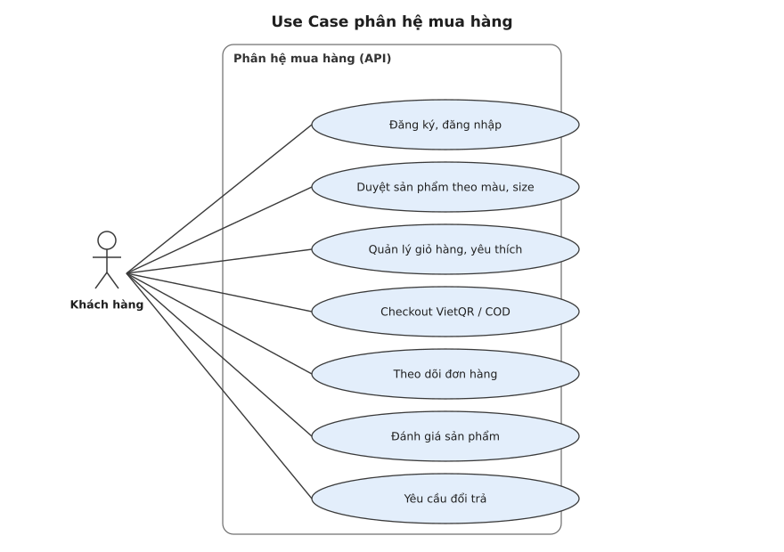


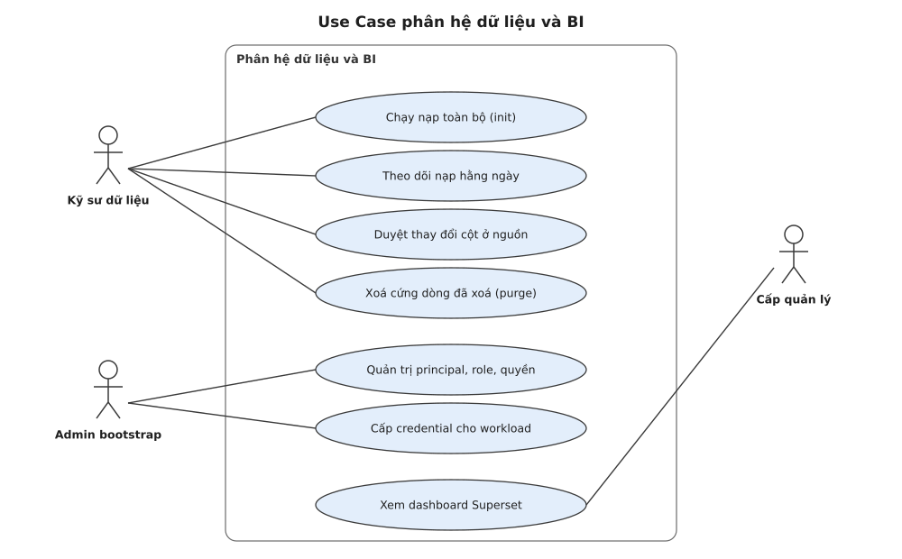

### **3.2.2. Sơ đồ hoạt động (Activity Diagram) các nghiệp vụ cốt lõi**

* **Quy trình đặt hàng và thanh toán (Checkout)**: khách gửi checkout → backend kiểm tra giỏ, áp dụng coupon, khóa và kiểm tra tồn kho → tạo đơn, dòng đơn (chụp giá bán và giá vốn), bản ghi thanh toán và lịch sử trạng thái → trừ tồn kho và ghi sổ cái → commit một lần. COD bắt đầu ở trạng thái đã xác nhận/chờ thu; doanh thu chỉ ghi nhận khi hoàn tất và thu đủ tiền.


* **Quy trình bán hàng tại quầy (POS)**: nhân viên chọn cửa hàng → chọn biến thể → hệ thống kiểm tra tồn tại cửa hàng → áp dụng giảm giá → thanh toán → trừ tồn cửa hàng và hoàn tất đơn POS ngay.

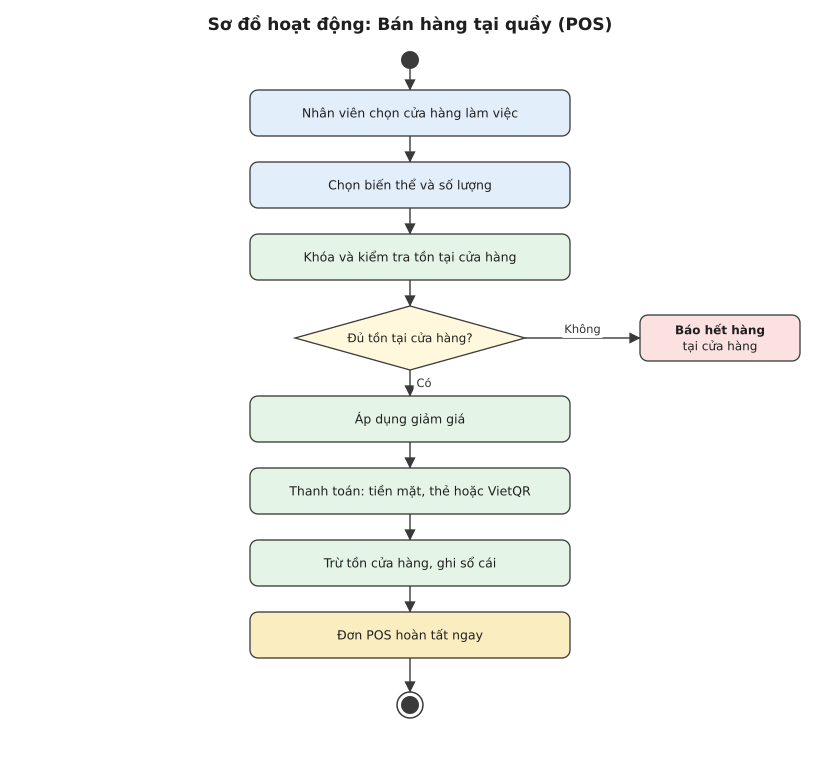

* **Quy trình đổi trả và hoàn tiền (Returns)**: khách tạo yêu cầu kèm lý do → quản trị viên duyệt → kho nhận và kiểm định hàng hoàn → hàng đạt chuẩn được nhập lại kho → tạo hoàn tiền gắn với yêu cầu trả hàng, hoặc đổi sản phẩm khác.

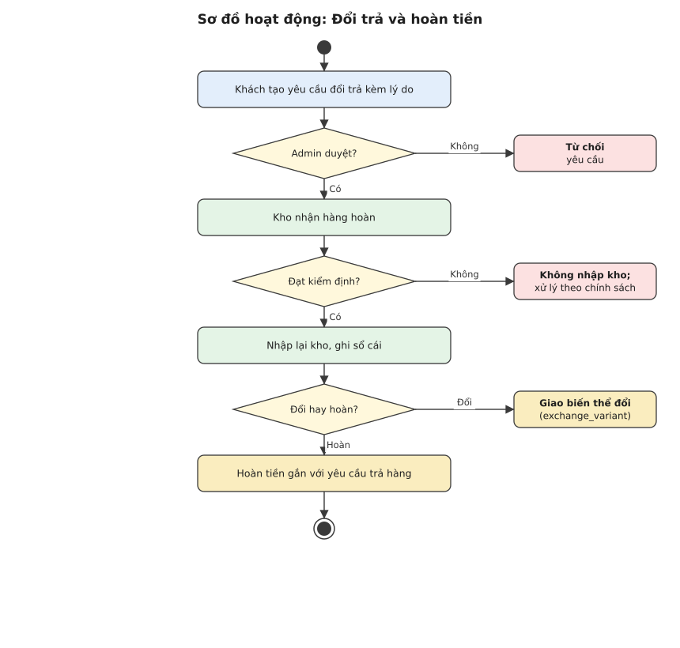

### **3.2.3. Sơ đồ tuần tự (Sequence Diagram) các luồng xử lý**

* **Luồng giao dịch Checkout**: Console mô phỏng → FastAPI → PostgreSQL trong một giao dịch. Middleware ghi sự kiện truy cập JSON ra stdout.
* **Luồng truy vấn báo cáo BI**: người dùng mở dashboard Superset → Superset gửi SQL tới Trino bằng tài khoản `analytics_reader` → Trino lấy metadata bảng từ Polaris, nhận credential lưu trữ tạm cho đúng bảng → đọc tệp Parquet trên MinIO → trả kết quả cho chart.

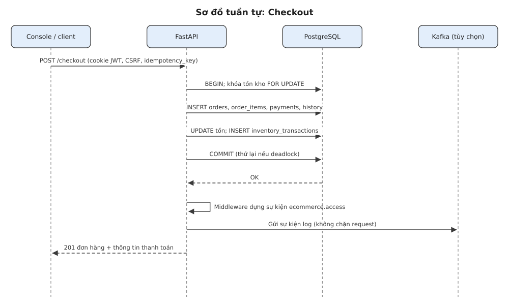


## **3.3. Thiết kế kiến trúc tổng thể**

### **3.3.1. Kiến trúc tổng thể toàn hệ thống**

Hệ thống tách tầng giao dịch trực tuyến (OLTP) và tầng phân tích (OLAP):

```text
Console ──► FastAPI ──► PostgreSQL ──► staging ──► [reconcile] ──► bronze ──► silver ──► gold ──► Trino ──► Superset
               │           ▲            PyIceberg    chỉ init       PyIceberg   dbt merge   dbt
               │           └── datagen OLTP
               └─► stdout (access log JSON)
```


### **3.3.2. Kiến trúc thành phần ứng dụng thương mại điện tử**

Container `platform-app` chạy FastAPI (cổng 8000) và Streamlit (cổng 8501). API tổ chức theo module trong `services/platform-app/src/platform_app/api/modules/`:
* `auth`: đăng ký, đăng nhập, cookie JWT, CSRF và kiểm tra quyền.
* `catalog`, `location`, `store`: danh mục, sản phẩm, biến thể, thành phố và cửa hàng.
* `cart`, `wishlist`, `checkout`, `coupons`: giỏ hàng, yêu thích, đặt hàng và mã giảm giá.
* `orders`: vòng đời đơn hàng và lịch sử trạng thái.
* `pos`: bán hàng tại quầy.
* `inbound`: nhập hàng và sổ cái kho.
* `logistics`: vận đơn, lần giao và COD.
* `returns`, `reviews`: đổi trả – hoàn tiền và đánh giá.
* `admin`, `analytics`: tác vụ quản trị và số liệu vận hành.
* Middleware nhật ký truy cập (`api/core/access_logging.py`): ghi JSON theo hợp đồng `ecommerce.access` ra stdout, che dữ liệu nhạy cảm và bỏ qua health check.

Ngoài API nghiệp vụ, router `/api/v1/access` phục vụ quản trị quyền Lakehouse, và service riêng `credential-exporter` ghi file credential vào volume của từng workload.


### **3.3.3. Kiến trúc nền tảng Data Lakehouse và phục vụ phân tích**

Lakehouse dùng một bucket MinIO (`MINIO_LAKEHOUSE_BUCKET`, mặc định `lakehouse`) và một catalog Polaris `lakehouse`, chia bốn namespace:
* `staging`: bản trích xuất của lần chạy gần nhất cho mỗi bảng nguồn.
* `bronze`: dòng nguồn hiện tại theo khóa chính, kiểu dữ liệu nguồn, kèm cờ xoá mềm.
* `silver`: cùng dòng với Bronze, kiểu chuẩn hóa.
* `gold`: 7 dimension, 6 fact, 14 mart, 2 seed và bảng trạng thái `_mart_state` giữ mốc tiến độ của mart.

Tầng phục vụ là Trino đọc trực tiếp bảng Gold hiện tại qua Polaris; Superset kết nối Trino. MinIO chỉ có một tài khoản lưu trữ, của Polaris, do service `minio-init` tạo; các workload nhận credential tạm theo bảng.


### **3.3.4. Mô hình tương tác giữa các luồng dữ liệu**

| Luồng dữ liệu | Cơ chế thực thi | Tần suất | Đầu vào | Đầu ra |
|---|---|---|---|---|
| **1. Nạp toàn bộ (init)** | Tạo namespace và bảng → staging → đối soát → Bronze (thay cả bảng) → Silver → Gold → bảo trì | Chạy tay | Mọi dòng của 19 bảng tạo trước mốc chạy | Lakehouse dựng lại hoàn chỉnh |
| **2. Nạp gia tăng (incremental)** | Staging theo data interval → Bronze upsert → Silver merge → Gold merge/tính lại ngày → bảo trì | 03:00 hằng ngày (Asia/Ho_Chi_Minh), catchup và backfill | Dòng có `updated_at`/`created_at` trong khoảng | Gold cập nhật; phát Asset `lakehouse_oltp_loaded` |
| **3. Đồng bộ nguồn (sync)** | Kiểm tra lược đồ → phát hiện xoá/khôi phục → Bronze → Silver → Gold → bảo trì | Theo Asset từ incremental hoặc chạy tay | Danh sách cột và toàn bộ khóa chính nguồn | Cột đã duyệt được thêm; dòng bị xoá được đánh dấu |
| **4. Xoá cứng (purge)** | Xoá dòng `_is_deleted` ở Gold → Silver → Bronze | Chạy tay | Dòng đã xoá mềm | Lakehouse không còn dòng đã xoá |
| **5. Access log hiện tại** | Middleware ghi JSON, `datagen logs` ghi tệp Parquet riêng | Mỗi request hợp lệ hoặc chạy tay generator | Request API hoặc đơn online mô phỏng | Stdout v1.0.0 hoặc tệp Parquet v1.1.0 |
| **6. Phân tích access log (hướng phát triển)** | Nạp sự kiện thô → chuẩn hóa → tổng hợp phễu | Streaming và nạp file (đã thiết kế, chưa xây) | Sự kiện HTTP và tệp log lịch sử | `mart_web_funnel_daily` |

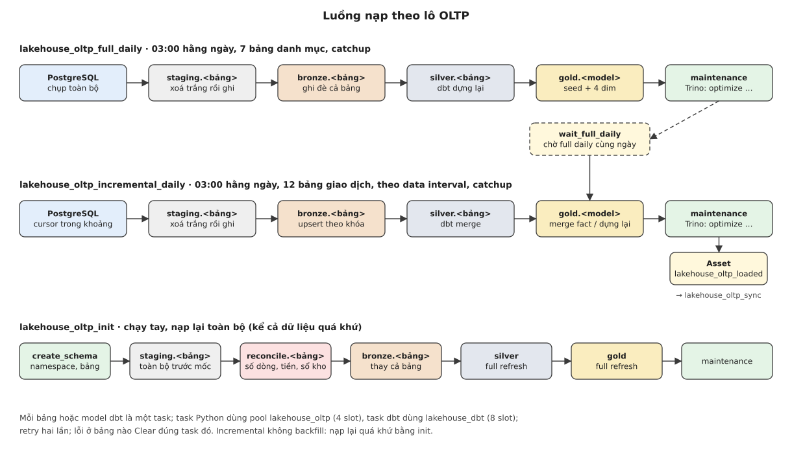

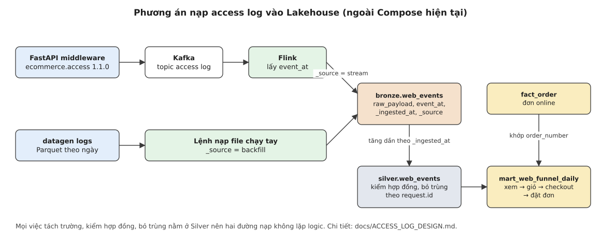

## **3.4. Thiết kế cơ sở dữ liệu giao dịch (OLTP)**

### **3.4.1. Phân tích các cụm thực thể nghiệp vụ**

Cơ sở dữ liệu PostgreSQL chuẩn hóa mức 3NF, gồm các cụm thực thể:
1. **Định danh và địa điểm**: `customers`, `customer_credentials`, `cities`, `stores`, `delivery_staff`.
2. **Sản phẩm**: `categories`, `products`, `product_variants`, `product_reviews`.
3. **Khám phá và mua**: `carts`, `cart_items`, `wishlist_items`.
4. **Khuyến mại**: `coupons`, `coupon_redemptions`.
5. **Đơn hàng và thanh toán**: `orders`, `order_items`, `order_status_history`, `payments`.
6. **Tồn kho và nhập hàng**: `inventory`, `store_inventory`, `inbound_receipts`, `inbound_receipt_items`, `inventory_transactions`.
7. **Giao vận và hậu mãi**: `shipments`, `shipment_attempts`, `return_requests`, `return_items`, `refunds`.

### **3.4.2. Thiết kế sơ đồ quan hệ thực thể (ERD)**

ERD thể hiện liên kết giữa các cụm: khách hàng – đơn hàng – dòng đơn – biến thể; đơn hàng – thanh toán – hoàn tiền; đơn hàng – vận đơn – lần giao; biến thể – tồn kho theo vị trí – sổ cái kho.


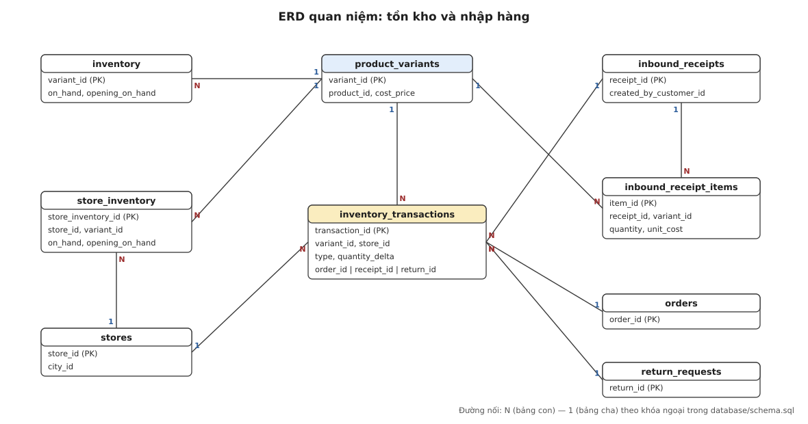

### **3.4.3. Thiết kế lược đồ cơ sở dữ liệu vật lý PostgreSQL (28 bảng)**

Lược đồ vật lý `database/schema.sql` được sinh từ ORM, gồm **28 bảng** với khóa ngoại, CHECK, UNIQUE và index. Cột "Nạp vào Lakehouse" cho biết bảng nằm trong 19 bảng của `SOURCE_TABLES` và cột cursor dùng cho nạp gia tăng.

| STT | Tên bảng | Khóa chính | Nạp vào Lakehouse (cursor) | Mục đích lưu trữ |
|---|---|---|---|---|
| 1 | `customers` | `customer_id` | `updated_at` | Người dùng, khách hàng và vai trò |
| 2 | `customer_credentials` | `customer_id` | Không nạp | Mật khẩu băm Argon2id, chỉ dùng cho xác thực |
| 3 | `categories` | `category_id` | `updated_at` | Cây danh mục |
| 4 | `products` | `product_id` | `updated_at` | Sản phẩm |
| 5 | `product_variants` | `variant_id` | `updated_at` | Biến thể SKU: màu, size, giá niêm yết, giá vốn |
| 6 | `carts` | `cart_id` | Không nạp | Giỏ hàng |
| 7 | `cart_items` | `cart_item_id` | Không nạp | Dòng giỏ hàng |
| 8 | `wishlist_items` | `wishlist_item_id` | Không nạp | Sản phẩm yêu thích |
| 9 | `orders` | `order_id` | `updated_at` | Đơn hàng online và POS |
| 10 | `order_items` | `order_item_id` | `created_at` | Dòng đơn; chụp giá bán và giá vốn lúc mua |
| 11 | `order_status_history` | `order_status_history_id` | `created_at` | Lịch sử trạng thái đơn |
| 12 | `inventory` | `variant_id` | Chỉ để đối soát | Tồn tổng theo biến thể |
| 13 | `inventory_transactions` | `transaction_id` | `created_at` | Sổ cái biến động kho |
| 14 | `inbound_receipts` | `receipt_id` | Không nạp | Phiếu nhập hàng |
| 15 | `inbound_receipt_items` | `item_id` | `created_at` | Dòng phiếu nhập |
| 16 | `coupons` | `coupon_id` | `updated_at` | Mã giảm giá |
| 17 | `coupon_redemptions` | `coupon_redemption_id` | Không nạp | Lượt dùng mã giảm giá |
| 18 | `product_reviews` | `review_id` | `updated_at` | Đánh giá sản phẩm |
| 19 | `cities` | `city_id` | `updated_at` | Tỉnh/thành phố |
| 20 | `stores` | `store_id` | `updated_at` | Cửa hàng |
| 21 | `store_inventory` | `store_inventory_id` | Chỉ để đối soát | Tồn theo cửa hàng và biến thể |
| 22 | `delivery_staff` | `staff_id` | `updated_at` | Nhân viên giao hàng |
| 23 | `shipments` | `shipment_id` | `updated_at` | Vận đơn và tiền COD |
| 24 | `shipment_attempts` | `attempt_id` | Không nạp | Các lần giao |
| 25 | `payments` | `payment_id` | `updated_at` | Thanh toán (VietQR, COD, thẻ, tiền mặt) |
| 26 | `return_requests` | `return_id` | `updated_at` | Yêu cầu đổi trả |
| 27 | `return_items` | `return_item_id` | `updated_at` | Dòng hàng đổi trả |
| 28 | `refunds` | `refund_id` | `updated_at` | Hoàn tiền |

Các bảng không nạp không được bảng Gold nào dùng; `customer_credentials` không được cấp quyền đọc cho pipeline.

### **3.4.4. Ràng buộc toàn vẹn và bảo đảm tính nhất quán giao dịch**

* **Toàn vẹn tham chiếu**: khóa ngoại ngăn xoá bản ghi cha khi đã có giao dịch con.
* **Bảo toàn giá lịch sử**: `order_items` lưu đơn giá bán, giảm giá và giá vốn tại thời điểm đặt; đổi giá trong `product_variants` sau đó không ảnh hưởng đơn cũ.
* **Idempotency key**: các thao tác nhạy cảm (tạo đơn, thanh toán, hoàn tiền) nhận `idempotency_key`, nên bấm đúp hay mạng gửi lại không tạo thao tác thứ hai.
* **Thời gian cập nhật**: trigger đặt `updated_at` khi dòng đổi, làm cơ sở cho nạp gia tăng.

## **3.5. Thiết kế nền tảng Data Lakehouse (OLAP)**

### **3.5.1. Xác định và phân loại nguồn dữ liệu**

1. **Nguồn giao dịch có cấu trúc (PostgreSQL)**: 19 bảng được khai báo tường minh trong `airflow/lakehouse/oltp/sources.py`. Bảng thay đổi trạng thái lọc theo `updated_at`; bảng chỉ ghi thêm lọc theo `created_at`. Mỗi bảng có danh sách cột được nạp (`columns`) và danh sách cột cố ý bỏ (`excluded`, gồm dữ liệu cá nhân như `receiver_phone`, `shipping_address_text`).
2. **Nguồn nhật ký truy cập bán cấu trúc**: sự kiện HTTP theo hợp đồng `ecommerce.access` (API phát v1.0.0; bộ sinh dữ liệu phát v1.1.0 có thêm `session.id`, `ecommerce.order_number`).

### **3.5.2. Thiết kế quy trình trích xuất Batch, đồng bộ nguồn và Access Log**

* **Trích xuất theo lô**:
  * Lần nạp toàn bộ dùng chung điều kiện `created_at < run_after`. Mỗi bảng có giao dịch đọc riêng. Lần nạp gia tăng đọc các dòng có cursor trong `[data_interval_start, data_interval_end)`.
  * Mỗi bảng đọc trong một giao dịch repeatable-read bằng con trỏ phía server (10.000 dòng mỗi lần fetch), ghi vào staging mỗi lô 200.000 dòng.
  * Staging được xoá trắng trước khi ghi và trích xuất lại khi retry.
* **Đồng bộ nguồn** (DAG `lakehouse_oltp_sync`, theo Asset từ incremental hoặc chạy tay):
  1. **Thay đổi cột** (nhóm `schema`, chạy trước). So nguồn với danh sách cho phép và Bronze:
     * cột mới chưa duyệt: sync báo lỗi chờ người duyệt; incremental vẫn chạy;
     * cột đã duyệt: tự thêm vào staging và Bronze, bật cờ `lakehouse.reload-pending`, rồi nạp lại cả bảng trong một commit;
     * kiểu được nới (int → long…): tự nới;
     * cột trong hợp đồng bị bỏ hoặc đổi sang kiểu không tương thích: bước kiểm tra lược đồ hoặc trích xuất dừng kèm thông báo.
  2. **Dòng bị xoá** (nhóm `detect`, chạy sau). So toàn bộ khóa chính nguồn với khóa còn sống ở Bronze:
     * khóa mất ở nguồn: xoá mềm (`_is_deleted`, `_deleted_at`) qua Bronze, Silver và Gold; mart không tính;
     * khóa có lại ở nguồn: dòng sống lại.
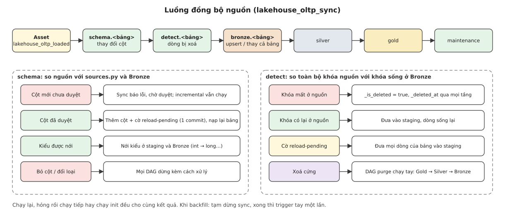

* **Xoá cứng chủ động**: DAG chạy tay `lakehouse_oltp_purge` xoá hẳn các dòng đã xoá mềm, theo thứ tự Gold → Silver → Bronze.
* **Access Log**: thiết kế ở mục 4.4.3.

### **3.5.3. Thiết kế các tầng dữ liệu Medallion**

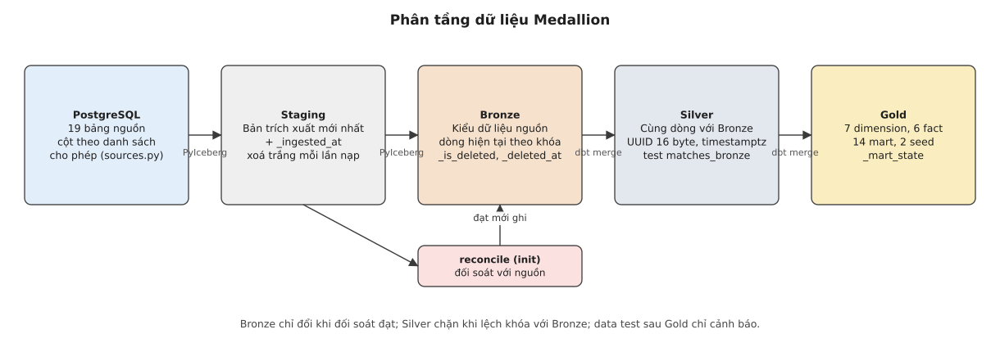

* **Staging**: bản trích xuất của lần chạy, kèm `_ingested_at`.
* **Bronze**: lần nạp toàn bộ thay cả bảng trong một commit, giữ các dòng đã xoá mềm và đánh dấu xoá các dòng nguồn không còn; lần nạp gia tăng upsert theo khóa chính và không để dòng có cursor cũ hơn ghi đè bản mới.
* **Silver**: dbt merge các dòng Bronze mới hơn `_ingested_at` lớn nhất của Silver, chuẩn hóa kiểu; test `matches_bronze` chặn khi hai tầng lệch khóa.
* **Gold**: dimension và fact merge các dòng có đầu vào thay đổi; mart xoá rồi dựng lại các ngày bị ảnh hưởng kể từ mốc trong `gold._mart_state`.

### **3.5.4. Thiết kế mô hình dữ liệu Dimensional Model (Star Schema) và Data Marts**

* **7 bảng Dimension**:
  * `dim_date`: lịch, ngày lễ và ngày sale (seed `calendar_events`).
  * `dim_city`: thành phố, vùng giao và SLA giao hàng (seed `delivery_sla`).
  * `dim_store`: cửa hàng.
  * `dim_product`: sản phẩm và danh mục.
  * `dim_variant`: biến thể SKU.
  * `dim_customer`: khách hàng.
  * `dim_staff`: nhân viên giao hàng và nhân viên bán.


* **6 bảng Fact**:
  * `fact_order`: một dòng mỗi đơn.
  * `fact_order_item`: một dòng mỗi dòng đơn; giảm giá đơn được phân bổ theo tỷ lệ tiền dòng, làm tròn xuống tích lũy nên tổng phân bổ bằng đúng giảm giá đơn.
  * `fact_shipment`: một dòng mỗi vận đơn.
  * `fact_return`: một dòng mỗi dòng hàng trả.
  * `fact_inventory_daily`: ngày × vị trí × biến thể, dựng từ sổ cái kho.
  * `fact_review`: một dòng mỗi đánh giá.

  Dimension và fact mang cờ `_is_deleted`; mỗi fact giữ `_previous_dates` (các ngày trước lần merge) để mart tính lại cả ngày mà dòng vừa rời đi.


* **14 Data Mart theo nhóm người xem**:
  1. *Kinh doanh*: `mart_orders_daily`, `mart_sales_daily`, `mart_product_sales_daily`, `mart_cancellations_daily`.
  2. *Cửa hàng*: `mart_pos_hourly`.
  3. *Giao vận và đổi trả*: `mart_delivery_daily`, `mart_fulfilment_backlog_daily`, `mart_returns_daily`.
  4. *Tồn kho*: `mart_inventory_current`, `mart_inventory_health_daily`.
  5. *Khách hàng và marketing*: `mart_coupon_daily`, `mart_reviews_daily`, `mart_customer_value`, `mart_customer_cohort_monthly`.

  Mart chỉ đọc dòng còn sống qua macro `live()`. Grain của từng mart nằm trong [DATA.md](DATA.md).

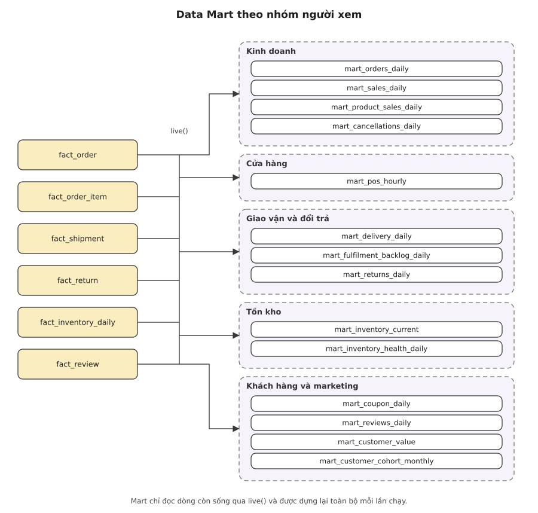

### **3.5.5. Thiết kế quy trình kiểm soát chất lượng dữ liệu và bảo mật thông tin**

* **Chất lượng dữ liệu**:
  * Đối soát với nguồn khi nạp toàn bộ (số dòng, tổng tiền `orders`/`payments`/`refunds`, số dư sổ kho so với `inventory`/`store_inventory`), chặn trước khi Bronze đổi.
  * Test `matches_bronze` chặn khi Silver lệch khóa với Bronze.
  * Data test sau Gold (cảnh báo): khóa duy nhất, phân bổ giảm giá bảo toàn, đơn khớp Silver, các mart doanh thu khớp nhau, tồn khớp sổ cái, grain của tồn kho ngày.
  * Phân loại thay đổi lược đồ nguồn (mục 3.5.2).
* **Bảo mật và phân quyền hạ tầng**:
  * Pipeline đọc PostgreSQL bằng role chỉ `SELECT`, phiên read-only.
  * Chỉ cột trong danh sách cho phép được nạp; cột cá nhân mới không thể lọt vào trước khi được duyệt.
  * Mỗi workload có một principal Polaris riêng: `batch_airflow` cho Airflow, `trino_writer` cho Trino ETL và `trino_reader` cho Trino phân tích. Quyền gán theo chuỗi principal → principal role → catalog role → quyền trên catalog, namespace hoặc bảng.
  * Polaris cấp credential MinIO tạm cho đúng bảng được mở; MinIO chỉ có một tài khoản lưu trữ, của Polaris.
  * Trino xác thực bằng mật khẩu qua HTTPS: `analytics_reader` chỉ đọc catalog `lakehouse`, `dbt_writer` chỉ ghi schema `silver` và `gold` của `lakehouse_etl`.

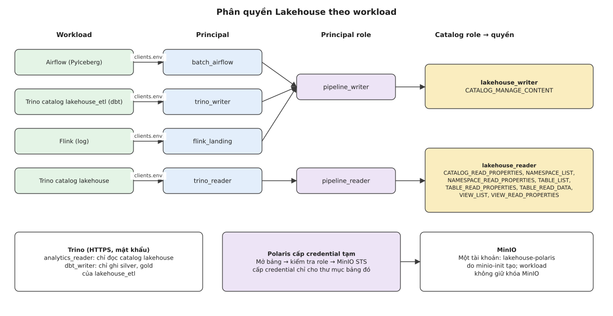

## **3.6. Thiết kế giao diện người dùng và hệ thống Dashboard**

### **3.6.1. Thiết kế giao diện Console mô phỏng mua hàng**

Màn hình **Mô phỏng API** của Streamlit chạy kịch bản mua hàng online qua API thật, thay cho thao tác tay trên storefront:
* Người dùng chọn số lượt mua và cấu hình kịch bản; worker chạy nền thực hiện các bước như một khách thật: đăng nhập, xem sản phẩm, thêm giỏ, lấy báo giá, checkout VietQR hoặc COD.
* Mỗi lượt được ghi vào journal; lượt chỉ được ghi thành công khi đọc lại đơn và giỏ thấy khớp (mã đơn, tổng tiền, SKU, số lượng, trạng thái thanh toán, giỏ rỗng).
* Lượt không xác định được kết quả (lỗi mạng sau khi gửi) được đánh dấu riêng và không tự gửi lại.

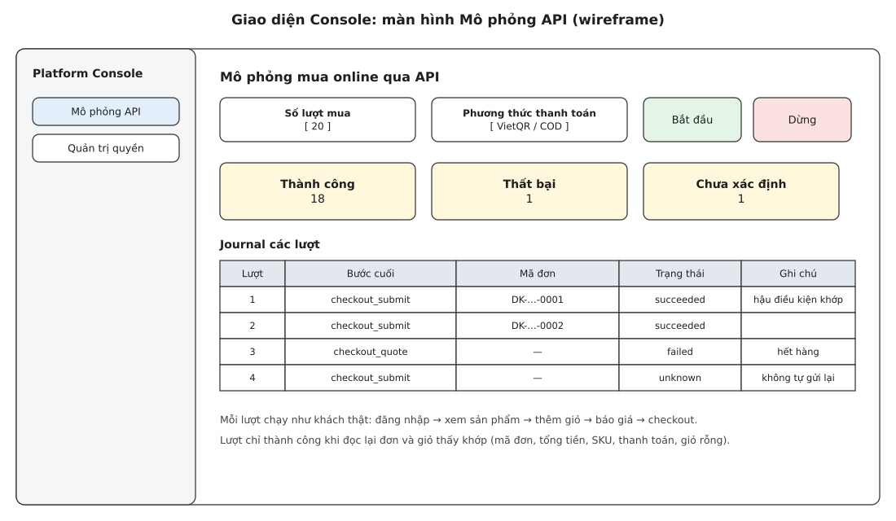

### **3.6.2. Thiết kế giao diện quản trị quyền Lakehouse và nghiệp vụ Admin/POS**

* Nghiệp vụ Admin và POS (quản lý sản phẩm, đơn, kho, nhập hàng, bán tại quầy) được cung cấp qua API có phân quyền theo vai trò và cửa hàng.
* Màn hình **Quản trị quyền** của Streamlit chỉ dành cho admin bootstrap, gồm các tab: Danh sách, Tạo mới, Sửa, Xóa, Gán/Gỡ quyền, Credential và Cấp cho workload. Mọi thao tác ghi cần CSRF và được ghi audit trước và sau.

### **3.6.3. Thiết kế hệ thống Dashboard BI trên Superset**

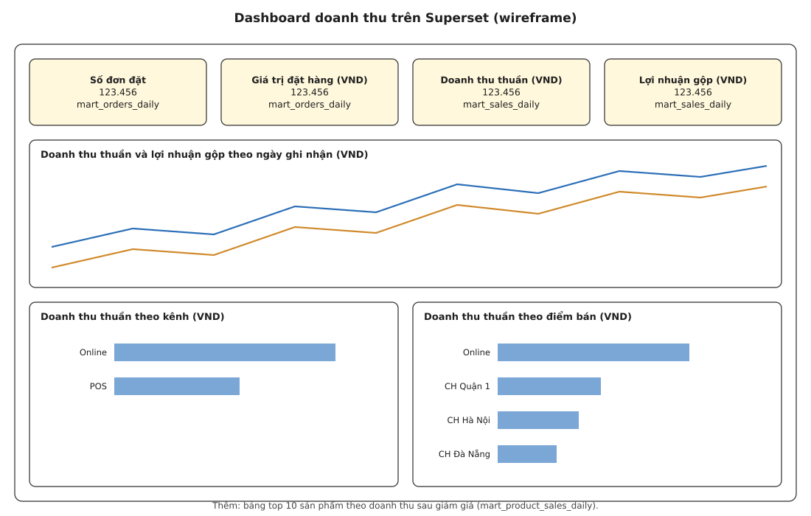

| Dashboard | Biểu đồ | Chỉ số và góc nhìn |
|---|---:|---|
| **Doanh thu bán lẻ** | 12 | Đơn đặt, giá trị đặt hàng, doanh thu thuần, lợi nhuận, kênh, điểm bán, sản phẩm và danh mục |
| **Vận hành bán lẻ** | 9 | Tồn kho, số ngày đủ bán, hết hàng, giao đúng hạn, tồn đọng giao vận, hủy đơn và đổi trả |
| **Bán hàng tại cửa hàng (POS)** | 2 | Số đơn theo giờ và cửa hàng, doanh thu theo nhân viên POS |
| **Khách hàng và marketing** | 4 | Khách mua lại, cohort, coupon và đánh giá |

Bốn dashboard dùng 16 định nghĩa dataset trên 14 mart Gold. Mặc định bộ lọc thời gian mở toàn bộ kỳ và trường ngày của biểu đồ tuân theo grain của mart. Các biểu đồ tồn kho tức thời dùng ngày snapshot trong mart. [Hướng dẫn kiểm tra dashboard](SETUP.md#6-dashboard-superset).

---

# **CHƯƠNG 4. TRIỂN KHAI VÀ ĐÁNH GIÁ THỰC NGHIỆM**

## **4.1. Môi trường và kiến trúc triển khai**

### **4.1.1. Cấu trúc dự án Monorepo và môi trường phát triển**

```text
dk-ecommerce-data-platform/
├── services/platform-app/   # FastAPI, Streamlit Console, quản trị quyền, credential exporter
├── database/                # schema.sql sinh từ ORM, seed danh mục
├── generator/               # CLI datagen, notebook EDA, preset OLTP và log
├── airflow/
│   ├── dags/                # lakehouse_oltp_init, _incremental, _sync, _purge
│   ├── tasks/               # callable của PythonOperator, task dbt
│   ├── lakehouse/           # thư viện: nguồn, staging, Bronze, đồng bộ, đối soát, tạo bảng
│   └── tests/               # unittest chạy trong container Airflow
├── dbt/                     # models/silver, models/oltp (Gold), macros, seeds, tests
├── infrastructure/          # Dockerfile và cấu hình Airflow, MinIO, PostgreSQL, Trino, Superset
└── docs/                    # kiến trúc, dữ liệu, cài đặt, vận hành, thiết kế
```

Môi trường Python 3.11 dùng chung `uv.lock` cho workspace. Mã được kiểm tra bằng Ruff. `make test` chạy test pipeline trong container `airflow-scheduler` và các bộ test platform-app, generator, Superset trên máy chủ qua `uv`.

### **4.1.2. Đóng gói và triển khai dịch vụ bằng Docker Compose**

| Nhóm | Dịch vụ chính | Mục đích |
|---|---|---|
| Nguồn và quản trị | `postgres`, `minio`, `minio-init`, `polaris`, `polaris-bootstrap`, `platform-app`, `platform-admin-init`, `credential-exporter` | API, Console, lưu trữ, catalog và cấp quyền |
| Xử lý và truy vấn | `airflow-init`, `airflow-api-server`, `airflow-scheduler`, `airflow-dag-processor`, `trino`, `trino-auth-init` | Điều phối, xử lý lô và truy vấn SQL |
| BI | `superset-db-init`, `superset-init`, `superset`, `superset-sync` | Database metadata, khởi tạo người dùng, giao diện và đồng bộ dashboard |

Lần đầu dùng `make up SERVICES=platform-app`, cấu hình quyền cho ba workload trong Console, thiết lập role đọc nguồn bằng `make source-reader` rồi nạp dữ liệu nguồn. Tiếp theo `make up` khởi động toàn bộ stack. Chạy `lakehouse_oltp_init` để có dữ liệu Gold, rồi chạy `make superset-sync` một lần để cài bộ dashboard. PythonOperator dùng môi trường trong image Airflow, còn BashOperator gọi dbt. [Quy trình triển khai](SETUP.md).

### **4.1.3. Cấu hình mạng, kết nối và phân bổ tài nguyên**

Các dịch vụ kết nối qua mạng nội bộ `lakehouse-network`. Hầu hết giao diện bind vào `127.0.0.1` theo cấu hình mặc định. PostgreSQL công bố cổng trên host qua `POSTGRES_PORT`. Khai báo mật khẩu và khóa ký cần thiết trong `.env` tạo từ `.env.example`.

Dữ liệu PostgreSQL, dữ liệu MinIO và log Airflow nằm trên Docker named volume. `credential-exporter` ghi credential Polaris vào volume riêng của từng workload (`polaris-batch-airflow-credentials`, `polaris-trino-reader-credentials`, `polaris-trino-writer-credentials`). Chỉ exporter và workload tương ứng mount volume credential.

## **4.2. Xây dựng Backend và cơ sở dữ liệu giao dịch**

### **4.2.1. Khởi tạo cơ sở dữ liệu và quản lý lược đồ**

Service một lần `platform-admin-init` áp lược đồ `database/schema.sql` lên database trống và tạo tài khoản admin bootstrap. Lược đồ được sinh từ ORM và kiểm tra khớp bằng lệnh `python -m platform_app.api.db.schema --check`. Thời gian lưu `TIMESTAMPTZ` theo UTC; trigger cập nhật `updated_at` khi dữ liệu đổi.

Dữ liệu danh mục gốc nạp bằng `make seed`; tồn đầu ghi thành giao dịch `adjustment` trong sổ cái, nên số dư tồn luôn cộng ra được từ sổ cái.

### **4.2.2. Xây dựng dịch vụ xác thực, phân quyền và bảo mật API**

* Băm mật khẩu bằng Argon2id.
* Phiên đăng nhập bằng JWT trong cookie HttpOnly; yêu cầu ghi cần CSRF token.
* Quyền kiểm tra qua Dependency Injection của FastAPI theo vai trò và cửa hàng của từng route; riêng quản trị quyền Lakehouse chỉ chấp nhận đúng tài khoản admin bootstrap.

### **4.2.3. Triển khai các module quản lý sản phẩm, giỏ hàng và đơn hàng**

* Danh mục và biến thể SKU, nạp kèm quan hệ để tránh truy vấn N+1.
* Giỏ hàng và danh sách yêu thích theo khách hàng.
* Checkout chạy trong một giao dịch: khóa dòng tồn kho (`FOR UPDATE`), kiểm tra coupon, tạo đơn, dòng đơn (chụp giá bán và giá vốn), thanh toán và lịch sử trạng thái, trừ tồn và ghi sổ cái; tự thử lại có giới hạn khi deadlock hoặc lỗi tuần tự hóa.

### **4.2.4. Triển khai module quản lý kho hàng, nhập kho và POS**

* Nhập hàng tạo phiếu nhập và dòng phiếu, ghi biến động vào sổ cái `inventory_transactions`.
* POS bán tại quầy, kiểm tra tồn tại đúng cửa hàng và hoàn tất đơn ngay.
* Tồn được theo dõi theo biến thể và vị trí (kho tổng và từng cửa hàng).

### **4.2.5. Triển khai module thanh toán, vận chuyển và đổi trả hàng**

* Thanh toán VietQR, COD, thẻ và tiền mặt tại quầy; COD chỉ ghi nhận đã thu khi giao thành công.
* Vận đơn theo dõi các lần giao (`shipment_attempts`) và tiền thu hộ COD; giao thất bại có biến động kho tương ứng.
* Đổi trả theo các bước: yêu cầu → duyệt → nhận và kiểm định hàng hoàn → nhập lại kho → hoàn tiền gắn với yêu cầu.

### **4.2.6. Triển khai middleware ghi access log có cấu trúc**

Middleware trong `api/core/access_logging.py` ghi mọi request (trừ health check):
* Theo hợp đồng `ecommerce.access` v1.0.0: `request.id` 32 ký tự hex do server tạo, thời gian UTC, method, route template (không dùng đường dẫn thô), mã trạng thái, thời gian xử lý, actor và hành động thương mại (ví dụ `product_detail`, `cart_item_set`, `checkout_submit`) kèm sản phẩm nếu route có.
* Không ghi request body, mật khẩu, header Authorization, cookie hay thông tin thanh toán; từ khóa tìm kiếm chứa dữ liệu cá nhân được che.
* Phát bản ghi JSON ra stdout của container `platform-app`, có thể xem từ Docker Compose logs.

## **4.3. Xây dựng giao diện người dùng**

### **4.3.1. Giao diện Console mô phỏng mua hàng (Streamlit)**

Màn hình **Mô phỏng API** (`ui/views/scenarios.py`, `ui/scenarios/`) chạy kịch bản mua online qua API thật bằng worker nền: tạo phiên khách, xem sản phẩm, thêm giỏ, báo giá, checkout. Journal ghi từng lượt (`succeeded`, `failed`, `unknown`) và hậu điều kiện kiểm tra sau checkout, nên dữ liệu sinh qua Console đi đúng đường của khách thật, khác với dữ liệu lịch sử do `datagen` ghi thẳng.

### **4.3.2. Giao diện quản trị quyền Lakehouse (Streamlit)**

Màn hình **Quản trị quyền** (`ui/views/access*.py`) gọi router `/api/v1/access`:
* Tạo, sửa thuộc tính, xoá catalog, principal, principal role và catalog role Polaris; xoá bị chặn khi còn liên kết hoặc principal đang cấp cho workload.
* Gán/gỡ liên kết principal → principal role → catalog role → quyền ở cấp catalog, namespace hoặc bảng.
* Cấp credential cho workload: API đọc credential principal đã lưu, gửi yêu cầu ký JWT (kèm digest payload) tới `credential-exporter`; exporter ghi `clients.env` quyền `0600` với đúng chủ là UID/GID của workload.
* Mọi thao tác ghi được ghi audit (`started`, rồi `done`, `rejected` hoặc `failed`) trong `data/access-admin/audit.jsonl`.

## **4.4. Xây dựng hệ thống thu thập dữ liệu**

### **4.4.1. Thu thập dữ liệu giao dịch PostgreSQL theo lô bằng PyIceberg và Airflow**

Thư viện `airflow/lakehouse/oltp/` và callable `airflow/tasks/oltp.py`:
* Kết nối PostgreSQL qua Airflow connection `oltp_postgres` (`PostgresHook`), phiên read-only.
* Mỗi bảng một task `staging.<bảng>`: một giao dịch repeatable-read, con trỏ phía server đọc 10.000 dòng mỗi lần, ghi vào staging mỗi lô 200.000 dòng kèm `_ingested_at`.
* Nạp gia tăng chỉ đọc các cột vừa được duyệt vừa có ở Bronze, và dừng với thông báo rõ khi nguồn bỏ cột hoặc đổi loại cột.
* Lần nạp toàn bộ có nhóm `reconcile.<bảng>` đối soát staging với nguồn tại cùng mốc trước khi Bronze đổi.

### **4.4.2. Đồng bộ dòng bị xoá và thay đổi cột ở nguồn**

DAG `lakehouse_oltp_sync` thay vai trò mà CDC thường đảm nhận, chỉ bằng cách đọc nguồn:
* `schema.<bảng>`: thêm cột đã duyệt (cùng cờ `lakehouse.reload-pending` trong một commit Iceberg), nới kiểu, báo lỗi cột chưa duyệt. Khi bảng có tệp dữ liệu cũ thiếu cột, Bronze được ghi lại một lần, vì PyIceberg 0.12 không upsert được vào bảng như vậy.
* `detect.<bảng>`: đọc toàn bộ khóa chính nguồn và khóa sống ở Bronze, đánh dấu xoá mềm khóa đã mất, đưa dòng khôi phục vào staging; khi cờ nạp lại bật, đưa mọi dòng của bảng vào staging.
* `bronze.<bảng>`: khi cờ bật, thay cả bảng Bronze trong một commit (giữ dòng đã xoá mềm) rồi mới xoá cờ; nếu không, upsert như incremental. Silver và Gold nhận thay đổi qua `_ingested_at` như mọi dòng khác.

Khi backfill incremental, DAG sync được tạm dừng và trigger tay một lần sau khi backfill xong, vì `max_active_runs` không giới hạn giữa hai DAG.

### **4.4.3. Hiện trạng access log và hướng tích hợp Lakehouse**

API ghi JSON v1.0.0. Lệnh `datagen logs` tạo tệp Parquet v1.1.0 theo `session_date`, với `session.id` và `ecommerce.order_number` để có thể nối log với đơn online mô phỏng. Compose hiện tại phục vụ pipeline OLTP và BI. DDL và model dbt của luồng log cũ đã được gỡ khỏi repo.

Tích hợp access log vào Lakehouse là hướng phát triển của khóa luận (mục 4.8.3). Thiết kế đã duyệt và được giữ lại gồm các bước sau. [Thiết kế access log](ACCESS_LOG_DESIGN.md).

* Nâng API lên v1.1.0, ghi nhận mã phiên và gắn mã đơn vào sự kiện checkout thành công.
* Nạp payload sự kiện thô vào `bronze.web_events` (`raw_payload`, `event_at`, `_ingested_at`, `_source`). Phương án nghiên cứu dùng Kafka và Flink cho dữ liệu trực tuyến, cùng đường nạp Parquet cho dữ liệu lịch sử.
* `silver.web_events` tách trường, kiểm hợp đồng, bỏ trùng theo `request.id`.
* `mart_web_funnel_daily` đếm số phiên ở mỗi bước (xem sản phẩm → thêm giỏ → checkout → đặt đơn khớp `fact_order`), nối hành vi web với đơn hàng thật.

## **4.5. Xây dựng nền tảng Data Lakehouse**

### **4.5.1. Triển khai lớp lưu trữ MinIO S3, Iceberg và Polaris REST Catalog**

* Service `minio-init` (dùng `mc`) tạo bucket `lakehouse`, policy `lakehouse-polaris` và tài khoản lưu trữ của Polaris; chạy lại không đổi gì.
* Polaris quản lý catalog `lakehouse` với đường dẫn `s3://lakehouse/warehouse`, cấu hình MinIO STS để cấp credential tạm theo bảng.
* Principal, role và quyền được tạo trên Console. Exporter cấp credential cho `batch-airflow`, `trino-reader` và `trino-writer`.

### **4.5.2. Xử lý và chuyển đổi dữ liệu tại tầng Bronze và Silver**

* **Bronze** (`lakehouse/oltp/bronze.py`): lần nạp toàn bộ thay cả bảng trong một commit, giữ dấu xoá cũ và đánh dấu dòng nguồn không còn; lần nạp gia tăng upsert theo khóa chính, bỏ dòng có cursor cũ hơn bản hiện có. Mỗi dòng mới hoặc khôi phục có `_is_deleted = false`.
* **Silver** (`dbt/models/silver`): 19 model incremental merge các dòng Bronze mới hơn mốc `_ingested_at` của Silver, chuẩn hóa UUID và timestamp, chuyển nguyên cờ xoá mềm; test `matches_bronze` chặn khi lệch khóa.

### **4.5.3. Xây dựng tầng Gold và các Data Mart phục vụ phân tích**

Gold (`dbt/models/oltp`) áp dụng các quy tắc hạch toán:
* Doanh thu hàng hóa = dòng hàng trừ giảm giá phân bổ, ghi nhận vào ngày muộn hơn giữa `completed_at` và `paid_at`; không gồm phí vận chuyển.
* Hoàn tiền thành công của đơn đã ghi nhận giảm doanh thu vào ngày hoàn; hoàn tiền của đơn chưa từng ghi nhận (trả tiền rồi hủy) không trừ doanh thu.
* Giá vốn lấy từ giá vốn chụp trên dòng đơn; hàng trả đạt kiểm định được trừ lại giá vốn vào ngày hoàn tiền, nên đơn trả toàn bộ cho lãi 0.
* Giao đúng hạn khi ngày giao (giờ Việt Nam) không quá ngày đặt cộng SLA của thành phố nhận (TP.HCM 4 ngày; Bình Dương, Cần Thơ, Hà Nội 6; Đà Nẵng, Hải Phòng 8).
* Tồn kho cộng dồn từ sổ cái theo vị trí tới từng ngày; giá trị tồn = tồn × giá vốn hiện tại.

Dimension và fact là model incremental merge; mart xoá và dựng lại các ngày bị ảnh hưởng. Mốc của mart nằm trong `gold._mart_state` (chỉ ghi thêm), được post-hook đẩy lên chỉ sau khi mart đã ghi xong, nên một lần chạy hỏng sẽ được lần sau bắt kịp. `DBT_AS_OF` (mốc bắt đầu lần chạy) là ngày hiện tại của Gold.

### **4.5.4. Điều phối toàn diện Pipeline bằng Apache Airflow**

| Tên DAG | Lịch thực thi | Cấu trúc |
|---|---|---|
| `lakehouse_oltp_init` | Chạy tay | `create_schema` → `staging` → `reconcile` → `bronze` → `silver` → `gold` → `maintenance` |
| `lakehouse_oltp_incremental` | 03:00 hằng ngày (Asia/Ho_Chi_Minh), catchup, backfill | `staging` → `bronze` → `silver` → `gold` → `maintenance`; task cuối phát Asset `lakehouse_oltp_loaded` |
| `lakehouse_oltp_sync` | Theo Asset `lakehouse_oltp_loaded` hoặc chạy tay | `schema` → `detect` → `bronze` → `silver` → `gold` → `maintenance` |
| `lakehouse_oltp_purge` | Chạy tay | `silver_gold` → `bronze` |

Các nhóm xử lý có một task cho mỗi bảng hoặc model dbt. Thứ tự Gold được suy ra từ lời gọi `ref()` và `live()`. Bảo trì gộp tệp nhỏ ở Bronze, tối ưu tệp ở Silver và Gold qua dbt, và giữ tối thiểu 20 snapshot mới nhất cùng các snapshot trong 3 ngày gần nhất. Compact và kiểm tra lược đồ bỏ qua thao tác kiểm kê tệp khi snapshot chưa có manifest. Tác vụ orphan chỉ đếm tệp cũ chưa được snapshot còn giữ tham chiếu. [Chi tiết vận hành](OPERATIONS.md).

### **4.5.5. Kiểm soát chất lượng dữ liệu và khả năng chạy lại (idempotency)**

Đối soát nguồn ở lần nạp toàn bộ và test `matches_bronze` chặn các task phụ thuộc khi có lỗi. Năm test SQL kiểm tra bất biến xuyên bảng ở Gold chạy ở mức cảnh báo. Các kiểm tra schema dùng mức độ được khai báo trong dbt.

Pipeline hỗ trợ retry theo các cơ chế sau:
* Staging xoá trắng rồi ghi lại; Bronze upsert theo khóa; Silver và Gold merge theo khóa từ mốc của chúng.
* Mốc của mart chỉ tiến khi mart đã ghi xong.
* Đồng bộ nguồn: chạy lại `detect` cho cùng hai tập khóa; `_deleted_at` giữ giá trị lần phát hiện đầu; cờ nạp lại chỉ bị xoá sau khi Bronze đã nạp đủ.

Tính nguyên tử áp dụng cho từng commit bảng Iceberg. Khi một DAG hỏng giữa chừng, có thể đã có bảng được cập nhật. Đọc lỗi task, sửa nguyên nhân rồi chạy lại với đầu vào phù hợp. Tạm dừng sync trước backfill vì incremental và sync dùng chung staging. Mục 4.8.1 ghi lại phạm vi đã thử nghiệm.

## **4.6. Xây dựng hệ thống Business Intelligence và phục vụ phân tích**

### **4.6.1. Kết nối Apache Trino và phân quyền truy vấn phân tích**

* Trino chạy HTTPS, xác thực bằng mật khẩu; SQL access rules giới hạn `analytics_reader` chỉ đọc catalog `lakehouse` và `dbt_writer` chỉ ghi schema `silver`, `gold` của catalog `lakehouse_etl`.
* Hai catalog Trino dùng hai principal Polaris khác nhau (`trino_reader`, `trino_writer`), nên quyền đọc và ghi được kiểm soát ở cả Trino lẫn Polaris.
* Mỗi truy vấn đọc snapshot Iceberg hiện tại hoàn chỉnh; không cần bảng công bố riêng để tránh đọc dữ liệu ghi dở.

### **4.6.2. Trực quan hóa dữ liệu với Apache Superset**

Bốn dashboard ở mục 3.6.3 được khai báo trong `infrastructure/superset/`. `superset-db-init` chuẩn bị database metadata và `superset-init` chạy migration, tạo người dùng quản trị. Sau khi các mart Gold có dữ liệu, `make superset-sync` tạo hoặc cập nhật dataset, biểu đồ, bộ lọc và bố cục của repo. Các truy vấn đọc Gold trực tiếp qua Trino HTTPS bằng CA của stack. Khi dữ liệu Gold thay đổi, tải lại biểu đồ và làm mới kết quả nếu còn cache.

### **4.6.3. Kiểm soát phân quyền truy cập dữ liệu phân tích**

* Superset kết nối Trino bằng tài khoản chỉ đọc `analytics_reader`; Superset có đăng nhập riêng.
* Catalog `lakehouse` cấp quyền đọc. dbt ghi vào Silver và Gold qua tài khoản `dbt_writer` và catalog `lakehouse_etl`.
* Sau khi Polaris thu hồi quyền trên bảng, yêu cầu mới được đánh giá theo quyền đã cập nhật. Credential MinIO đã phát có thời hạn riêng.
* Phân quyền dữ liệu theo cửa hàng là hướng mở rộng. Đăng nhập Superset và quyền đọc Gold hiện tại áp dụng ở cấp dashboard và tài khoản kết nối.

## **4.7. Xây dựng dữ liệu mô phỏng phục vụ trình diễn và kiểm thử**

### **4.7.1. Bối cảnh và tính tất yếu của việc phân tích dữ liệu khám phá (EDA)**

Một trong những hạn chế lớn nhất của các đồ án xây dựng Data Lakehouse trong môi trường học thuật là sự thiếu hụt dữ liệu thực tế ở quy mô lớn. Việc sử dụng các công cụ sinh dữ liệu ngẫu nhiên phổ biến (như thư viện Faker, phân phối đều Uniform hoặc phân phối chuẩn thông thường) dẫn đến những tập dữ liệu "phẳng":
* Không phản ánh được tính tập trung bất đối xứng (heavy-tailed, Pareto 80/20) vốn có của hành vi mua sắm.
* Bỏ qua hoàn toàn mối tương quan nhân quả giữa chất lượng dịch vụ (thời gian giao hàng trễ) và phản hồi của người dùng (điểm số đánh giá sao).
* Triệt tiêu tính chất mùa vụ, sự bùng nổ lưu lượng trong các đợt khuyến mại lớn (Sale ngày đôi, Black Friday, Tết), cũng như nhịp sinh học tự nhiên theo khung giờ trong ngày của người tiêu dùng trực tuyến.

Hệ quả là, khi nạp các tập dữ liệu ngẫu nhiên thuần túy vào Lakehouse, các Data Mart và Dashboard phân tích tại tầng Gold (như phân tích RFM, cohort khách hàng, tồn kho an toàn, phễu marketing) sẽ đưa ra các kết quả sai lệch và không có ý nghĩa kinh doanh thực tiễn.

Để khắc phục triệt để vấn đề này, đề tài áp dụng nguyên tắc nghiên cứu thực chứng: **"Quy luật trước, bộ sinh sau" (Data-driven synthetic data generation)**. Mọi tham số và quy luật sinh dữ liệu đều phải bắt nguồn từ quá trình phân tích dữ liệu khám phá (Exploratory Data Analysis – EDA) trên các tập dữ liệu thương mại điện tử công khai quy mô lớn, kết hợp đối chiếu với các báo cáo thị trường và cam kết dịch vụ thực tế tại Việt Nam.

Mỗi khối quy luật trong cấu hình sinh dữ liệu được gán nhãn xuất xứ rõ ràng (*provenance labels*):
1. **`measured` (Đo lường trực tiếp):** Quy luật và tham số được ước lượng, kiểm định độ khớp phân phối trực tiếp từ dữ liệu thực nghiệm thông qua các Jupyter Notebook EDA.
2. **`transfer` (Chuyển giao quy luật):** Quy luật kinh điển được đo lường trên các nguồn dữ liệu quốc tế lớn và được áp dụng cho doanh nghiệp bán lẻ thời trang Việt Nam như một giả định chuyển giao có cơ sở.
3. **`assumption` (Tham số kịch bản):** Các tham số chính sách vận hành (dải giá, tỷ lệ hủy đơn, tỷ trọng COD, chiết khấu coupon) không có dữ liệu giao dịch gốc công khai, được thiết lập dựa trên đối chiếu định tính với các báo cáo khảo sát tại Việt Nam.

### **4.7.2. Các tập dữ liệu thực nghiệm và nguồn khảo sát đối chiếu**

Đề tài sử dụng ba bộ dữ liệu thương mại điện tử công khai để phân tích hành vi mua hàng và duyệt web. Notebook [purchase_behavior_eda.ipynb](../generator/oltp/notebooks/purchase_behavior_eda.ipynb) phân tích dữ liệu giao dịch OLTP. Notebook [browsing_behavior_eda.ipynb](../generator/logs/notebooks/browsing_behavior_eda.ipynb) phân tích dữ liệu sự kiện theo phiên truy cập.

**Các tập dữ liệu thực nghiệm**

* **H&M Personalized Fashion Recommendations.** Tệp giao dịch công khai có khoảng 31,8 triệu dòng. Notebook lọc kênh online năm 2019, thu được **11.397.400 dòng bán hàng**. Vì nguồn không có mã đơn, nghiên cứu quy ước mỗi cặp khách hàng và ngày mua là một lượt mua, thu được **2.682.063 lượt mua** của **751.398 khách hàng**. Mẫu này dùng để phân tích tần suất mua, khoảng cách giữa các lượt mua, kích thước giỏ và biến động theo ngày. Khi phân tích độ tập trung nhu cầu ở R03, notebook xét các nhóm sản phẩm `Ladieswear` và `Divided`. Phép ước lượng độ phân tán của lượng bán dùng các sản phẩm phát sinh giao dịch trong đủ 12 tháng. [Bộ dữ liệu H&M](https://www.kaggle.com/competitions/h-and-m-personalized-fashion-recommendations/data).
* **Brazilian E-Commerce Public Dataset by Olist.** Bộ dữ liệu công khai gồm khoảng 100.000 đơn hàng. Notebook chọn **45.101 đơn đặt năm 2017** để phân tích phân bố theo giờ và so sánh số đơn dịp Black Friday với giai đoạn trước đó. Phân tích điểm đánh giá theo mức giao trễ sử dụng **43.098 đơn đã giao có đánh giá**, thu được sau khi lọc và ghép dữ liệu đơn hàng với dữ liệu đánh giá. [Bộ dữ liệu Olist](https://www.kaggle.com/datasets/olistbr/brazilian-ecommerce).
* **eCommerce Behavior Data của REES46.** Để phân tích các quy luật L1–L3, notebook dùng sự kiện từ **02 đến 31/10/2019 theo giờ UTC**, sau khi loại các phiên chạm biên đầu và cuối tháng. Mẫu còn khoảng **41,2 triệu sự kiện** thuộc **8.974.352 phiên**, trong đó có **303.167 phiên `apparel`** theo tiêu chí phân loại của notebook. Phân tích tập trung vào tỷ lệ phiên không mua trên phiên có mua, số lượt xem sản phẩm và khoảng thời gian giữa các sự kiện trong một phiên. Dữ liệu tháng 11 được dùng để nhận diện phiên vắt qua cuối tháng 10 và để phân tích riêng biến động mua hàng trong ngày cao điểm **17/11/2019** cho L4. [Bộ dữ liệu REES46](https://www.kaggle.com/datasets/mkechinov/ecommerce-behavior-data-from-multi-category-store).

**Nguồn đối chiếu tại Việt Nam**

Các nguồn sau giúp đặt giả định mô phỏng vào bối cảnh bán lẻ Việt Nam. Số liệu khảo sát và thống kê thị trường được dùng để đối chiếu tính hợp lý của kịch bản.

* **Khảo sát mức sống dân cư 2024** cung cấp bối cảnh về mức chi tiêu và sự khác biệt giữa các nhóm thu nhập. Chỉ tiêu được công bố là tổng chi tiêu của người dân, nên phạm vi rộng hơn chi tiêu cho thời trang. [Cục Thống kê](https://www.nso.gov.vn/tin-tuc-thong-ke/2025/05/thong-cao-bao-chi-ket-qua-khao-sat-muc-song-dan-cu-nam-2024/).
* **TGM Research và PwC** cung cấp thông tin về nhóm hàng mua trực tuyến, thiết bị mua sắm, hành vi đa kênh và phương thức thanh toán được ưa chuộng. Trong khảo sát PwC tại Việt Nam, **67%** người trả lời cho biết mua sắm trực tuyến qua điện thoại và **63%** mua sắm tại cửa hàng. Hai nhóm có thể trùng nhau. Tỷ lệ ưu tiên COD của TGM đo lựa chọn được người trả lời ưa chuộng. Tỷ trọng đơn online, POS và COD trong hệ thống mô phỏng được khai báo riêng trong preset. [TGM Research](https://tgmresearch.com/press-tgm-vietnam-ecommerce-insights-2025.html) · [Khảo sát COD](https://tgmresearch.vn/thanh-toan-thuong-mai-dien-tu-viet-nam-cod-bnpl.html) · [PwC Việt Nam](https://www.pwc.com/vn/vn/publications/vietnam-publications/voice-of-consumer-2024.html).
* **Báo cáo thương mại điện tử của Metric** cung cấp bối cảnh về doanh số và phân khúc giá trên các sàn. Dải giá sản phẩm của cửa hàng mô phỏng là tham số kịch bản trong preset. [Báo cáo Metric 2025](https://metric.vn/blog/cong-bo-bao-cao-thuong-mai-dien-tu-viet-nam-2025).
* **Bảng thời gian giao nhận của GHTK Express**, áp dụng từ ngày **10/11/2026**, là căn cứ để thiết lập khoảng ngày vận chuyển theo tuyến từ kho trung tâm TP.HCM trong R07. Đề tài đối chiếu với bảng dịch vụ GHN. Các khoảng thời gian này phản ánh cam kết công bố của hãng và được dùng làm giả định mô phỏng. [GHTK Express](https://ghtk.vn/dich-vu-giao-hang/bang-gia-dich-vu-ghtk/) · [GHN](https://ghn.vn/pages/dich-vu-giao-hang).

Hồ sơ [S01–S11](DATA.md#8-hồ-sơ-nguồn-nghiên-cứu-generator) ghi chi tiết phạm vi và giới hạn của các nguồn đối chiếu. Các nguồn S09–S11 được lưu để tham khảo cho nghiên cứu tiếp theo. Các tham số giá, COD, hủy đơn, đổi trả, coupon và Tết được giữ dưới dạng giả định kịch bản.

### **4.7.3. Phân tích chi tiết các quy luật hành vi mua hàng OLTP (R01 – R07)**

Toàn bộ quy trình sinh dữ liệu giao dịch OLTP được điều khiển bởi 7 quy luật toán học – thống kê (R01 đến R07), được trích xuất và kiểm định từ dữ liệu thực nghiệm:

| Mã quy luật | Tên quy luật | Mô hình toán học & Tham số thực nghiệm | Kết quả kiểm định EDA & Mức sai lệch | Nguồn & Nhãn |
|---|---|---|---|---|
| **R01** | Số đơn mỗi khách hàng | Phân phối **Log-series (Zero-Truncated)**:<br>$P(K = k) = -\frac{1}{\ln(1-\theta)} \frac{\theta^k}{k}$ với $k \ge 1$<br>$\theta = \frac{T}{\alpha + T}$, với $\alpha = 0,1141$ năm (~41,6 ngày) | Giả định Poisson (mọi khách cùng tốc độ) lệch tới **30,7 điểm %** (dự báo đa số mua 3–4 lần). Phân phối Log-series khớp sát thực tế với sai lệch tối đa chỉ **1,1 điểm %** (42% khách chỉ mua 1 lần). Dự báo ngoại suy cửa sổ 3 tháng và 12 tháng từ dữ liệu 6 tháng chỉ lệch 1–3 điểm %. | H&M 2019<br>`measured` |
| **R02** | Khoảng cách giữa các lần mua | Phân phối **Hàm mũ (Exponential)** với trung bình co cụm:<br>$\mu = T \cdot \frac{1 - c/k}{k+1}$, hệ số $c = 0,518$ | Giả định rải đều cả năm ($T/(k+1)$) thất bại ở các khách mua ít lần ($k$ nhỏ). Khách mua 2 lần có khoảng cách trung bình thực tế là 90 ngày (thay vì 122 ngày). Mô hình hiệu chỉnh bù trừ co cụm cho sai số trung bình dưới **1,9%** với mọi $k$ từ 2 đến 30. | H&M 2019<br>`measured` |
| **R03** | Độ bán chạy của sản phẩm | Phân phối **Log-Normal** kết hợp hệ số danh mục:<br>$w \sim \text{LogNormal}(0; \sigma = 1,35) \times \text{Multiplier}$ | Khi lọc cohort sản phẩm bán đủ 12 tháng, $\ln(\text{số bán})$ có dạng hình chuông đối xứng chuẩn mực. Tỷ trọng bán của top 10% và top 20% sản phẩm chỉ lệch **2–3,5 điểm %**. Hệ số tương quan Spearman giữa giá và số bán là $0,012$ (giá không quyết định độ bán chạy). | H&M 2019<br>`measured` |
| **R04** | Kích thước giỏ hàng | Phân phối **Hình học (Geometric)**:<br>$P(X = x) = p(1-p)^{x-1}$ với $p = 0,296$ | Trung bình 3,38 mặt hàng/đơn. Sai lệch lớn nhất so với thực tế chỉ **1,6 điểm %**. Tương quan giữa kích thước giỏ hàng và tổng số đơn của khách là $0,016$ (kích thước giỏ độc lập với tần suất mua hàng). | H&M 2019<br>`transfer` |
| **R05** | Nhịp độ lịch & Mùa vụ | Hệ số ngày Sale: Black Friday $\times 6,39$, 3 ngày sau $\times 2,6$. Phân phối khung giờ theo Olist | Black Friday tăng gấp 5,55 lần ở H&M và 7,24 lần ở Olist so với ngày thường. Khung giờ đặt hàng có hai đỉnh rõ rệt: trưa (11h–13h) và tối (20h–22h). Các ngày trong tuần có lưu lượng tương đương. | H&M, Olist<br>`transfer` |
| **R06** | Đánh giá sao theo giao trễ | Bảng xác suất có điều kiện $P(\text{Sao} \mid \text{Mức trễ})$, tỷ lệ giao trễ tự nhiên 5,5% | Trên 43.098 đơn hàng Olist: Giao đúng hẹn có **62% chấm 5 sao** (chỉ 6,7% chấm 1 sao). Trễ 1–3 ngày tỷ lệ 5 sao giảm còn 33,6%. Trễ trên 8 ngày có tới **68,2% khách chấm 1 sao**. | Olist 2017<br>`measured` |
| **R07** | Thời gian giao hàng theo vùng | Ngày giao = Ngày lấy hàng + Thời gian hành trình theo vùng địa lý Việt Nam | Dựa trên cam kết công bố của GHTK Express từ kho TP.HCM: Nội thành TP.HCM (1–2 ngày); Nội miền Bình Dương, Cần Thơ (2–4 ngày); Hà Nội (3–4 ngày); Liên miền xa Đà Nẵng, Hải Phòng (4–6 ngày). Đơn trước 10h30 lấy trong ngày, sau 10h30 lấy ngày kế tiếp. | GHTK Express<br>`assumption có căn cứ` |

Bốn preset OLTP `100k`, `1m`, `10m`, `50m` dùng chung các quy luật trên, với lần lượt 26.000, 260.000, 2.600.000 và 13.000.000 khách có mua, tương ứng nhãn quy mô khoảng 0,1, 1, 10 và 50 triệu đơn online trong 12 tháng. R01 xác định số đơn thực sinh trên từng khách. Dùng `100k` cho kịch bản pipeline đầu cuối. Generator access log có ba preset `1m`, `10m` và `50m`. Giá, tỷ lệ hủy/COD/trả hàng, coupon và Tết là giả định, được notebook đối chiếu với một số số liệu Việt Nam công khai.

### **4.7.4. Phân tích chi tiết các quy luật duyệt web Access Log (L1 – L4)**

Dữ liệu nhật ký truy cập (Access Log) được sinh ra nhằm mục đích tái hiện chân thực hành vi người dùng trên website xung quanh các đơn hàng trực tuyến, tuân thủ 4 quy luật đo lường từ tập dữ liệu eCommerce Behavior (cohort thời trang `apparel`):

| Mã quy luật | Hành vi duyệt web | Mô hình & Tham số thực nghiệm | Ý nghĩa và Kết quả kiểm định EDA |
|---|---|---|---|
| **L1** | Tỷ lệ lưu lượng duyệt / mua | $r = \frac{\text{Phiên không mua}}{\text{Phiên có mua}} = 41,39$ | Trên toàn bộ sàn TMĐT tổng hợp $r = 13,6$; nhưng riêng phân khúc thời trang `apparel`, tỷ lệ này ổn định ở mức $r = 41,39$ (khoảng tin cậy 31–52). Điều này phản ánh đặc thù ngành thời trang: người dùng xem lướt nhiều lần trước khi quyết định mua. |
| **L2** | Số lượt xem mỗi phiên | Phiên có mua: Phân phối Hình học ($p = 0,1044$)<br>Phiên không mua: Phân phối Log-series ($\theta = 0,9239$) | Khách có mua hàng duyệt trung bình ~9,5 sản phẩm trước khi checkout. Ngược lại, khách không mua tuân theo Log-series với sai số chỉ **1,3 điểm %**, phần lớn chỉ xem 1–2 sản phẩm rồi thoát trang (bounce rate cao). |
| **L3** | Nhịp độ giữa các request | Phân phối **Log-Normal**:<br>Median $= 36,2$ giây, $\sigma = 0,938$ | Đo lường khoảng cách thời gian giữa hai sự kiện liên tiếp của cùng một phiên. Mô hình Log-Normal khớp sát thực nghiệm với sai lệch tối đa chỉ **4,4 điểm %**. |
| **L4** | Chuyển đổi trong ngày Sale | Hệ số chuyển đổi ngày hội mua sắm:<br>$r_{\text{sale}} = r \times 0,35 = 14,44$ | Vào ngày Sale lớn (đo trên ngày 17/11/2019), tỷ lệ $r$ giảm mạnh từ 45,9 ngày thường xuống 16,2. Khách hàng truy cập vào ngày sale có chủ đích mua hàng rõ rệt, thúc đẩy tỷ lệ chuyển đổi (*conversion rate*) tăng gấp **2,8 lần**. |

Phễu giỏ hàng được đặt làm giả định vì nguồn ghi thiếu sự kiện giỏ và phép hiệu chỉnh không ổn định giữa các khối ngày. Hành trình nhiều phiên không được mô hình hóa. Lệnh `datagen logs` dùng các quy luật này sinh log mùa sale 01/11–15/12/2025 theo hợp đồng v1.1.0: mỗi đơn online một phiên kết thúc bằng `checkout_submit` mang `order_number` (ở `1m`: khoảng 45 triệu request).

### **4.7.5. Hiện thực hóa các quy luật vào Bộ sinh dữ liệu `datagen`**

Toàn bộ các quy luật thống kê trên được hiện thực hóa trong package Python `data-generator` (mã nguồn tại `generator/src/datagen/`), được điều khiển thông qua giao diện dòng lệnh `datagen`:

1. **Kiến trúc module hóa chặt chẽ:**
   * `distributions.py`: Định nghĩa các hàm phân phối xác suất giải tích (Log-series, Log-Normal, Geometric, Exponential co cụm) và kỳ vọng toán học chia sẻ chung giữa quá trình sinh và quá trình kiểm chứng.
   * `randomness.py`: Quản lý các dòng số ngẫu nhiên độc lập được dẫn xuất từ hạt giống duy nhất (`seed: 20260724`), đảm bảo khả năng tái lập 100% kết quả giữa các lần chạy.
   * `presets.py`: Kiểm thực cấu hình YAML theo schema nghiêm ngặt (`schema_version: 3`), hỗ trợ 4 mức quy mô: `100k`, `1m`, `10m`, `50m` đơn hàng.
   * `postgres.py`: Tối ưu hóa I/O cơ sở dữ liệu. Để nạp hàng chục triệu bản ghi trong thời gian ngắn mà không làm nghẽn bộ nhớ, quy trình nạp thực hiện:
     - Tạm thời gỡ bỏ (*DROP*) các khóa ngoại, ràng buộc UNIQUE và chỉ mục thứ cấp của các bảng được nạp trước batch đầu tiên.
     - Sử dụng lệnh `COPY` truyền dữ liệu theo từng khối (batch) trực tiếp vào PostgreSQL trong một transaction duy nhất.
     - Tái tạo chỉ mục, ràng buộc và đồng bộ sequence trước khi commit. Chạy `ANALYZE` sau commit.
2. **Quy trình kiểm chứng đối soát 22 tiêu chí tự động (`datagen verify`):**
   Chạy `make generate-verify PRESET=100k` sau khi nạp preset `100k`. Lệnh kiểm tra 22 tiêu chí trong `generator/src/datagen/verify/report.py`. Dùng đúng preset đã nạp khi đối chiếu các ngưỡng:
   * *Sổ cái kho*: Số dư tại kho tổng và cửa hàng phải bằng chính xác tổng phát sinh trên sổ cái; không có vị trí nào bị âm tồn ở bất kỳ thời điểm nào; mọi dòng biến động phải gắn với chứng từ hợp lệ.
   * *Quy luật mua sắm*: Kiểm tra số đơn trung bình trên mỗi khách (R01), khoảng cách giữa 2 đơn (R02), tỷ trọng sản lượng của top 10% sản phẩm (R03), số mặt hàng mỗi đơn (R04), tỷ lệ đơn ngày sale so với ngày thường (R05), tỷ lệ đánh giá 5 sao khi giao đúng hạn (R06).
   * *Chính sách nghiệp vụ*: Kiểm tra tỷ lệ thanh toán COD, tỷ lệ hủy đơn, tỷ lệ giao hàng thất bại, tỷ lệ đổi hàng và tỷ lệ sử dụng mã giảm giá.
   * Các lần kiểm chứng đã ghi nhận với preset `1m` và `10m` đạt **22/22**. Lần demo `100k` ngày 22/11/2026 đạt **20/22**, gồm cả bốn kiểm tra sổ cái. R03 đo tỷ trọng nhóm sản phẩm bán chạy là 60,88% so với 52,73% (ngưỡng 8 điểm phần trăm). R05 đo hệ số Black Friday là 7,226 so với 6,390 (ngưỡng sai lệch tương đối 12%). Kết quả được ghi riêng theo từng lần chạy và từng preset.

### **4.7.6. Ý nghĩa đối với việc Phân tích và Quản trị trên Data Lakehouse**

Việc sinh dữ liệu dựa trên nền tảng EDA thực nghiệm mang lại giá trị cốt lõi cho nền tảng Lakehouse:
* **Tính chân thực của chỉ số phân tích:** Khi chạy dbt để xây dựng các mô hình tầng Gold, các bảng phân tích khách hàng (`mart_customer_value`, `mart_customer_cohort_monthly`) thể hiện rõ nét đường cong suy giảm khách hàng (*customer churn rate*) và vòng đời giá trị khách hàng (LTV) theo đúng quy luật kinh tế học, thay vì các đường thẳng nhân tạo.
* **Độ biến thiên doanh thu:** `mart_sales_daily` và `mart_orders_daily` thể hiện các đỉnh theo lịch mô phỏng như Black Friday, ngày đôi và Tết, tạo dữ liệu kiểm tra khả năng tính lại theo ngày của dbt qua `gold._mart_state`.
* **Cơ sở phân tích tồn kho:** `fact_inventory_daily` và các mart tồn kho cung cấp lịch sử số lượng, giá trị tồn, cảnh báo hết hàng và số ngày đủ bán.
* **Phễu chuyển đổi tiếp thị:** Tệp log mô phỏng phân biệt phiên duyệt và phiên có đặt đơn. Đây là đầu vào dự kiến cho luồng phân tích access log ở mục 4.4.3.

## **4.8. Đánh giá kết quả, giới hạn hệ thống và hướng phát triển**

### **4.8.1. Đánh giá kết quả đạt được của đề tài**

* **Hệ thống nguồn**: API FastAPI đầy đủ nghiệp vụ mua online, POS, kho, giao vận, đổi trả trên PostgreSQL 28 bảng; Console Streamlit mô phỏng mua hàng qua API thật.
* **Lakehouse**: Medallion bốn tầng trên Iceberg, MinIO, Polaris; 19 bảng nguồn; Gold 7 dimension, 6 fact, 14 mart, 2 seed bằng dbt trên Trino.
* **Kịch bản chạy lại pipeline**, kiểm chứng trên preset `100k` bằng dấu vân tay của từng bảng (số dòng và checksum các cột nghiệp vụ):
  * chạy lại init cho cùng kết quả;
  * Clear rồi chạy lại một lần incremental cho cùng kết quả;
  * một lần chạy hỏng (Trino dừng) rồi lần sau bằng dựng lại toàn bộ;
  * backfill ba ngày bằng dựng lại toàn bộ;
  * incremental cộng sync bằng init trên toàn bộ 67 bảng.
* **Đồng bộ nguồn**, kiểm chứng trên `100k`:
  * dòng bị xoá được đánh dấu qua mọi tầng; dòng khôi phục sống lại;
  * purge để lại 0 dòng đã đánh dấu, mart không đổi, chạy purge lần hai không làm gì;
  * cột chưa duyệt: incremental vẫn xanh, sync báo lỗi rõ, Lakehouse không đổi;
  * cột đã duyệt: nạp lại đủ 28.610 dòng khách hàng; kiểu `integer` → `bigint` được nới; cột bị bỏ làm incremental dừng rõ, sửa theo thông báo thì chạy tiếp.
* **Quản trị quyền tự vận hành**: principal Polaris riêng cho từng workload, credential lưu trữ tạm theo bảng, Trino tách đọc/ghi, Console quản trị có audit.
* **Lần demo đầu cuối ngày 22/11/2026**: preset `100k` có 116.990 đơn (101.730 online, 15.260 POS) từ ngày 02/07/2025 đến 30/06/2026. DAG init thành công, năm kiểm tra SQL xuyên bảng Gold đạt và dashboard doanh thu phiên bản tám biểu đồ đã hiển thị dữ liệu.
* **Bản BI hiện tại**: repo định nghĩa bốn dashboard, 27 biểu đồ và 16 dataset trên 14 mart. Kết quả demo ngày 22/11 áp dụng cho dashboard doanh thu của phiên bản tại thời điểm đó.
* **Kiểm thử tự động**: `make test` chạy bộ test pipeline trong Airflow scheduler và các bộ test platform-app, generator, Superset trên máy chủ. CI kiểm tra cấu hình Compose, biên dịch mã Airflow và chạy Ruff.

### **4.8.2. Các giới hạn hiện tại của hệ thống**

* Luồng access log vào Lakehouse (`bronze.web_events`, `silver.web_events`, `mart_web_funnel_daily`) mới có thiết kế, được để lại làm hướng phát triển. API phát v1.0.0 ra stdout và generator xuất tệp v1.1.0.
* Bốn dashboard dùng chung tài khoản Trino chỉ đọc. Phân quyền theo dòng dữ liệu của từng cửa hàng chưa được triển khai.
* Đồng bộ nguồn dựa trên đối chiếu khóa định kỳ: `_deleted_at` là lúc phát hiện chứ không phải lúc xoá thật; lần sửa dòng mà nạp gia tăng bỏ sót (giao dịch commit sau khi cửa sổ đã đóng) chưa được bắt.
* Duyệt một cột mới làm nạp lại cả bảng; một cột chưa duyệt ở một bảng làm hoãn đồng bộ xoá của mọi bảng cho tới khi được duyệt.
* Dữ liệu sinh dùng quy luật đo trên dữ liệu nước ngoài và các giả định có ghi rõ; chưa khẳng định đại diện cho thị trường Việt Nam.
* Hệ thống chạy trên một máy bằng Docker Compose; chưa có phân cụm, HA, sao lưu/khôi phục đồng bộ nhiều hệ thống.

### **4.8.3. Hướng nghiên cứu và phát triển trong tương lai**

* **Hướng phát triển chính: luồng access log streaming** theo thiết kế ở mục 4.4.3. Triển khai hợp đồng v1.1.0 trên API; nạp sự kiện trực tuyến bằng streaming (Kafka nhận sự kiện, Flink ghi `bronze.web_events`) song song với đường nạp file log lịch sử; nối phiên web với đơn hàng qua Silver và mart phễu; trình diễn bằng kịch bản truy cập liên tục trên Console.
* Kiểm chứng bộ dashboard bán hàng, kho vận, POS và khách hàng với dữ liệu đầu cuối. Bổ sung phân quyền xem dữ liệu theo cửa hàng.
* CDC theo WAL (Debezium) để bắt thay đổi và xoá gần thời gian thực khi quy mô hoặc yêu cầu độ trễ tăng.
* Triển khai trên Kubernetes với HA cho Trino và Polaris, cùng quy trình sao lưu và khôi phục.
* Ứng dụng học máy trên Lakehouse: gợi ý sản phẩm, dự báo nhu cầu tồn kho theo mùa, phát hiện gian lận thanh toán.

---

# **TÀI LIỆU THAM KHẢO**

[1] OECD, *OECD Handbook on Compiling Digital Supply and Use Tables*, OECD Publishing, Paris, 2023. DOI: https://doi.org/10.1787/11a0db02-en.  
[2] Streamlit, *Streamlit Documentation*, Snowflake Inc., 2024. https://docs.streamlit.io.  
[3] FastAPI, *FastAPI Framework Documentation*, Tiangolo, 2024. https://fastapi.tiangolo.com.  
[4] PostgreSQL Global Development Group, *PostgreSQL 16 Documentation*, 2024. https://www.postgresql.org/docs/16/.  
[5] SQLAlchemy, *SQLAlchemy 2.0 Documentation*, SQLAlchemy Authors, 2024. https://docs.sqlalchemy.org/en/20/.  
[6] OWASP, *API Security Top 10 2023*, Open Web Application Security Project, 2023. https://owasp.org/API-Security/.  
[7] M. Armbrust, A. Ghodsi, R. Xin, và M. Zaharia, "Lakehouse: A New Generation of Open Platforms that Unify Data Warehousing and Advanced Analytics," trong *Proceedings of the 11th Conference on Innovative Data Systems Research (CIDR)*, 2021.  
[8] MinIO, *MinIO High Performance Object Storage Documentation*, MinIO, Inc., 2024. https://min.io/docs/minio/linux/index.html.  
[9] Apache Iceberg, *Apache Iceberg Table Format Documentation*, Apache Software Foundation, 2024. https://iceberg.apache.org/docs/latest/.  
[10] Apache Polaris, *Apache Polaris Documentation*, Apache Software Foundation, 2025. https://polaris.apache.org/.  
[11] R. Kimball và M. Ross, *The Data Warehouse Toolkit: The Definitive Guide to Dimensional Modeling*, 3rd ed., Wiley, Indianapolis, 2013.  
[12] Apache Iceberg, *PyIceberg Documentation*, Apache Software Foundation, 2025. https://py.iceberg.apache.org/.  
[13] dbt Labs, *dbt Documentation*, dbt Labs, Inc., 2025. https://docs.getdbt.com/.  
[14] Apache Kafka, *Apache Kafka Documentation*, Apache Software Foundation, 2024. https://kafka.apache.org/documentation/.  
[15] Apache Flink, *Apache Flink Documentation: Stateful Stream Processing*, Apache Software Foundation, 2024. https://nightlies.apache.org/flink/flink-docs-stable/.  
[16] Apache Airflow, *Apache Airflow Documentation*, Apache Software Foundation, 2025. https://airflow.apache.org/docs/apache-airflow/stable/.  
[17] ISO/IEC, *ISO/IEC 25012:2008 - Software engineering -- Software product Quality Requirements and Evaluation (SQuaRE) -- Data quality model*, International Organization for Standardization, Geneva, 2008.  
[18] Trino, *Trino Documentation: Iceberg Connector*, Trino Software Foundation, 2024. https://trino.io/docs/current/connector/iceberg.html.  
[19] S. Few, *Information Dashboard Design: Displaying Data for At-a-Glance Monitoring*, 2nd ed., Analytics Press, Burlingame, 2013.  
[20] Apache Superset, *Apache Superset Documentation*, Apache Software Foundation, 2025. https://superset.apache.org/docs/intro.
