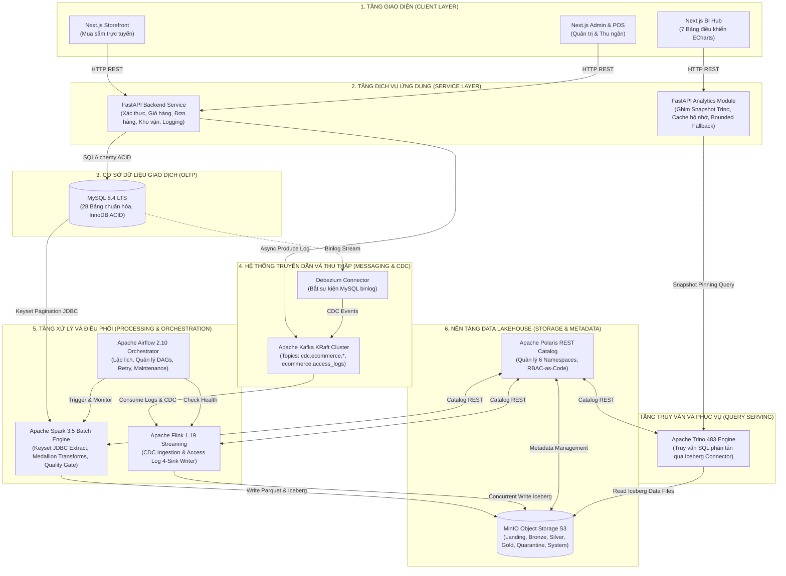
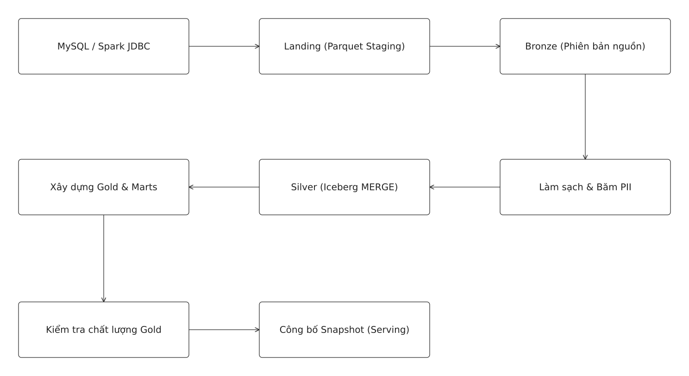
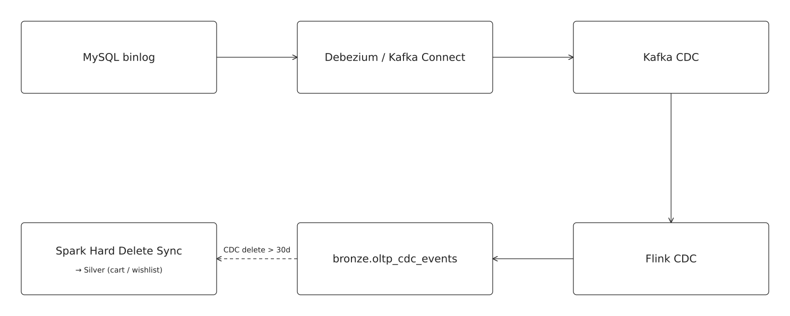
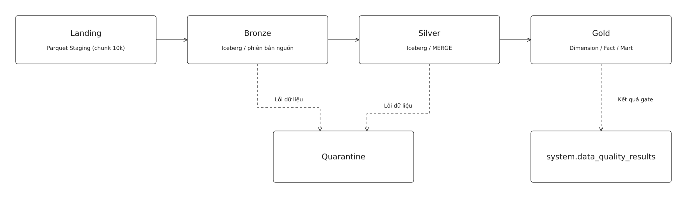
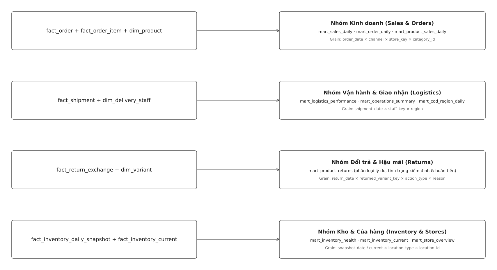
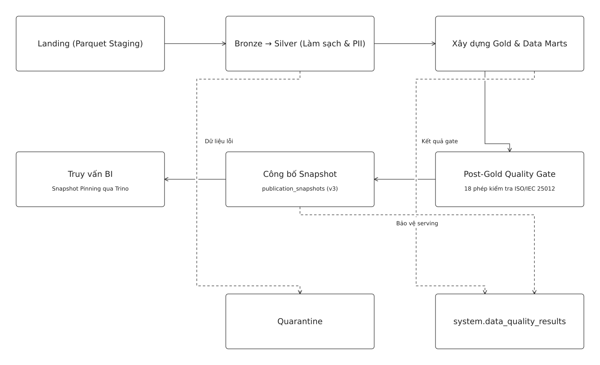

# **THIẾT KẾ VÀ TRIỂN KHAI DATA LAKEHOUSE PHỤC VỤ XỬ LÝ VÀ PHÂN TÍCH DỮ LIỆU CHO WEBSITE THƯƠNG MẠI ĐIỆN TỬ THỜI TRANG**

---

# **CHƯƠNG 1. TỔNG QUAN ĐỀ TÀI**

## **1.1. Tính cấp thiết của đề tài**

Trong bối cảnh chuyển đổi số và sự bùng nổ của thương mại điện tử (TMĐT), các doanh nghiệp bán lẻ thời trang phải đối mặt với bài toán quản lý và khai thác khối lượng dữ liệu khổng lồ phát sinh từng giây. Nguồn dữ liệu này có tính chất đa dạng cao, bao gồm dữ liệu giao dịch có cấu trúc chặt chẽ (đơn hàng, thanh toán, tồn kho theo biến thể màu sắc và kích cỡ) cùng với khối lượng lớn dữ liệu nhật ký hành vi người dùng bán cấu trúc (clickstream, tìm kiếm, xem sản phẩm, thêm vào giỏ hàng và danh sách yêu thích).

Việc khai thác hiệu quả nguồn dữ liệu hỗn hợp này đặt ra thách thức lớn đối với các kiến trúc dữ liệu truyền thống. Mô hình Kho dữ liệu (Data Warehouse) truyền thống tuy bảo đảm tính nhất quán giao dịch (ACID) và tối ưu cho truy vấn phân tích (OLAP), nhưng chi phí lưu trữ rất tốn kém khi mở rộng với dữ liệu bán cấu trúc và thiếu tính linh hoạt trong việc tiếp nhận dữ liệu streaming. Ngược lại, Hồ dữ liệu (Data Lake) cho phép lưu trữ dữ liệu thô với chi phí rẻ trên nền tảng lưu trữ đối tượng (Object Storage), song lại thiếu cơ chế kiểm soát giao dịch, dễ dẫn đến hiện tượng "vũng lầy dữ liệu" (Data Swamp), suy giảm chất lượng dữ liệu và hiệu năng truy vấn phân tích chậm chạp.

Kiến trúc **Data Lakehouse** ra đời như một bước tiến đột phá, kết hợp ưu điểm về chi phí thấp và khả năng mở rộng của Data Lake với năng lực quản trị, độ tin cậy và tính toàn vẹn giao dịch ACID của Data Warehouse. Việc nghiên cứu, thiết kế và triển khai một nền tảng Data Lakehouse hoàn chỉnh phục vụ bài toán bán lẻ thời trang đa kênh (kết hợp bán hàng trực tuyến Storefront và bán hàng tại quầy POS) có ý nghĩa thực tiễn sâu sắc. Hệ thống giúp doanh nghiệp hợp nhất dữ liệu, tối ưu hóa công tác quản lý kho hàng, phân tích sâu hành vi mua sắm của khách hàng và hỗ trợ các cấp quản trị đưa ra quyết định kinh doanh kịp thời dựa trên dữ liệu chuẩn xác.

## **1.2. Mục tiêu nghiên cứu**

Đề tài hướng tới hai nhóm mục tiêu cốt lõi sau:

1. **Mục tiêu tổng quát**:
   * Nghiên cứu, thiết kế và xây dựng hoàn chỉnh một hệ thống Data Lakehouse đầu cuối (End-to-End) ứng dụng cho lĩnh vực thương mại điện tử thời trang, hỗ trợ thu thập, lưu trữ phân tầng, xử lý dữ liệu quy mô lớn và trực quan hóa các chỉ số phân tích kinh doanh đa chiều.

2. **Mục tiêu cụ thể**:
   * Xây dựng hệ thống thương mại điện tử nguồn bao gồm ứng dụng bán hàng trực tuyến (Storefront) và giao diện quản trị, bán hàng tại quầy (POS/Admin) tích hợp chung một cơ sở dữ liệu giao dịch MySQL 8.4 chuẩn hóa 28 bảng.
   * Thiết kế và triển khai kiến trúc lưu trữ Data Lakehouse theo mô hình phân tầng Medallion (Landing – Bronze – Silver – Gold) sử dụng định dạng bảng mở Apache Iceberg trên nền tảng MinIO S3 và quản lý metadata tập trung với Apache Polaris REST Catalog.
   * Triển khai các đường ống (data pipeline) thu thập dữ liệu tự động: nạp dữ liệu theo lô (Batch Ingestion) trích xuất gia tăng bằng Apache Spark, thu thập dữ liệu biến đổi thời gian thực (CDC) bằng Debezium qua Apache Kafka, và thu thập xử lý nhật ký truy cập (Access Log) streaming bằng Apache Flink.
   * Xây dựng mô hình dữ liệu phân tích Dimensional Model (Star Schema) gồm 6 bảng Dimension, 6 bảng Fact cốt lõi và 17 Data Marts chuyên biệt, bảo đảm quy tắc hạch toán tài chính và kiểm soát chất lượng dữ liệu nghiêm ngặt.
   * Triển khai dịch vụ phân tích phục vụ truy vấn tốc độ cao sử dụng Apache Trino và xây dựng bảng điều khiển trực quan hóa Business Intelligence (BI Hub) phân quyền theo 7 vai trò quản trị.

## **1.3. Nhiệm vụ nghiên cứu**

Để đạt được các mục tiêu nêu trên, đề tài thực hiện các nhiệm vụ cụ thể:

* **Nhiệm vụ 1: Khảo sát nghiệp vụ và cơ sở lý thuyết**: Tìm hiểu quy trình nghiệp vụ bán hàng thời trang đa kênh, vòng đời đơn hàng, hạch toán doanh thu - giá vốn, kiểm soát tồn kho đa điểm và hệ thống chỉ số KPI then chốt. Nghiên cứu các công nghệ nền tảng: Apache Iceberg, MinIO, Polaris, Apache Spark, Debezium, Apache Kafka, Apache Flink, Apache Airflow, Apache Trino và Next.js.
* **Nhiệm vụ 2: Thiết kế và xây dựng hệ thống giao dịch nguồn**: Phân tích thiết kế hệ thống phần mềm, xây dựng cơ sở dữ liệu quan hệ MySQL chuẩn 3NF với 28 bảng, phát triển ứng dụng Web Client–Server với FastAPI Backend và Next.js Frontend, tích hợp cơ chế ghi nhận nhật ký truy cập mạng có kiểm soát PII.
* **Nhiệm vụ 3: Thiết kế và triển khai kiến trúc Data Lakehouse**: Thiết lập hạ tầng lưu trữ đối tượng, định nghĩa lược đồ phân tầng Medallion, cài đặt catalog trung tâm Polaris và phân quyền truy cập hạ tầng.
* **Nhiệm vụ 4: Xây dựng các đường ống dữ liệu và kiểm soát chất lượng**: Viết các kịch bản Spark trích xuất và chuyển đổi dữ liệu batch theo chu kỳ thời gian; triển khai Flink streaming đồng bộ CDC và ghi log đồng thời; thiết kế cơ chế làm sạch, khử trùng lặp, băm định danh PII (pseudonymization) và phân lập lỗi vào bảng cách ly (Quarantine); cấu hình Airflow điều phối tự động và triển khai Quality Gate kiểm soát tính toàn vẹn dữ liệu trước khi công bố snapshot.
* **Nhiệm vụ 5: Phát triển hệ thống BI và kiểm thử thực nghiệm**: Tích hợp engine truy vấn Trino, phát triển API phục vụ phân tích với cơ chế dự phòng an toàn (Bounded Fallback), xây dựng Dashboard BI đa vai trò với Apache ECharts và kiểm thử hệ thống với dữ liệu mô phỏng thị trường bán lẻ Việt Nam.

## **1.4. Đối tượng và phạm vi nghiên cứu**

* **Đối tượng nghiên cứu**:
  * Mô hình kiến trúc Data Lakehouse, công nghệ định dạng bảng mở (Apache Iceberg) và giải pháp Catalog chuẩn mở (Polaris REST Catalog).
  * Quy trình thu thập, xử lý và tích hợp luồng dữ liệu kép: Dữ liệu giao dịch có cấu trúc (OLTP RDBMS) và dữ liệu sự kiện nhật ký hành vi bán cấu trúc (Access Log).
  * Kỹ thuật mô hình hóa dữ liệu đa chiều Kimball Star Schema và xây dựng Data Mart phục vụ khai thác kinh doanh.
  * Các chỉ số đo lường hiệu quả hoạt động kinh doanh (KPIs), quản lý kho vận và phễu tương tác khách hàng trong TMĐT.

* **Phạm vi nghiên cứu**:
  * *Phạm vi nghiệp vụ*: Tập trung vào chu trình bán lẻ thời trang cốt lõi gồm: duyệt sản phẩm theo biến thể (màu, size), quản lý giỏ hàng, đặt hàng trực tuyến, bán hàng tại quầy POS, quản lý tồn kho đa kho/cửa hàng, giao hàng COD, đổi trả - hoàn tiền và theo dõi tương tác người dùng.
  * *Phạm vi kỹ thuật*: Đề tài giới hạn triển khai trên môi trường máy chủ cục bộ hoặc máy ảo thông qua hệ thống đóng gói container Docker Compose với các profile dịch vụ rõ ràng (`core`, `batch`, `streaming`, `tools`). Các tính năng như phân cụm chịu lỗi cao (High Availability), tự động co giãn (Autoscaling) hay ứng dụng học máy dự báo nâng cao được xác định là hướng mở rộng trong tương lai.

## **1.5. Tổng quan các công trình liên quan**

Trong lịch sử phát triển kiến trúc dữ liệu, các nghiên cứu và triển khai ban đầu dựa trên mô hình Data Warehouse tập trung (Inmon hay Kimball). Ưu điểm của mô hình này là tính toàn vẹn dữ liệu cao, hỗ trợ giao dịch ACID mạnh mẽ và hiệu năng truy vấn phân tích được tối ưu hóa. Tuy nhiên, chi phí lưu trữ trên các hệ thống cơ sở dữ liệu chuyên dụng rất đắt đỏ, không thể đáp ứng được tốc độ sinh dữ liệu và khối lượng khổng lồ của dữ liệu nhật ký clickstream [1], [7].

Sự xuất hiện của Hadoop và phong trào Data Lake trên nền tảng lưu trữ đối tượng (S3, HDFS) đã giải quyết bài toán chi phí lưu trữ quy mô lớn. Dù vậy, Data Lake thiếu vắng cơ chế quản lý giao dịch, dẫn đến rủi ro đọc dữ liệu bẩn khi ghi đồng thời, khó khăn trong việc cập nhật/xóa dữ liệu (đặc biệt là yêu cầu tuân thủ quyền riêng tư dữ liệu như GDPR) và hiệu năng truy vấn báo cáo trực tiếp rất thấp.

Để khắc phục khoảng trống đó, kiến trúc Data Lakehouse ra đời với sự thúc đẩy của các định dạng bảng mở tiên tiến như Apache Iceberg, Delta Lake và Apache Hudi. Trong đó, Apache Iceberg nổi bật nhờ khả năng trừu tượng hóa tầng lưu trữ ở cấp độ snapshot, hỗ trợ tính năng time-travel, tiến hóa lược đồ (schema evolution) an toàn và phân tách hoàn toàn giữa tầng lưu trữ dữ liệu với công cụ tính toán [9]. Các nghiên cứu gần đây thường ứng dụng kiến trúc phân tầng Medallion (Bronze – Silver – Gold) để quản lý vòng đời dữ liệu một cách chặt chẽ [7], [11].

Tuy nhiên, phần lớn các công trình hiện nay thường chỉ dừng lại ở mức độ nghiên cứu lý thuyết, sử dụng các tập dữ liệu tĩnh có sẵn (benchmarks như TPC-DS, TPC-H) hoặc triển khai phân mảnh từng thành phần riêng lẻ mà thiếu đi một hệ thống hoàn chỉnh từ khâu phát sinh dữ liệu nghiệp vụ đến khâu khai thác phân tích. Đề tài này giải quyết khoảng trống đó bằng cách hiện thực hóa trọn vẹn một giải pháp Data Lakehouse thực tế, tự chủ từ ứng dụng nguồn phát sinh giao dịch, hệ thống điều phối pipeline tự động, cơ chế kiểm soát chất lượng dữ liệu nghiêm ngặt đến hệ thống trực quan hóa phân quyền cho doanh nghiệp.

## **1.6. Kết quả dự kiến đạt được**

Đề tài cam kết mang lại các sản phẩm cụ thể, có thể kiểm chứng được bao gồm:

1. **Sản phẩm phần mềm ứng dụng**:
   * Ứng dụng web bán hàng trực tuyến (Storefront) giao diện hiện đại, tối ưu trải nghiệm người dùng với đầy đủ chức năng tìm kiếm, chọn biến thể, giỏ hàng và thanh toán VietQR / COD.
   * Hệ thống quản trị (Admin) và bán hàng tại quầy (POS) hỗ trợ quản lý sản phẩm, đơn hàng, nhập kho tính giá vốn bình quân và xử lý hoàn trả.
   * Module middleware ghi nhận nhật ký truy cập mạng (Access Log) chuẩn hóa theo hợp đồng dữ liệu `ecommerce.access` v1.0.0 và kiểm soát an toàn thông tin nhạy cảm.

2. **Sản phẩm hạ tầng và nền tảng dữ liệu**:
   * Hệ thống Data Lakehouse đa tầng (Landing, Bronze, Silver, Gold, Quarantine, System) vận hành hoàn chỉnh trên MinIO S3 và Apache Iceberg, quản lý bởi Polaris REST Catalog.
   * Bộ các đường ống dữ liệu tự động hóa: Pipeline batch trích xuất 27 bảng MySQL bằng Spark JDBC phân trang keyset; Pipeline streaming thu thập CDC Debezium và Flink ghi đồng thời access log vào 4 sink Iceberg; DAG điều phối Airflow tích hợp Quality Gate tự động.

3. **Sản phẩm phân tích và báo cáo (BI)**:
   * Mô hình dữ liệu đa chiều Star Schema gồm 6 dimensions, 6 facts và 17 data marts phục vụ toàn diện các lĩnh vực kinh doanh, vận hành, kho vận và marketing.
   * Ứng dụng BI Hub trực quan hóa bằng Apache ECharts hỗ trợ 7 bảng điều khiển theo vai trò người dùng với cơ chế ghim snapshot truy vấn phân tán Trino an toàn.

4. **Sản phẩm tài liệu kỹ thuật**:
   * Bản báo cáo đồ án tốt nghiệp hoàn chỉnh, mô tả chi tiết toàn bộ cơ sở lý thuyết, kiến trúc, thiết kế, triển khai thực nghiệm và đánh giá hệ thống.

---

# **CHƯƠNG 2. CƠ SỞ LÝ THUYẾT VÀ CÔNG NGHỆ ÁP DỤNG**

## **2.1. Tổng quan về thương mại điện tử và bán hàng đa kênh**

### **2.1.1. Mô hình thương mại điện tử và bán hàng đa kênh**

Thương mại điện tử (TMĐT) là phương thức kinh doanh trong đó các hoạt động giao dịch, mua bán hàng hóa và dịch vụ được tiến hành qua các mạng máy tính và phương tiện điện tử [1]. Trong mô hình B2C (Business-to-Consumer), doanh nghiệp thiết lập kênh tương tác trực tiếp với người tiêu dùng qua nền tảng web hoặc ứng dụng di động.

Khi doanh nghiệp mở rộng quy mô kinh doanh sang mô hình bán hàng đa kênh (Omnichannel / Multichannel Retailing), việc kết hợp giữa website bán hàng trực tuyến và chuỗi cửa hàng vật lý là xu hướng tất yếu. Thách thức lớn nhất của mô hình này là sự phân mảnh dữ liệu giữa các kênh, dễ dẫn đến hiện tượng sai lệch tồn kho (overselling) và khó khăn trong việc hợp nhất bức tranh doanh thu. Đề tài lựa chọn giải pháp tích hợp kênh trực tuyến (Storefront) và điểm bán hàng tại quầy (POS) trên cùng một hệ thống Backend và cơ sở dữ liệu giao dịch tập trung, bảo đảm dữ liệu sản phẩm, giá bán, khách hàng và tồn kho luôn được cập nhật đồng bộ và duy nhất.

### **2.1.2. Quy trình quản lý bán hàng, đơn hàng và tồn kho**

Quy trình bán hàng trong ngành thời trang đòi hỏi sự quản lý tỉ mỉ do tính chất đa dạng về biến thể sản phẩm (SKU) theo màu sắc và kích cỡ. Dù khách hàng đặt hàng qua website hay mua trực tiếp tại quầy, hệ thống đều phải thực thi nhất quán các bước kiểm tra nghiệp vụ: xác thực giá bán, áp dụng mã giảm giá hợp lệ và kiểm tra tính khả dụng của tồn kho.

Về quản lý vòng đời đơn hàng, hệ thống tách bạch ba luồng trạng thái độc lập nhưng có mối liên kết chặt chẽ:
1. **Trạng thái đơn hàng** (*Chờ xử lý, Đã xác nhận, Đang xử lý, Hoàn thành, Đã hủy*).
2. **Trạng thái thanh toán** (*Chưa thanh toán, Đã thanh toán, Hoàn tiền một phần, Hoàn tiền toàn bộ*).
3. **Trạng thái giao nhận** (*Chờ lấy hàng, Đang giao, Đã giao thành công, Giao thất bại*).

Việc phân tách này giúp kiểm soát chính xác các trường hợp thanh toán khi nhận hàng (COD), xử lý đổi trả hoặc hủy đơn mà không ghi nhận sai lệch thời điểm ghi nhận doanh thu thực tế. Đồng thời, đối với tồn kho, hệ thống phân biệt rõ ràng giữa tồn kho tổng của chuỗi và tồn kho vật lý tại từng cửa hàng, bảo đảm việc xuất kho bán lẻ tại POS hay xuất kho giao hàng online luôn được ghi nhận giao dịch tức thời vào sổ cái biến động kho (`inventory_transactions`).

### **2.1.3. Vai trò của phân tích dữ liệu trong hoạt động kinh doanh**

Trong môi trường kinh doanh hiện đại, dữ liệu được coi là tài sản chiến lược. Dữ liệu giao dịch từ hệ thống OLTP phản ánh chính xác kết quả kinh doanh quá khứ: doanh thu thuần, số lượng đơn hàng, tỷ lệ hủy đơn, biên lợi nhuận gộp và vòng quay hàng tồn kho. Tuy nhiên, dữ liệu giao dịch chỉ cho biết *kết quả đã xảy ra* mà không giải thích được *hành vi dẫn đến kết quả đó*.

Dữ liệu nhật ký truy cập (Access Log) cung cấp góc nhìn bổ trợ vô giá: lưu lượng truy cập theo khung giờ, các mặt hàng được tìm kiếm nhiều nhất, tỷ lệ thoát trang tại bước giỏ hàng hoặc thanh toán. Do hệ thống OLTP được tối ưu hóa cho các thao tác đọc/ghi giao dịch ngắn hạn (ACID), việc thực hiện các truy vấn phân tích tổng hợp phức tạp trên OLTP sẽ gây khóa bảng, nghẽn tài nguyên và ảnh hưởng trực tiếp đến người dùng mua sắm. Vì vậy, việc đồng bộ dữ liệu giao dịch và log sang nền tảng Data Lakehouse chuyên dụng là điều kiện tiên quyết để phân tích dữ liệu hiệu quả mà không làm suy giảm hiệu năng của hệ thống vận hành.

### **2.1.4. Hệ thống chỉ số KPI trong thương mại điện tử**

Hệ thống chỉ số hiệu quả kinh doanh (KPI) được phân nhóm khoa học nhằm phục vụ các cấp quản trị khác nhau trong doanh nghiệp:

| Nhóm KPI | Chỉ số cốt lõi | Ý nghĩa nghiệp vụ |
|---|---|---|
| **Kinh doanh (Sales)** | Doanh thu gộp, Hoàn tiền, Doanh thu thuần, Giá vốn hàng bán (COGS), Lợi nhuận gộp, Giá trị đơn trung bình (AOV) | Đánh giá sức khỏe tài chính và hiệu quả bán hàng thực tế sau khi đã trừ các khoản giảm trừ và hoàn tiền. |
| **Kho vận (Inventory)** | Số lượng tồn kho, Giá trị tồn kho theo giá vốn bình quân, Tỷ lệ SKU hết hàng / sắp hết hàng, Tồn kho theo cửa hàng | Cảnh báo nguy cơ đứt gãy nguồn hàng hoặc ứ đọng vốn lưu động tại từng điểm bán lẻ. |
| **Vận hành (Operations)** | Tỷ lệ giao hàng thành công, Thời gian xử lý đơn, Số lần giao hàng trung bình, Công nợ thu hộ COD theo khu vực | Tối ưu hóa hiệu quả của đội ngũ giao vận và quản lý rủi ro dòng tiền thu hộ. |
| **Marketing** | Lượt truy cập, Lượt xem sản phẩm, Tỷ lệ thêm giỏ hàng, Hiệu quả mã coupon, Phễu chuyển đổi tương tác | Đánh giá mức độ thu hút của sản phẩm và hiệu quả của các chương trình khuyến mại. |
| **Kỹ thuật hệ thống** | Lưu lượng request, Tỷ lệ lỗi HTTP 4xx/5xx, Độ trễ phản hồi API, Độ trễ dữ liệu công bố (Data Freshness) | Giám sát độ ổn định của hạ tầng công nghệ và độ tin cậy của dữ liệu phân tích. |

## **2.2. Kiến trúc và công nghệ phát triển hệ thống thương mại điện tử**

### **2.2.1. Kiến trúc Web Client–Server và REST API**

Hệ thống thương mại điện tử nguồn được xây dựng theo kiến trúc Client–Server hiện đại, phân tách hoàn toàn giữa giao diện người dùng (Frontend) và logic xử lý nghiệp vụ (Backend) thông qua giao thức truyền thông RESTful API [2], [3].

Tầng Frontend được phát triển bằng **Next.js 15** (sử dụng thư viện React 19 và kiến trúc App Router), hỗ trợ kỹ thuật kết hợp giữa Server-Side Rendering (SSR) để tối ưu hóa SEO và Client-Side Rendering (CSR) cho các trải nghiệm tương tác mượt mà tại giỏ hàng và thanh toán. Tầng Backend được xây dựng bằng **FastAPI** (Python 3.11), một framework hiện đại có tốc độ xử lý cao nhờ hỗ trợ bất đồng bộ (Asynchronous I/O), tự động kiểm thực dữ liệu qua Pydantic và sinh tài liệu API chuẩn OpenAPI/Swagger.

### **2.2.2. Cơ sở dữ liệu giao dịch OLTP**

Cơ sở dữ liệu giao dịch sử dụng **MySQL 8.4 LTS** với công cụ lưu trữ mặc định **InnoDB** [4]. InnoDB cung cấp đầy đủ các tính năng bảo đảm tính toàn vẹn dữ liệu: hỗ trợ giao dịch tuân thủ chuẩn ACID, quản lý khóa ở mức độ dòng (Row-level Locking) và cơ chế đọc nhất quán không khóa thông qua Multi-Version Concurrency Control (MVCC).

Tầng ứng dụng sử dụng thư viện **SQLAlchemy 2.0 ORM** để ánh xạ dữ liệu [5]. Để giải quyết triệt để vấn đề tranh chấp dữ liệu khi nhiều người dùng đồng thời mua một sản phẩm có số lượng tồn kho giới hạn, hệ thống kết hợp cơ chế khóa bi quan (`SELECT ... FOR UPDATE`) trong một giao dịch Unit-of-Work, kèm theo cơ chế tự động thử lại (exponential backoff retry) khi phát sinh lỗi Deadlock (MySQL Error 1213) hoặc Lock Wait Timeout (MySQL Error 1205).

### **2.2.3. Xác thực, phân quyền và bảo mật hệ thống**

An toàn thông tin là yêu cầu sống còn của hệ thống thương mại điện tử. Mật khẩu người dùng được băm an toàn bằng thuật toán **Argon2id** (đạt giải quán quân Password Hashing Competition), có khả năng chống lại các cuộc tấn công vét cạn bằng phần cứng GPU chuyên dụng.

Cơ chế xác thực sử dụng JSON Web Token (JWT) được lưu trữ trong **HttpOnly, Secure Cookie**, ngăn chặn hoàn toàn nguy cơ bị đánh cắp token qua các lỗ hổng Cross-Site Scripting (XSS). Hệ thống tích hợp sẵn mã bảo vệ CSRF Token cho toàn bộ các yêu cầu thay đổi trạng thái (POST, PUT, DELETE) [6]. Quyền truy cập tài nguyên được kiểm soát chặt chẽ theo mô hình Phân quyền dựa trên vai trò (RBAC) kết hợp phạm vi cửa hàng (Store Scope), phân định rõ 6 vai trò: *Khách hàng, Nhân viên bán hàng POS, Nhân viên kho, Nhân viên giao vận, Quản lý cửa hàng, và Quản trị viên hệ thống*.

## **2.3. Kiến trúc và công nghệ lưu trữ Data Lakehouse**

### **2.3.1. Tổng quan về kiến trúc Data Lakehouse**

Kiến trúc Data Lakehouse đại diện cho thế hệ nền tảng dữ liệu hiện đại, hợp nhất ưu điểm của Data Warehouse và Data Lake trên cùng một nền tảng duy nhất [7]. Bằng cách bổ sung một tầng quản lý siêu dữ liệu (Metadata Layer) có cấu trúc phía trên hệ thống lưu trữ đối tượng chi phí thấp, Lakehouse cung cấp đầy đủ các tính năng nâng cao: giao dịch ACID đa bảng, quản lý phiên bản snapshot (Time-travel), tiến hóa lược đồ mà không cần viết lại toàn bộ dữ liệu, và hỗ trợ đồng thời cả tác vụ xử lý streaming lẫn batch.

### **2.3.2. Mô hình kiến trúc dữ liệu phân tầng Medallion**

Dữ liệu trong Lakehouse được tổ chức khoa học theo mô hình kiến trúc phân tầng Medallion gồm bốn cấp độ chính:

```
[Nguồn dữ liệu] ---> [Landing/Staging] ---> [Bronze] ---> [Silver] ---> [Gold & Marts]
   (MySQL, Log)      (Parquet thô)        (Raw Iceberg) (Cleaned)   (Star Schema/KPI)
                                                             |
                                                             v
                                                      [Quarantine]
                                                     (Bản ghi lỗi)
```

* **Tầng Landing / Staging**: Vùng tiếp nhận dữ liệu trung gian dạng file Parquet được trích xuất từ nguồn MySQL hoặc tệp log tạm thời. Vùng này lưu trữ tạm thời theo chu kỳ xử lý và được ghi đè ở mỗi lượt chạy mới.
* **Tầng Bronze (Raw Data)**: Lưu trữ toàn bộ dữ liệu thô dạng bảng Iceberg, bảo toàn nguyên vẹn mọi phiên bản dữ liệu từ nguồn gốc kèm theo các trường siêu dữ liệu truy vết nguồn gốc (`_ingested_at`, `_source_file`, `_source_run_id`).
* **Tầng Silver (Cleaned & Conformed Data)**: Tầng dữ liệu nghiệp vụ chuẩn hóa. Dữ liệu từ Bronze được làm sạch, kiểm tra tính hợp lệ về kiểu dữ liệu và ràng buộc logic, loại bỏ trùng lặp theo khóa chính và thời điểm cập nhật, băm định danh các trường thông tin cá nhân nhạy cảm (PII), và cập nhật trạng thái mới nhất vào Iceberg qua lệnh `MERGE INTO`. Các bản ghi không hợp lệ được phân lập sang namespace `quarantine`.
* **Tầng Gold (Business-Level Data & Data Marts)**: Tầng dữ liệu phân tích phục vụ trực tiếp cho người dùng nghiệp vụ và hệ thống báo cáo. Dữ liệu được tổ chức theo mô hình hình sao (Star Schema) gồm các bảng Dimension chuẩn tắc, các bảng Fact sự kiện giao dịch và hệ thống 17 Data Marts được tổng hợp sẵn theo các chiều nghiệp vụ then chốt.

### **2.3.3. Lưu trữ Object Storage và định dạng bảng mở Apache Iceberg**

Hạ tầng lưu trữ đối tượng sử dụng **MinIO**, một hệ thống lưu trữ phân tán mã nguồn mở tương thích hoàn toàn với chuẩn Amazon S3 API [8]. MinIO cung cấp hiệu năng đọc ghi cao, hỗ trợ phân quyền truy cập thông qua các chính sách IAM Policy và quản lý khóa dịch vụ bảo mật.

Định dạng bảng phân tích sử dụng **Apache Iceberg** [9]. Khác với cách quản lý dựa trên cấu trúc thư mục truyền thống của Hive (dễ gây nghẽn NameNode và không hỗ trợ ACID), Iceberg quản lý bảng thông qua một cây phân cấp siêu dữ liệu (Metadata Tree) gồm: Snapshot, Manifest List và Manifest File. Mỗi thao tác ghi vào bảng Iceberg tạo ra một snapshot mới một cách nguyên tử (Atomic Commit), hỗ trợ các truy vấn đọc nhất quán cô lập (Snapshot Isolation), cho phép engine truy vấn đọc dữ liệu tại bất kỳ thời điểm nào trong quá khứ mà không bị ảnh hưởng bởi các tiến trình ghi đang diễn ra.

Để quản lý thống nhất các bảng Iceberg giữa nhiều công cụ tính toán khác nhau (Spark, Flink, Trino), hệ thống sử dụng **Apache Polaris** làm Catalog trung tâm theo chuẩn Iceberg REST Catalog Specification [10]. Polaris hỗ trợ quản lý phân tầng namespace rõ ràng, tích hợp chính sách kiểm soát truy cập dựa trên vai trò (RBAC) cho từng engine tính toán độc lập.

### **2.3.4. Mô hình dữ liệu phân tích Kimball**

Mô hình dữ liệu tại tầng Gold được thiết kế theo phương pháp luận mô hình hóa đa chiều (Dimensional Modeling) của Ralph Kimball [11]. Kiến trúc Star Schema gồm:
* **Bảng chiều (Dimension Tables)**: Chứa các thuộc tính mô tả ngữ cảnh kinh doanh (khách hàng, sản phẩm, biến thể, cửa hàng, nhân viên giao hàng, ngày tháng). Các bảng chiều cung cấp các góc nhìn đa dạng để cắt lát (slice-and-dice) và gom nhóm dữ liệu.
* **Bảng sự kiện (Fact Tables)**: Lưu trữ các độ đo số lượng (measures) phát sinh từ các sự kiện kinh doanh tại một mức độ chi tiết (grain) xác định duy nhất (ví dụ: một dòng sản phẩm trong đơn hàng, một lần chuyển trạng thái giao hàng, hay mức tồn kho tại một thời điểm quan sát).
* **Bảng tổng hợp nghiệp vụ (Data Marts)**: Được tiền tổng hợp (pre-aggregated) từ các bảng Fact và Dimension để tối ưu hóa tối đa tốc độ phản hồi cho các báo cáo Dashboard, hạn chế việc phải thực hiện các phép kết nối (JOIN) bảng lớn đắt đỏ khi truy vấn.

## **2.4. Công nghệ thu thập và xử lý dữ liệu lớn**

### **2.4.1. Thu thập và xử lý dữ liệu theo lô với Apache Spark**

**Apache Spark 3.5** là engine tính toán phân tán trong bộ nhớ chủ lực được sử dụng cho toàn bộ các tác vụ xử lý theo lô (Batch Processing) từ tầng Landing đến Gold [12]. Với cơ chế xử lý song song trên cấu trúc dữ liệu DataFrame và tối ưu hóa truy vấn thông qua bộ tối ưu Catalyst Optimizer, Spark mang lại hiệu năng vượt trội khi chuyển đổi dữ liệu quy mô lớn.

Trong quy trình trích xuất dữ liệu từ MySQL, Spark kết nối qua JDBC và thực thi thuật toán phân trang theo khóa chính (Keyset Pagination), đọc tuần tự từng khối dữ liệu 10.000 dòng để bảo đảm an toàn bộ nhớ JVM và không gây áp lực tải đột biến lên cơ sở dữ liệu vận hành. Spark tích hợp trực tiếp với Apache Iceberg runtime, hỗ trợ các câu lệnh biến đổi nâng cao như `MERGE INTO` để đồng bộ dữ liệu vào Silver và Gold một cách hiệu quả.

### **2.4.2. Thu thập dữ liệu biến đổi (CDC) và nhật ký truy cập với Debezium, Kafka và Flink**

Đối với các yêu cầu thu thập dữ liệu gần thời gian thực, hệ thống ứng dụng giải pháp Change Data Capture (CDC) không xâm nhập:
* **Debezium MySQL Connector**: Hoạt động như một tiến trình theo dõi trực tiếp nhật ký nhị phân (Binary Log - binlog) của MySQL theo chế độ `ROW` [13]. Mọi thao tác thêm (Insert), sửa (Update), xóa (Delete) trên 27 bảng nghiệp vụ đều được Debezium ghi nhận và chuyển đổi thành các sự kiện có cấu trúc (chứa đầy đủ trạng thái dữ liệu trước và sau biến đổi).
* **Apache Kafka 3.8**: Đóng vai trò là hệ thống hàng đợi phân tán trung tâm (Message Broker) hoạt động theo cơ chế KRaft (loại bỏ phụ thuộc ZooKeeper), tiếp nhận các luồng sự kiện CDC và luồng nhật ký truy cập mạng với độ trễ cực thấp và khả năng đệm dữ liệu bền bỉ [14].
* **Apache Flink 1.19**: Là nền tảng xử lý luồng dữ liệu liên tục có trạng thái (Stateful Stream Processing) [15]. Flink tiêu thụ các thông điệp từ Kafka, thực hiện chuẩn hóa dữ liệu, bóc tách cấu trúc JSON và sử dụng cơ chế `StatementSet` để ghi song song vào nhiều bảng Iceberg đích trong cùng một chu kỳ kiểm tra trạng thái (Checkpointing 10 giây).

### **2.4.3. Điều phối luồng dữ liệu tự động với Apache Airflow**

**Apache Airflow 2.10** đảm nhiệm vai trò nhạc trưởng điều phối toàn bộ lịch trình thực thi của các pipeline dữ liệu [16]. Các quy trình làm việc được định nghĩa hoàn toàn bằng mã nguồn Python dưới dạng Đồ thị có hướng không chu trình (Directed Acyclic Graph - DAG).

Airflow quản lý chặt chẽ sự phụ thuộc giữa các tác vụ (Task Dependency) thông qua cấu trúc TaskGroup, hỗ trợ cơ chế tự động thử lại khi có lỗi mạng tạm thời (Retry with Backoff), gửi cảnh báo trạng thái và quản lý ngữ cảnh thời gian trích xuất chính xác theo các khoảng thời gian (`data_interval_start` và `data_interval_end`).

### **2.4.4. Kiểm soát chất lượng dữ liệu và quản lý lỗi**

Chất lượng dữ liệu được kiểm soát chặt chẽ theo tiêu chuẩn quốc tế ISO/IEC 25012 về mô hình chất lượng dữ liệu [17]. Hệ thống thiết lập cổng kiểm soát chất lượng tự động (Quality Gate) tại tầng Gold, bao gồm 18 phép kiểm tra logic toàn diện:
* Kiểm tra tính duy nhất (Uniqueness) và không rỗng (Completeness) của các khóa chính và khóa ngoại.
* Kiểm tra tính toàn vẹn tham chiếu (Referential Integrity) giữa các bảng Fact và Dimension.
* Kiểm tra tính nhất quán tài chính (Financial Consistency): Doanh thu thuần = Doanh thu gộp − Hoàn tiền; Lợi nhuận = Doanh thu thuần − Giá vốn.
* Kiểm tra an toàn thông tin: Xác nhận 100% các trường dữ liệu định danh khách hàng nhạy cảm đã được băm mã hóa một chiều kèm chuỗi bí mật (Salted SHA-256).

Mọi kết quả đánh giá chất lượng đều được ghi nhận vào bảng siêu dữ liệu hệ thống `lakehouse.system.data_quality_results`. Chỉ khi toàn bộ các bài kiểm tra đạt trạng thái PASSED, pipeline mới cho phép tạo bản công bố Snapshot (Publication) để phục vụ cho tầng báo cáo.

## **2.5. Công nghệ phân tích và trực quan hóa dữ liệu**

### **2.5.1. Công cụ truy vấn dữ liệu phân tán Apache Trino**

**Apache Trino** (tiền thân là PrestoSQL) là công cụ truy vấn SQL phân tán hiệu năng cao, được thiết kế chuyên biệt cho các tác vụ phân tích tương tác trên hồ dữ liệu [18]. Trino kết nối trực tiếp với Apache Iceberg thông qua Polaris REST Catalog, tận dụng siêu dữ liệu của Iceberg để thực hiện kỹ thuật cắt tỉa phân vùng (Partition Pruning) và lọc dữ liệu ở cấp độ tệp (Min/Max Statistics Pruning), giảm thiểu tối đa khối lượng dữ liệu phải đọc từ MinIO S3.

Đặc biệt, hệ thống áp dụng cơ chế ghim phiên đọc an toàn (**Snapshot Pinning**): API phân tích sẽ đọc bảng thông qua câu lệnh `FOR VERSION AS OF <snapshot_id>` dựa trên bản ghi Snapshot đã được công bố chính thức. Giải pháp này giúp các báo cáo Dashboard luôn đọc được dữ liệu nhất quán, không bao giờ gặp phải hiện tượng dữ liệu bị thay đổi giữa chừng khi các tiến trình batch đang ghi dữ liệu mới.

### **2.5.2. Trực quan hóa dữ liệu và xây dựng Dashboard với Apache ECharts**

Giao diện Business Intelligence (BI Hub) được xây dựng bằng **Apache ECharts 6.1** tích hợp trong nền tảng Next.js [19], [20]. ECharts là thư viện đồ họa mạnh mẽ dựa trên Canvas/SVG, hỗ trợ hiển thị mượt mà các biểu đồ phức tạp: biểu đồ đường xu hướng doanh thu đa kênh, biểu đồ cột xếp hạng sản phẩm bán chạy, phễu chuyển đổi hành vi người dùng, và bản đồ nhiệt ma trận tồn kho.

Hệ thống Dashboard được thiết kế đáp ứng tiêu chuẩn trải nghiệm người dùng hiện đại: hiển thị rõ ràng độ mới của dữ liệu (Data Freshness), phân biệt minh bạch giữa trạng thái không có dữ liệu (Empty Data) và lỗi hệ thống, tự động làm mới thông minh (Smart Auto-refresh) theo chu kỳ khi người dùng đang mở tab làm việc.

---

# **CHƯƠNG 3. PHÂN TÍCH VÀ THIẾT KẾ HỆ THỐNG**

## **3.1. Phân tích yêu cầu hệ thống**

### **3.1.1. Bối cảnh và phát biểu bài toán**

Doanh nghiệp thời trang D&K vận hành mô hình kinh doanh bán lẻ kết hợp giữa nền tảng trực tuyến (website) và hệ thống cửa hàng thực tế. Hệ thống giao dịch hiện tại phải xử lý hàng nghìn yêu cầu mỗi ngày, bao gồm duyệt danh mục, đặt hàng, thanh toán qua ngân hàng, giao vận COD và xử lý đổi trả hàng hóa. Đồng thời, máy chủ web ghi nhận hàng triệu lượt tương tác của người dùng mỗi tháng.

Vấn đề đặt ra là: Ban giám đốc và các trưởng bộ phận thiếu một công cụ phân tích tập trung để theo dõi sát sao tình hình kinh doanh theo thời gian thực; việc tổng hợp báo cáo thủ công từ MySQL tốn nhiều thời gian, tiềm ẩn sai sót và làm chậm tốc độ phản hồi của website bán hàng; các dữ liệu nhật ký clickstream quý giá bị bỏ phí do không có hạ tầng lưu trữ và xử lý phù hợp. Do đó, bài toán đặt ra là phải thiết kế một kiến trúc nền tảng dữ liệu toàn diện, vừa bảo đảm vận hành giao dịch ổn định, vừa tự động hóa quá trình thu thập và phân tích dữ liệu chuyên sâu.

### **3.1.2. Tác nhân và phạm vi hệ thống**

Hệ thống phục vụ 5 nhóm tác nhân chính:

| Tác nhân | Trách nhiệm và nhu cầu khai thác |
|---|---|
| **Khách hàng (Customer)** | Tìm kiếm sản phẩm thời trang theo kích cỡ/màu sắc, quản lý giỏ hàng, đặt hàng trực tuyến, thanh toán VietQR/COD, theo dõi vận đơn và gửi yêu cầu đổi trả. |
| **Nhân viên thu ngân & kho (Store/Warehouse Staff)** | Bán hàng trực tiếp tại quầy qua giao diện POS, tra cứu tồn kho tức thời giữa các chi nhánh, tạo phiếu nhập kho và kiểm định hàng đổi trả. |
| **Nhân viên giao nhận (Delivery Staff)** | Cập nhật tiến độ giao hàng, số lần giao và xác nhận thu hộ tiền COD. |
| **Cấp quản lý (Managers / Executives)** | Xem các báo cáo phân tích tổng thể về doanh thu, lợi nhuận, hiệu quả kho vận, phễu marketing và đánh giá sản phẩm. |
| **Kỹ sư vận hành dữ liệu (Data Engineer)** | Giám sát trạng thái các đường ống dữ liệu, kiểm tra chất lượng dữ liệu, thực hiện bảo trì định kỳ và quản lý quyền truy cập catalog. |


### **3.1.3. Yêu cầu chức năng**

* **Nhóm chức năng ứng dụng giao dịch**:
  * Quản lý danh mục đa cấp, sản phẩm và biến thể SKU chi tiết (màu sắc, kích cỡ, giá niêm yết, mã vạch).
  * Xử lý giỏ hàng và đặt hàng an toàn, bảo đảm tính nhất quán của tồn kho khả dụng thông qua cơ chế khóa dòng.
  * Hỗ trợ bán hàng tại quầy POS với tính năng quét mã nhanh và áp dụng mã giảm giá.
  * Quản lý nhập kho theo phương pháp giá vốn bình quân gia quyền và theo dõi sổ cái biến động kho.
  * Quản lý vòng đời vận chuyển, thu hộ tiền mặt COD và quy trình xử lý đổi trả/hoàn tiền nhiều bước.
  * Ghi nhận tự động nhật ký tương tác của người dùng trên toàn bộ các route API.
* **Nhóm chức năng nền tảng dữ liệu và phân tích**:
  * Trích xuất định kỳ 27 bảng dữ liệu quan hệ từ MySQL theo các khoảng thời gian (Batch interval) và đồng bộ vào Lakehouse.
  * Thu thập sự kiện thay đổi dữ liệu (CDC) từ MySQL binlog vào tầng Bronze phục vụ kiểm toán.
  * Thu thập và xử lý dòng dữ liệu nhật ký truy cập mạng, bóc tách thông tin người dùng và thiết bị.
  * Xây dựng và duy trì 17 Data Marts phục vụ tính toán các chỉ số KPI nghiệp vụ.
  * Kiểm tra chất lượng dữ liệu tự động trước khi công bố snapshot phục vụ báo cáo.
  * Cung cấp Dashboard trực quan hóa đa chiều phân quyền theo 7 vai trò quản trị.

### **3.1.4. Yêu cầu phi chức năng**

* **Tính toàn vẹn và nhất quán**: Dữ liệu giao dịch trên MySQL bảo đảm chuẩn ACID 100%. Dữ liệu phân tích trên Lakehouse duy trì tính nhất quán đọc thông qua cơ chế snapshot isolation; doanh thu báo cáo phải khớp chính xác với dữ liệu giao dịch gốc (sai số đối soát cho phép $\le 0.05\%$).
* **Khả năng mở rộng (Scalability)**: Kiến trúc phân tách hoàn toàn giữa tính toán (Spark, Flink, Trino) và lưu trữ (MinIO S3), cho phép mở rộng độc lập dung lượng lưu trữ và năng lực tính toán.
* **Hiệu năng truy vấn**: Thời gian phản hồi các truy vấn Dashboard BI trên Trino đạt dưới 2 giây đối với các bảng Data Mart được tối ưu hóa.
* **Bảo mật và an toàn thông tin**: Thông tin nhạy cảm của khách hàng (họ tên, email, số điện thoại, địa chỉ nhận hàng) phải được băm định danh (pseudonymization) trước khi lưu trữ vào tầng Silver và Gold; hệ thống API có cơ chế xác thực JWT, chống CSRF và phân quyền RBAC đa cấp.

## **3.2. Phân tích chức năng và quy trình nghiệp vụ**

### **3.2.1. Sơ đồ Use Case hệ thống**

Hệ thống phân rã các trường hợp sử dụng thành ba phân hệ chính:
1. **Phân hệ Storefront**: Phục vụ trải nghiệm mua sắm của khách hàng cá nhân.
2. **Phân hệ Quản trị & POS**: Phục vụ nghiệp vụ bán hàng tại quầy, quản trị kho và vận hành đơn hàng.
3. **Phân hệ Quản trị Dữ liệu & BI**: Phục vụ các nhà quản lý và kỹ sư dữ liệu trong việc khai thác báo cáo và điều phối hệ thống.


### **3.2.2. Sơ đồ hoạt động (Activity Diagram) các nghiệp vụ cốt lõi**

* **Quy trình Đặt hàng và Thanh toán (Checkout Workflow)**: Khách hàng tiến hành checkout $
ightarrow$ Backend kiểm tra tính hợp lệ của giỏ hàng, áp dụng mã coupon và kiểm tra tồn kho bằng khóa bi quan $
ightarrow$ Khởi tạo đơn hàng ở trạng thái `pending` $
ightarrow$ Tạm giữ tồn kho $
ightarrow$ Tạo bản ghi thanh toán tương ứng (chờ chuyển khoản VietQR hoặc ghi nhận COD) $
ightarrow$ Hoàn tất đơn hàng.


* **Quy trình Bán hàng tại quầy (POS Workflow)**: Thu ngân chọn chi nhánh $
ightarrow$ Quét mã vạch sản phẩm $
ightarrow$ Hệ thống tự động kiểm tra tồn kho thực tế tại cửa hàng $
ightarrow$ Áp dụng chiết khấu $
ightarrow$ Xác nhận thanh toán $
ightarrow$ Trừ tồn kho chi nhánh tức thời và sinh hóa đơn bán lẻ.


* **Quy trình Đổi trả và Hoàn tiền (Returns Workflow)**: Khách hàng tạo yêu cầu đổi trả kèm lý do $
ightarrow$ Quản trị viên duyệt yêu cầu $
ightarrow$ Nhân viên kho tiếp nhận và kiểm định chất lượng hàng hoàn $
ightarrow$ Nếu đạt chuẩn, hệ thống thực hiện hoàn kho và khởi tạo lệnh hoàn tiền (Refund) hoặc đổi sản phẩm mới.


### **3.2.3. Sơ đồ tuần tự (Sequence Diagram) các luồng xử lý**

* **Luồng giao dịch Checkout**: Minh họa sự tương tác đồng bộ giữa Trình duyệt người dùng, FastAPI Backend, MySQL Database và Message Broker Kafka (phát sinh Access Log).
* **Luồng truy vấn báo cáo BI**: Minh họa quy trình an toàn khi Dashboard gửi yêu cầu lấy số liệu: API kiểm tra quyền người dùng $
ightarrow$ Đọc snapshot ID mới nhất từ bảng công bố $
ightarrow$ Gửi câu lệnh truy vấn tới Trino $
ightarrow$ Trino đọc metadata Iceberg trên Polaris và quét dữ liệu Parquet trên MinIO $
ightarrow$ Trả kết quả JSON về giao diện để vẽ biểu đồ ECharts.


## **3.3. Thiết kế kiến trúc tổng thể**

### **3.3.1. Kiến trúc tổng thể toàn hệ thống**

Hệ thống được thiết kế theo mô hình kiến trúc phân lớp hiện đại, tách bạch rõ ràng giữa tầng thu nhận giao dịch trực tuyến (Online Transaction Processing) và tầng phân tích xử lý dữ liệu lớn (Online Analytical Processing).



### **3.3.2. Kiến trúc thành phần ứng dụng thương mại điện tử**

Ứng dụng thương mại điện tử nguồn được tổ chức theo cấu trúc module hóa cao độ (Modular Architecture) bên trong dịch vụ `ecommerce-api`:
* Module `auth`: Xử lý đăng ký, đăng nhập, cấp phát JWT HttpOnly Cookie và kiểm tra quyền RBAC.
* Module `catalog`: Quản lý danh mục sản phẩm, biến thể, hình ảnh và trạng thái hoạt động.
* Module `cart` & `checkout`: Xử lý giỏ hàng, áp dụng coupon và thực thi giao dịch đặt hàng an toàn.
* Module `orders`: Quản lý trạng thái vòng đời đơn hàng, lịch sử chuyển trạng thái.
* Module `inventory`: Quản lý số dư tồn kho tổng và tồn kho chi nhánh, xử lý phiếu nhập hàng và sổ cái giao dịch kho.
* Module `pos`: Cung cấp API chuyên biệt cho thu ngân bán lẻ tại quầy.
* Module `logistics`: Quản lý vận đơn, lần thử giao hàng và đối soát tiền thu hộ COD.
* Module `returns`: Quản lý yêu cầu trả hàng, kiểm định sản phẩm và tạo giao dịch hoàn tiền.
* Middleware `access_logger`: Tự động bắt mọi request HTTP, làm sạch thông tin định danh (PII) và gửi sự kiện bất đồng bộ vào Kafka topic `ecommerce.access_logs`.


### **3.3.3. Kiến trúc nền tảng Data Lakehouse và phục vụ phân tích**

Nền tảng Data Lakehouse được tổ chức trên MinIO S3 với bucket duy nhất `lakehouse`, được phân chia thành 6 không gian tên (Namespaces) do Polaris REST Catalog quản lý tập trung:
* `landing`: Lưu trữ các tệp Parquet trích xuất tạm thời từ MySQL và tệp nhật ký truy cập thô.
* `bronze`: Lưu trữ các bảng Iceberg nguyên bản dữ liệu nguồn kèm siêu dữ liệu kiểm toán và bảng sự kiện `oltp_cdc_events`.
* `silver`: Lưu trữ các bảng Iceberg nghiệp vụ đã được làm sạch, băm định danh PII và cập nhật trạng thái mới nhất theo khóa chính.
* `gold`: Lưu trữ 6 bảng Dimension, 6 bảng Fact cốt lõi và 17 Data Marts phục vụ phân tích.
* `quarantine`: Lưu trữ các bản ghi dữ liệu không vượt qua được bài kiểm tra tính hợp lệ tại tầng Silver, kèm lý do lỗi và payload đã được che dấu PII.
* `system`: Lưu trữ bảng nhật ký kiểm tra chất lượng (`data_quality_results`) và bảng quản lý phiên bản công bố (`publication_snapshots`).

Tầng phục vụ phân tích sử dụng Trino kết nối qua Polaris. Dịch vụ API phân tích (`analytics module`) duy trì một bộ nhớ đệm (In-memory Cache) kết hợp cơ chế dự phòng an toàn (Bounded Fallback): trong trường hợp Trino gặp sự cố kết nối, API sẽ trả về dữ liệu phân tích gần nhất còn trong thời hạn hợp lệ kèm cờ cảnh báo `degraded: true`, bảo đảm trải nghiệm người dùng trên Dashboard không bị gián đoạn hoàn toàn.


### **3.3.4. Mô hình tương tác giữa các luồng dữ liệu**

Hệ thống điều phối 6 luồng dữ liệu chính hoạt động nhịp nhàng:

| Luồng dữ liệu | Cơ chế thực thi | Tần suất | Đầu vào | Đầu ra |
|---|---|---|---|---|
| **1. OLTP Batch** | Spark JDBC Keyset Pagination $
ightarrow$ Parquet Staging $
ightarrow$ Bronze MERGE $
ightarrow$ Silver MERGE $
ightarrow$ Gold/Marts $
ightarrow$ Quality Gate | 03:00 hàng ngày (Asia/Ho_Chi_Minh) | 27 bảng MySQL (theo khoảng thời gian `updated_at`/`created_at`) | Dữ liệu phân tích tầng Gold đã công bố snapshot |
| **2. Full Init** | Spark Full Extract (`SELECT *`) $
ightarrow$ Nạp toàn diện các tầng Medallion | Kích hoạt thủ công khi khởi tạo | Toàn bộ 27 bảng MySQL | Dữ liệu khởi tạo toàn diện ban đầu trong Lakehouse |
| **3. CDC Streaming** | Debezium bắt binlog $
ightarrow$ Kafka topic `cdc.ecommerce.*` $
ightarrow$ Flink streaming job | Thời gian thực (Checkpoint 10s) | Các thao tác INSERT, UPDATE, DELETE trên MySQL | Bảng Iceberg `bronze.oltp_cdc_events` phục vụ kiểm toán |
| **4. Hard Delete Sync** | Spark lọc sự kiện CDC delete thỏa điều kiện $
ightarrow$ MERGE xóa dữ liệu tương ứng tại Silver | Kích hoạt thủ công khi cần | Sự kiện delete của `cart_items` và `wishlist_items` cũ hơn 30 ngày | Làm sạch dữ liệu rác tại Silver mà không làm mất lịch sử Bronze |
| **5. Access Log Stream**| FastAPI Middleware $
ightarrow$ Kafka topic `ecommerce.access_logs` $
ightarrow$ Flink StatementSet | Thời gian thực (Checkpoint 10s) | Sự kiện truy cập mạng HTTP của người dùng | Ghi đồng thời vào 4 bảng Iceberg (Landing, Bronze, Silver, Gold Fact) |
| **6. Log Mart Rollup** | Spark đọc `fact_web_events` và snapshot danh mục Silver $
ightarrow$ Tính toán và công bố | Chạy mỗi giờ | Fact log và dữ liệu sản phẩm | 3 Data Marts nhật ký truy cập đã công bố |






## **3.4. Thiết kế cơ sở dữ liệu giao dịch (OLTP)**

### **3.4.1. Phân tích các cụm thực thể nghiệp vụ**

Cơ sở dữ liệu giao dịch MySQL được thiết kế chuẩn hóa mức 3NF, phân rã thành 7 cụm thực thể gắn liền với các phân hệ nghiệp vụ:
1. **Cụm Định danh & Địa lý**: `customers`, `customer_credentials`, `cities`, `stores`, `delivery_staff`.
2. **Cụm Sản phẩm & Danh mục**: `categories`, `products`, `product_variants`, `product_reviews`.
3. **Cụm Khách hàng & Tương tác**: `carts`, `cart_items`, `wishlist_items`.
4. **Cụm Khuyến mại**: `coupons`, `coupon_redemptions`.
5. **Cụm Bán hàng & Đơn hàng**: `orders`, `order_items`, `order_status_history`.
6. **Cụm Tồn kho & Nhập hàng**: `inventory`, `store_inventory`, `inbound_receipts`, `inbound_receipt_items`, `inventory_transactions`.
7. **Cụm Vận chuyển & Hậu mãi**: `payments`, `shipments`, `shipment_attempts`, `return_requests`, `return_items`, `refunds`.

### **3.4.2. Thiết kế sơ đồ quan hệ thực thể (ERD)**

Sơ đồ ERD quan niệm phản ánh mối liên kết chặt chẽ giữa các cụm thực thể, bảo đảm toàn vẹn khóa ngoại và hỗ trợ truy xuất thông tin hai chiều giữa khách hàng, đơn hàng, kho bãi và giao vận.


### **3.4.3. Thiết kế lược đồ cơ sở dữ liệu vật lý MySQL (28 bảng)**

Lược đồ vật lý được cài đặt trong tệp `database/schema.sql` gồm đúng **28 bảng**, thiết lập 50 ràng buộc khóa ngoại (Foreign Keys) và hệ thống chỉ mục (Indexes) tối ưu hóa truy vấn:

| STT | Tên bảng | Khóa chính (PK) | Cột lọc Batch | Tính chất | Mục đích lưu trữ nghiệp vụ |
|---|---|---|---|---|---|
| 1 | `customers` | `customer_id` | `updated_at` | Mutable | Thông tin người dùng, khách hàng và vai trò hệ thống. |
| 2 | `customer_credentials`| `customer_id` | *Không trích xuất* | Bảo mật | Băm mật khẩu Argon2id (cách ly bảo mật, không đưa vào Lakehouse). |
| 3 | `categories` | `category_id` | `updated_at` | Mutable | Cây danh mục sản phẩm thời trang (nam, nữ, phụ kiện...). |
| 4 | `products` | `product_id` | `updated_at` | Mutable | Thông tin sản phẩm tổng thể (tên, mã, thương hiệu, mô tả). |
| 5 | `product_variants` | `variant_id` | `updated_at` | Mutable | Biến thể cụ thể theo SKU (màu sắc, kích cỡ, mã vạch, giá niêm yết). |
| 6 | `carts` | `cart_id` | `updated_at` | Mutable | Giỏ hàng của từng khách hàng. |
| 7 | `cart_items` | `cart_item_id` | `updated_at` | Mutable | Chi tiết các mặt hàng nằm trong giỏ hàng. |
| 8 | `wishlist_items` | `wishlist_item_id` | `updated_at` | Mutable | Danh sách sản phẩm yêu thích được khách hàng lưu lại. |
| 9 | `orders` | `order_id` | `updated_at` | Mutable | Đơn hàng mua sắm (kênh Online hoặc kênh tại quầy POS). |
| 10 | `order_items` | `order_item_id` | `created_at` | Append-only | Dòng sản phẩm trong đơn; chụp cố định giá bán và giá vốn tại thời điểm mua. |
| 11 | `order_status_history`| `order_status_history_id`| `created_at` | Append-only | Sổ cái lịch sử chuyển đổi các trạng thái của đơn hàng. |
| 12 | `inventory` | `variant_id` | `updated_at` | Mutable | Số dư tồn kho tổng của chuỗi theo từng biến thể. |
| 13 | `inventory_transactions`| `transaction_id` | `created_at` | Append-only | Nhật ký biến động kho (nhập, xuất bán, hoàn trả, kiểm kê). |
| 14 | `inbound_receipts` | `receipt_id` | `updated_at` | Mutable | Phiếu nhập hàng từ nhà cung cấp. |
| 15 | `inbound_receipt_items`| `item_id` | `created_at` | Append-only | Chi tiết số lượng và đơn giá nhập của từng mặt hàng. |
| 16 | `coupons` | `coupon_id` | `updated_at` | Mutable | Chương trình mã giảm giá (tỷ lệ %, tiền mặt, điều kiện tối thiểu). |
| 17 | `coupon_redemptions` | `coupon_redemption_id` | `updated_at` | Mutable | Nhật ký các lượt khách hàng sử dụng mã giảm giá. |
| 18 | `product_reviews` | `review_id` | `updated_at` | Mutable | Đánh giá xếp hạng sao và bình luận của khách hàng sau khi mua hàng. |
| 19 | `cities` | `city_id` | `updated_at` | Mutable | Danh mục tỉnh / thành phố phục vụ địa chỉ và tính phí giao hàng. |
| 20 | `stores` | `store_id` | `updated_at` | Mutable | Danh sách các cửa hàng vật lý trong chuỗi bán lẻ. |
| 21 | `store_inventory` | `store_inventory_id`* | `updated_at` | Mutable | Tồn kho chi tiết của từng SKU tại từng cửa hàng cụ thể. |
| 22 | `delivery_staff` | `staff_id` | `updated_at` | Mutable | Hồ sơ nhân viên giao vận và đội ngũ shipper. |
| 23 | `shipments` | `shipment_id` | `updated_at` | Mutable | Vận đơn giao hàng và thông tin tiền thu hộ COD. |
| 24 | `shipment_attempts` | `attempt_id` | `created_at` | Append-only | Nhật ký các lần nhân viên shipper đi giao hàng thực tế. |
| 25 | `payments` | `payment_id` | `updated_at` | Mutable | Giao dịch thanh toán đơn hàng (VietQR, thẻ hoặc tiền mặt). |
| 26 | `return_requests` | `return_id` | `updated_at` | Mutable | Đơn yêu cầu đổi trả hàng hóa từ khách hàng. |
| 27 | `return_items` | `return_item_id` | `updated_at` | Mutable | Danh sách các món hàng đề nghị đổi trả và lý do chi tiết. |
| 28 | `refunds` | `refund_id` | `updated_at` | Mutable | Lệnh hoàn tiền cho khách hàng sau khi kiểm định hàng hoàn đạt chuẩn. |

*\*Ghi chú:* Bảng `store_inventory` có khóa chính vật lý tổ hợp `(store_id, variant_id)` và một cột định danh duy nhất `store_inventory_id`; pipeline sử dụng cột này làm khóa định danh phân trang trích xuất an toàn.

### **3.4.4. Ràng buộc toàn vẹn và bảo đảm tính nhất quán giao dịch**

Hệ thống thiết lập các cơ chế toàn vẹn dữ liệu đa tầng:
* **Toàn vẹn quan hệ (Referential Integrity)**: Ràng buộc khóa ngoại `ON DELETE RESTRICT` ngăn chặn việc xóa các bản ghi cha (ví dụ: sản phẩm, khách hàng) khi đã phát sinh các bản ghi giao dịch con (đơn hàng, chi tiết đơn).
* **Bảo toàn giá trị lịch sử (Snapshot Pricing)**: Bảng `order_items` lưu trữ cố định đơn giá bán (`unit_price`), chiết khấu và giá vốn (`cost_price`) tại chính xác thời điểm khách bấm đặt hàng. Mọi sự thay đổi về giá niêm yết trong bảng `product_variants` sau đó đều không ảnh hưởng đến số liệu lịch sử của các đơn đã tạo.
* **Cơ chế Idempotency Key**: Các thao tác nhạy cảm (tạo đơn, xác nhận thanh toán, hoàn tiền) yêu cầu gửi kèm khóa định danh duy nhất `idempotency_key` để chống việc hệ thống xử lý lặp khi người dùng bấm đúp hoặc do mạng thử lại yêu cầu.

## **3.5. Thiết kế nền tảng Data Lakehouse (OLAP)**

### **3.5.1. Xác định và phân loại nguồn dữ liệu**

Lakehouse tiếp nhận hai luồng dữ liệu chính:
1. **Nguồn giao dịch có cấu trúc (OLTP MySQL)**: Gồm 27 bảng nghiệp vụ (loại trừ bảng nhạy cảm `customer_credentials`). Chia làm 2 nhóm: nhóm bảng biến đổi trạng thái (Mutable - lọc theo `updated_at`) và nhóm bảng chỉ ghi chèn (Append-only - lọc theo `created_at`).
2. **Nguồn nhật ký tương tác bán cấu trúc (Access Log)**: Gồm các sự kiện truy cập HTTP được sinh ra từ các client gửi về máy chủ API, tuân thủ chặt chẽ định dạng schema contract `ecommerce.access` v1.0.0.

### **3.5.2. Thiết kế quy trình trích xuất Batch, CDC và Access Log**

* **Quy trình trích xuất Batch theo khoảng thời gian**:
  * DAG Airflow truyền hai mốc thời gian cố định `data_interval_start` và `data_interval_end` (chuẩn hóa UTC) cho Spark Job.
  * Spark đọc dữ liệu từ MySQL qua câu truy vấn có điều kiện: `WHERE change_time >= interval_start AND change_time < interval_end`.
  * Áp dụng giải pháp phân trang Keyset Pagination: `WHERE ... AND pk > last_pk ORDER BY pk ASC LIMIT 10000`, ghi tuần tự từng tệp Parquet vào vùng đệm `landing/oltp/staging/<table>/`. Quá trình này không lưu file con trỏ (cursor) phức tạp, bảo đảm khả năng chạy lại (idempotent) hoàn hảo.
* **Quy trình CDC phục vụ kiểm toán**: Debezium bắt toàn bộ sự kiện binlog từ MySQL, đẩy vào các topic Kafka dạng `cdc.ecommerce.<table>`. Flink tiêu thụ và ghi nối tiếp vào bảng Iceberg `lakehouse.bronze.oltp_cdc_events`, lưu trữ đầy đủ `before_image`, `after_image`, loại thao tác và timestamp gốc `source_ts`.
* **Quy trình xóa cứng thủ công (Manual Hard Delete)**: Để tuân thủ chính sách dọn dẹp dữ liệu mà không làm phá vỡ tính toàn vẹn của báo cáo, DAG `manual_lakehouse_hard_delete` được kích hoạt thủ công, lọc các sự kiện delete từ CDC của hai bảng `cart_items` và `wishlist_items` thỏa mãn: có đánh dấu xóa mềm trước đó (`is_present=0`, `removed_at IS NOT NULL`) và thời điểm xóa thực tế tại MySQL đã trôi qua ít nhất 30 ngày (`source_ts <= DAG start time - 30 days`). Lệnh Spark MERGE sẽ xóa các dòng tương ứng tại tầng Silver mà vẫn bảo tồn lịch sử kiểm toán tại Bronze.

### **3.5.3. Thiết kế các tầng dữ liệu Medallion**



Hệ thống phân cấp các tầng dữ liệu rõ ràng:
* **Bronze**: Ghi nhận toàn bộ dữ liệu thô. Áp dụng kỹ thuật MERGE phiên bản nguồn dựa trên cặp khóa `(PK, change_timestamp)`, bảo đảm không phát sinh bản ghi trùng lặp khi chạy lại một khoảng thời gian.
* **Silver**: Lọc bỏ bản ghi lỗi logic đưa vào `quarantine`, thực hiện băm định danh PII bằng chuỗi bí mật ngẫu nhiên (Salted SHA-256), sau đó thực thi `MERGE INTO` vào bảng Silver tương ứng theo khóa chính.
* **Gold**: Tổ chức theo mô hình Star Schema và hệ thống Data Marts, tính toán các chỉ số kinh doanh phục vụ báo cáo.

### **3.5.4. Thiết kế mô hình dữ liệu Dimensional Model (Star Schema) và Data Marts**

Mô hình tầng Gold được chuẩn hóa gồm:
* **6 Bảng Dimension dùng chung (Conformed Dimensions)**:
  * `dim_date`: Khởi tạo sẵn toàn bộ các thuộc tính thời gian (ngày, tháng, quý, năm, thứ trong tuần, ngày cuối tuần).
  * `dim_product`: Thông tin sản phẩm tổng thể và phân cấp danh mục cha - con.
  * `dim_variant`: Chi tiết biến thể SKU (màu sắc, kích cỡ, giá niêm yết).
  * `dim_store`: Thông tin chi nhánh cửa hàng và địa bàn thành phố.
  * `dim_delivery_staff`: Hồ sơ nhân sự giao hàng và khu vực hoạt động.
  * `dim_customer`: Thông tin khách hàng đã được băm định danh an toàn.


* **6 Bảng Fact cốt lõi**:
  * `fact_order_item`: Grain là từng dòng hàng trong đơn mua, đo lường số lượng bán, doanh thu gộp, chiết khấu và giá vốn hàng bán.
  * `fact_order`: Grain là một đơn hàng tổng thể, đo lường tổng giá trị đơn, phụ phí vận chuyển và số lượng sản phẩm.
  * `fact_shipment`: Grain là một vận đơn giao hàng, theo dõi thời gian giao, số lần thử và số tiền thu hộ COD.
  * `fact_return_exchange`: Grain là từng mặt hàng đề nghị đổi trả, ghi nhận lý do và số tiền hoàn trả.
  * `fact_inventory_daily_snapshot`: Grain là Ngày quan sát $	imes$ SKU $	imes$ Cửa hàng/Kho, lưu mức tồn cuối ngày.
  * `fact_inventory_current`: Grain là SKU $	imes$ Cửa hàng/Kho, phản ánh tồn kho khả dụng và tồn kho thực tế tức thời.
  * *(Bổ sung)* `fact_web_events`: Grain là từng sự kiện truy cập HTTP của người dùng do Flink streaming ghi nhận.


* **Hệ thống 17 Data Marts chuyên biệt**:
  1. *Nhóm Kinh doanh (3 marts)*: `mart_sales_daily`, `mart_order_daily`, `mart_product_sales_daily`.
  2. *Nhóm Vận chuyển & Hoàn trả (4 marts)*: `mart_logistics_performance`, `mart_product_returns`, `mart_operations_summary`, `mart_cod_region_daily`.
  3. *Nhóm Tồn kho & Cửa hàng (4 marts)*: `mart_inventory_health`, `mart_inventory_current`, `mart_inventory_summary`, `mart_store_overview`.
  4. *Nhóm Marketing giao dịch (3 marts)*: `mart_marketing_summary`, `mart_coupon_usage`, `mart_product_review_summary`.
  5. *Nhóm Phân tích nhật ký truy cập (3 marts)*: `mart_hourly_route_metrics`, `mart_daily_product_demand`, `mart_marketing_funnel_daily`.




### **3.5.5. Thiết kế quy trình kiểm soát chất lượng dữ liệu và bảo mật thông tin**



* **Cơ chế Quality Gate**: Triển khai tập trung tại `pipelines/src/lakehouse/oltp/quality/gate.py`. Sau khi xây dựng xong các bảng tầng Gold, Spark thực thi tự động bộ 18 bài kiểm tra chất lượng. Kết quả được lưu trữ vào bảng `lakehouse.system.data_quality_results`. Chỉ khi không có lỗi nghiêm trọng nào phát sinh, tiến trình mới cập nhật snapshot ID mới vào bảng `lakehouse.system.publication_snapshots`.
* **Bảo mật và phân quyền hạ tầng**: Thiết lập chính sách RBAC cho từng công cụ tính toán thông qua Polaris REST Catalog (Spark có quyền đọc/ghi Bronze-Silver-Gold; Flink có quyền ghi Access Log; Trino chỉ có quyền đọc tầng Gold và Silver). MinIO áp dụng chính sách Bucket Policy hạn chế tối đa việc truy cập trực tiếp vào các file dữ liệu thô.


## **3.6. Thiết kế giao diện người dùng và hệ thống Dashboard**

### **3.6.1. Thiết kế giao diện bán hàng Storefront**

Giao diện Storefront được thiết kế theo xu hướng hiện đại, chuẩn Responsive trên cả thiết bị di động và máy tính:
* Trang chủ và Trang danh mục (`/products`): Hỗ trợ bộ lọc đa năng theo danh mục, khoảng giá, màu sắc và kích cỡ; tích hợp thanh tìm kiếm thông minh với cơ chế debounce giảm tải cho máy chủ.
* Trang chi tiết sản phẩm (`/products/[slug]`): Hiển thị hình ảnh chất lượng cao, bộ chọn biến thể hai chiều (chọn màu tự lọc size khả dụng và ngược lại), bảng hướng dẫn chọn kích cỡ (Size Guide) và khu vực đánh giá nhận xét của khách hàng.
* Giỏ hàng và Thanh toán (`/checkout`): Thiết kế giao diện 2 cột tinh gọn, hỗ trợ chọn địa chỉ phân cấp hành chính Việt Nam (Tỉnh/Thành $
ightarrow$ Quận/Huyện $
ightarrow$ Phường/Xã) và phương thức thanh toán linh hoạt (VietQR động NAPAS 247 hoặc COD).


### **3.6.2. Thiết kế giao diện Quản trị Admin và Bán hàng tại quầy POS**

* Giao diện Quản trị (`/admin`): Thiết lập bố cục chuyên nghiệp với thanh điều hướng bảo vệ theo quyền. Cung cấp các màn hình quản trị danh mục sản phẩm, duyệt đơn hàng, theo dõi trạng thái giao vận và tạo phiếu nhập kho với bảng tính giá vốn tự động.
* Giao diện POS (`/admin/pos`): Tối ưu cho thao tác nhanh của nhân viên thu ngân, hỗ trợ phím tắt, tìm kiếm sản phẩm tức thì theo mã vạch, chọn chi nhánh làm việc và in hóa đơn bán hàng.

### **3.6.3. Thiết kế hệ thống Dashboard BI phân quyền theo 7 vai trò**


Hệ thống BI Hub phân tách thành 7 góc nhìn bảng điều khiển độc lập:
1. **Executive Dashboard**: Dành cho Ban giám đốc, hiển thị tổng quan doanh thu thuần, tăng trưởng lợi nhuận gộp, tổng số đơn hàng, giá trị đơn trung bình (AOV) và tỷ lệ thanh toán COD.
2. **Sales Dashboard**: Dành cho Trưởng phòng kinh doanh, phân tích sâu cơ cấu doanh số theo kênh bán (Online vs POS), hiệu quả từng chi nhánh và danh sách top sản phẩm sinh lời cao nhất.
3. **Store Dashboard**: Dành cho Quản lý cửa hàng, hiển thị doanh số tại chi nhánh được phân quyền, cảnh báo các mặt hàng sắp hết hàng tại chỗ và hiệu suất thu ngân.
4. **Inventory Dashboard**: Dành cho Quản lý kho vận, hiển thị giá trị tồn kho tổng thể, ma trận cảnh báo sức khỏe tồn kho (hết hàng, tồn đọng, cận date) và lịch sử biến động kho.
5. **Operations Dashboard**: Dành cho Trưởng bộ phận vận hành, theo dõi tỷ lệ giao hàng thành công, hiệu suất giao nhận của từng shipper và tỷ lệ thu hồi công nợ COD.
6. **Marketing Dashboard**: Dành cho Bộ phận tiếp thị, phân tích phễu chuyển đổi từ lượt truy cập $
ightarrow$ xem sản phẩm $
ightarrow$ thêm giỏ hàng $
ightarrow$ mua hàng, cùng hiệu quả của các chiến dịch mã giảm giá coupon.
7. **System Dashboard**: Dành cho Kỹ sư dữ liệu, giám sát độ tươi mới của dữ liệu (Data Freshness), kết quả kiểm tra chất lượng Quality Gate và tình trạng đồng bộ giữa MySQL và Lakehouse.

---

# **CHƯƠNG 4. TRIỂN KHAI VÀ ĐÁNH GIÁ THỰC NGHIỆM**

## **4.1. Môi trường và kiến trúc triển khai**

### **4.1.1. Cấu trúc dự án Monorepo và môi trường phát triển**

Toàn bộ dự án được tổ chức theo mô hình Monorepo thống nhất, bảo đảm tính gắn kết giữa ứng dụng web nguồn, các dịch vụ dữ liệu và hạ tầng điều phối:

```text
dk-ecommerce-data-platform/
├── apps/
│   └── storefront/              # Ứng dụng Next.js 15: Storefront, POS, Admin & BI Hub
├── services/
│   └── ecommerce-api/           # FastAPI Backend Service: Nghiệp vụ OLTP, Auth & Logging
├── database/
│   ├── schema.sql               # Lược đồ DDL vật lý MySQL 8.4 chuẩn hóa 28 bảng
│   └── seeds/                  # Dữ liệu mầm khởi tạo ban đầu (catalog, admin user)
├── pipelines/
│   ├── config/default.yml       # Cấu hình đường dẫn staging và thông số pipeline
│   ├── src/jobs/                # Các điểm thực thi CLI (oltp, logs, cdc, maintenance)
│   └── src/lakehouse/           # Thư viện lõi xử lý dữ liệu Lakehouse
│       ├── utils/               # Cấu hình chia sẻ, khởi tạo Spark session, SQL loader
│       ├── oltp/                # Logic extract, ingestion, silver, gold, quality, hard-delete
│       ├── logs/                # Bộ phân tích log, Flink streaming, Spark mart rollup
│       ├── streaming/           # Tiện ích Flink runtime, catalog và cấu hình bảng Iceberg
│       └── sql_templates/       # Các câu truy vấn SQL mẫu tối ưu cho Spark và Trino
├── airflow/
│   └── dags/                    # 6 DAGs điều phối luồng dữ liệu tự động
├── infrastructure/              # Dockerfile, MinIO policy, Polaris RBAC và cấu hình engine
├── generator/                   # Bộ công cụ sinh dữ liệu mô phỏng bán lẻ Việt Nam (v0.7.0)
└── scripts/                     # Bộ kịch bản tự động hóa khởi động, nạp dữ liệu và kiểm thử
```

Môi trường phát triển chuẩn hóa sử dụng Python 3.11 được quản lý gói bằng công cụ **uv** hiện đại, kết hợp Node.js 22 cho ứng dụng web. Toàn bộ mã nguồn tuân thủ nghiêm ngặt các công cụ kiểm tra chất lượng mã: `ruff` cho định dạng và kiểm tra tĩnh Python, `typescript` và `eslint` cho dự án Next.js.

### **4.1.2. Đóng gói và triển khai dịch vụ bằng Docker Compose**

Hệ thống được đóng gói hoàn chỉnh bằng Docker Compose, phân chia thành các hồ sơ dịch vụ (Profiles) linh hoạt nhằm tối ưu hóa việc phân bổ tài nguyên phần cứng:

| Profile | Danh sách dịch vụ chính | Mục đích sử dụng |
|---|---|---|
| `core` | `storefront`, `ecommerce-api`, `mysql` | Chạy ứng dụng web thương mại điện tử giao dịch cơ bản. |
| `batch` | `minio`, `polaris`, `postgres`, `trino`, `airflow-webserver`, `airflow-scheduler` | Nền tảng lưu trữ Data Lakehouse và điều phối batch định kỳ. |
| `streaming` | `kafka`, `debezium-connect`, `flink-jobmanager`, `flink-taskmanager`, `flink-submit`, `flink-cdc-submit` | Hệ thống thu thập CDC và xử lý nhật ký truy cập thời gian thực. |
| `tools` | `libredb-studio`, `polaris-console` | Giao diện quản trị trực quan cơ sở dữ liệu và catalog. |
| `lakehouse-tools`| `spark-client` | Container chứa Spark SQL client chạy theo yêu cầu để truy vấn tương tác. |

Các engine tính toán phân tán Spark chạy ở chế độ `local[2]` bên trong container thực thi của Airflow, bảo đảm tính gọn nhẹ và ổn định tối đa trên môi trường máy chủ cục bộ mà không đòi hỏi duy trì cụm Spark Master/Worker thường trực.

### **4.1.3. Cấu hình mạng, kết nối và phân bổ tài nguyên**

Toàn bộ 28 dịch vụ container được kết nối với nhau thông qua mạng cầu nối nội bộ `lakehouse-network`. Các thông số cấu hình môi trường nhạy cảm (mật khẩu, khóa truy cập S3, token bí mật) được tách biệt hoàn toàn trong tệp `.env` (tạo từ bản mẫu `.env.example`).

Dữ liệu của MySQL, MinIO S3, Kafka và PostgreSQL được gắn kết (mount) vào các Docker Named Volumes bền vững, bảo đảm an toàn dữ liệu không bị mất mát khi khởi động lại các container. Quá trình trao đổi thông tin xác thực giữa Polaris Catalog và các engine tính toán được tự động hóa thông qua các volume cấp phát credential động.

## **4.2. Xây dựng Backend và cơ sở dữ liệu giao dịch**

### **4.2.1. Khởi tạo cơ sở dữ liệu và quản lý lược đồ**

Cơ sở dữ liệu giao dịch được khởi tạo tự động từ tệp DDL `database/schema.sql`. Quá trình tạo lập thiết lập bảng mã `utf8mb4` hỗ trợ đầy đủ tiếng Việt có dấu, múi giờ quốc tế `UTC`, và kích hoạt toàn bộ 50 ràng buộc khóa ngoại cùng hệ thống kiểm tra logic (`CHECK constraints`).

Dữ liệu danh mục gốc được nạp tự động thông qua script `seed_catalog.py`, sử dụng định danh UUIDv5 sinh từ tên sản phẩm để bảo đảm tính bất biến (idempotent) khi chạy lại nhiều lần.

### **4.2.2. Xây dựng dịch vụ xác thực, phân quyền và bảo mật API**

Dịch vụ Backend triển khai chuẩn mực quy trình bảo mật:
* Băm mật khẩu bằng hàm băm `argon2id` với các tham số bộ nhớ tối ưu.
* Quản lý phiên làm việc bằng JSON Web Token (JWT) lưu trong HttpOnly Cookie với thời gian hết hạn hợp lý.
* Kiểm tra xác thực và phân quyền thông qua hệ thống Dependency Injection của FastAPI, kiểm soát chặt chẽ quyền thao tác trên từng endpoint theo vai trò người dùng và phạm vi chi nhánh cửa hàng.

### **4.2.3. Triển khai các module quản lý sản phẩm, giỏ hàng và đơn hàng**

Module bán hàng hiện thực hóa đầy đủ các nghiệp vụ TMĐT:
* Quản lý danh mục đa tầng và biến thể SKU với cơ chế Eager Loading chống lỗi truy vấn N+1.
* Cơ chế giỏ hàng duy trì tính hiện diện thông qua hai trường `is_present` và `removed_at` phục vụ phân tích hành vi từ bỏ giỏ hàng.
* Quy trình đặt hàng thực thi trong một giao dịch Unit-of-Work duy nhất: khóa bi quan dòng tồn kho (`FOR UPDATE`), kiểm tra tính hợp lệ của mã coupon, tạo đơn hàng và cố định giá bán/giá vốn lịch sử vào bảng `order_items`.

### **4.2.4. Triển khai module quản lý kho hàng, nhập kho và POS**

* Nghiệp vụ nhập kho hỗ trợ tạo phiếu nhập `inbound_receipts`, tự động tính toán lại đơn giá vốn bình quân gia quyền (Weighted Average Cost) của sản phẩm và ghi nhận chi tiết giao dịch vào sổ cái `inventory_transactions`.
* Điểm bán lẻ POS hỗ trợ tìm kiếm sản phẩm tức thì, tự động kiểm tra tồn kho tại chính cửa hàng thu ngân đang đăng nhập và hoàn tất đơn hàng bán lẻ tại chỗ.

### **4.2.5. Triển khai module thanh toán, vận chuyển và đổi trả hàng**

* Thanh toán hỗ trợ tạo mã VietQR động theo chuẩn NAPAS 247 chứa đầy đủ số tiền và nội dung chuyển khoản mã hóa đơn, kèm phương thức thanh toán tiền mặt khi nhận hàng (COD).
* Vận chuyển theo dõi chi tiết từng lần đi giao của shipper (`shipment_attempts`) và trạng thái thu hộ tiền COD.
* Quy trình đổi trả kiểm soát chặt chẽ các bước: tiếp nhận yêu cầu $
ightarrow$ kiểm định hàng hoàn $
ightarrow$ hoàn kho và khởi tạo giao dịch hoàn tiền (`refunds`).

### **4.2.6. Triển khai Middleware ghi nhận Access Log phi cấu trúc**

Hệ thống tích hợp middleware tùy biến `AccessLogMiddleware` chặn bắt mọi yêu cầu HTTP đến máy chủ:
* Chuẩn hóa cấu trúc log theo schema contract `ecommerce.access` v1.0.0, bao gồm: `request_id`, thời gian chuẩn UTC, phương thức HTTP, route chuẩn tắc, mã trạng thái phản hồi, thời gian xử lý (latency tính bằng mili-giây), cùng thông tin thiết bị User-Agent.
* Tự động làm sạch dữ liệu (Data Cleansing) và che giấu các trường thông tin cá nhân nhạy cảm (PII) như mật khẩu, mã token, email bằng biểu thức chính quy (Regex Redaction).
* Phát tán sự kiện bất đồng bộ vào Kafka topic `ecommerce.access_logs` với cơ chế không nghẽn luồng xử lý chính của người dùng.

## **4.3. Xây dựng giao diện người dùng**

### **4.3.1. Giao diện người mua hàng Storefront**

Ứng dụng Storefront trên Next.js 15 mang lại trải nghiệm mua sắm hiện đại:
* Trang danh mục (`/products`) tích hợp bộ lọc đa chiều (Faceted Search) hỗ trợ liên kết sâu (Deep Linking qua URL Query Params), thanh tìm kiếm tối ưu hóa độ trễ phản hồi, hình ảnh tối ưu với `next/image` và tính năng xem nhanh sản phẩm.
* Trang chi tiết sản phẩm (`/products/[slug]`) cho phép chọn linh hoạt kích cỡ và màu sắc, hiển thị tình trạng còn hàng theo thời gian thực và tích hợp ngăn kéo giỏ hàng (Cart Drawer) tiện lợi.
* Trang thanh toán (`/checkout`) hiển thị mã VietQR động trực quan, tự động tính phí giao hàng theo địa chỉ lựa chọn.

### **4.3.2. Giao diện Quản trị viên Admin và Thu ngân POS**

* Phân hệ Admin bảo vệ toàn diện qua Layout bảo mật, cung cấp bảng dữ liệu quản lý đơn hàng với các bộ lọc trạng thái động, hộp thoại điều phối giao vận thông minh và tính năng xuất dữ liệu báo cáo ra file CSV.
* Giao diện POS tại quầy thiết kế tối giản, hỗ trợ thao tác nhanh không cần chuột, quét mã vạch tức thời và in phiếu thanh toán trong tích tắc.

## **4.4. Xây dựng hệ thống thu thập dữ liệu**

### **4.4.1. Thu thập dữ liệu giao dịch MySQL theo lô bằng Apache Spark**

Tác vụ trích xuất dữ liệu batch được hiện thực trong `pipelines/src/lakehouse/oltp/extract.py`:
* Nhận tham số khoảng thời gian trích xuất (`interval_start` và `interval_end`) từ Airflow.
* Kết nối MySQL qua Spark JDBC, thực thi trích xuất tuần tự 27 bảng nghiệp vụ bằng giải pháp phân trang Keyset Pagination: mỗi lần truy vấn lấy tối đa 10.000 dòng theo thứ tự khóa chính tăng dần.
* Ghi dữ liệu trực tiếp thành các tệp Parquet nén Snappy tại đường dẫn staging `landing/oltp/staging/<table>/`. Trường hợp không có bản ghi mới trong khoảng thời gian, hệ thống tự động ghi một tệp Parquet rỗng có đầy đủ cấu trúc lược đồ để bảo đảm tính an toàn cho các tác vụ tiếp theo.

### **4.4.2. Thu thập dữ liệu biến đổi (CDC) bằng Debezium, Kafka và Flink**

* Connector Debezium được cấu hình theo dõi nhật ký MySQL binlog, tự động chụp ảnh dữ liệu ban đầu (Initial Snapshot) và đẩy luồng biến đổi của 27 bảng vào Kafka.
* Ứng dụng Flink streaming `mysql_cdc_to_bronze.py` tiêu thụ liên tục từ các topic CDC, chuẩn hóa siêu dữ liệu và ghi nối tiếp vào bảng Iceberg `lakehouse.bronze.oltp_cdc_events` với chu kỳ lưu trạng thái (Checkpoint) 10 giây một lần, bảo đảm khả năng phục hồi dữ liệu chính xác một lần (Exactly-once).

### **4.4.3. Thu thập và xử lý dòng dữ liệu Access Log bằng Apache Flink**

* Ứng dụng Flink streaming `kafka_to_lakehouse.py` lắng nghe topic `ecommerce.access_logs`.
* Bóc tách và kiểm thực cấu trúc JSON của từng sự kiện, chuẩn hóa thời gian về UTC và phân loại hành vi người dùng (tìm kiếm, xem sản phẩm, thêm giỏ hàng, đặt hàng).
* Sử dụng cơ chế `StatementSet` để ghi đồng thời luồng dữ liệu đã xử lý vào 4 bảng Iceberg đích trong cùng một chu kỳ commit: `landing.access_logs`, `bronze.web_events`, `silver.silver_logs`, và `gold.fact_web_events`.
* DAG Airflow `lakehouse_logs_marts` định kỳ mỗi giờ một lần kích hoạt Spark đọc `fact_web_events`, kết hợp với siêu dữ liệu sản phẩm từ Silver để tổng hợp và công bố 3 Data Marts nhật ký truy cập mạng.

## **4.5. Xây dựng nền tảng Data Lakehouse**

### **4.5.1. Triển khai lớp lưu trữ MinIO S3, Iceberg và Polaris REST Catalog**

* MinIO được thiết lập với chính sách quản trị tập trung, tự động khởi tạo bucket `lakehouse` và cấu hình các tài khoản dịch vụ cùng quyền hạn IAM Policy tương ứng.
* Apache Polaris quản lý tập trung toàn bộ siêu dữ liệu của 6 không gian tên (Namespaces) theo chuẩn Iceberg REST Catalog, phân quyền RBAC độc lập cho từng công cụ tính toán.

### **4.5.2. Xử lý và chuyển đổi dữ liệu tại tầng Bronze và Silver**

* **Tầng Bronze** (`bronze/writer.py`): Thực thi câu lệnh `MERGE` dữ liệu từ staging vào Bronze dựa trên cặp thuộc tính `(PK, change_timestamp)`. Cơ chế này bảo đảm lưu giữ trọn vẹn lịch sử các phiên bản biến đổi của từng bản ghi nguồn mà không gây trùng lặp khi chạy lại pipeline.
* **Tầng Silver** (`silver/writer.py`): Đọc các phiên bản Bronze tương ứng với lượt xử lý, thực hiện khử trùng lặp dữ liệu, kiểm tra các ràng buộc logic nghiệp vụ, băm định danh PII (Salted SHA-256) đối với các trường thông tin nhạy cảm, và cập nhật trạng thái mới nhất vào bảng Silver qua lệnh `MERGE INTO`. Toàn bộ các bản ghi sai sót hoặc không hợp lệ được chuyển hướng lưu trữ an toàn tại `lakehouse.quarantine`.
* **Đồng bộ xóa cứng** (`hard_delete.py`): Kịch bản Spark xử lý các sự kiện CDC delete thỏa mãn điều kiện thời gian 30 ngày đối với `cart_items` và `wishlist_items`, thực thi xóa dữ liệu tương ứng tại Silver một cách chính xác.

### **4.5.3. Xây dựng tầng Gold và các Data Mart phục vụ phân tích**

Tầng Gold được xây dựng tự động từ dữ liệu Silver, thực thi hạch toán chuẩn xác các quy tắc tài chính và vận hành:
* Doanh thu hàng hóa chỉ được ghi nhận đối với các đơn hàng có trạng thái hợp lệ (`delivered`, `completed`, `returned`).
* Doanh thu thuần được tính toán chính xác bằng doanh thu gộp trừ đi phần tiền hoàn trả thực tế đã phân bổ về từng dòng sản phẩm.
* Giá vốn hàng bán (COGS) được tổng hợp từ giá vốn cố định lịch sử tại thời điểm đặt hàng.
* Tồn kho phân tách rạch ròi giữa số dư tức thời hiện tại (`fact_inventory_current`) và lịch sử tồn kho chụp theo từng ngày quan sát (`fact_inventory_daily_snapshot`).

### **4.5.4. Điều phối toàn diện Pipeline bằng Apache Airflow**

Hệ thống điều phối bao gồm 6 DAGs chuyên biệt:

| Tên DAG | Lịch thực thi | Cấu trúc nhiệm vụ |
|---|---|---|
| `lakehouse_oltp_pipeline` | 03:00 hàng ngày (Asia/Ho_Chi_Minh) | Gồm 5 TaskGroups tuần tự: 27 staging + 27 Bronze + 27 Silver + 12 Gold Facts/Dims + 14 Data Marts + 1 Quality Gate, tổng cộng **108 tasks**. |
| `init_lakehouse_oltp` | Thủ công | Thực hiện trích xuất toàn bộ dữ liệu nguồn (`SELECT *`) và nạp toàn diện các tầng Medallion. |
| `manual_lakehouse_hard_delete` | Thủ công | Đồng bộ các sự kiện xóa cứng từ CDC Debezium sang Silver cho giỏ hàng và danh sách yêu thích. |
| `lakehouse_logs_marts` | Mỗi giờ một lần | Rollup dữ liệu nhật ký truy cập từ `fact_web_events` và công bố 3 Data Marts log. |
| `lakehouse_oltp_maintenance` | 03:00 hàng ngày | Tối ưu hóa tệp dữ liệu Iceberg (compaction), dọn dẹp snapshot cũ và dọn dẹp bảng quarantine. |
| `lakehouse_streaming_maintenance` | Mỗi 2 giờ một lần | Kiểm tra trạng thái hoạt động của các Flink jobs và bảo trì định kỳ bảng streaming. |

### **4.5.5. Kiểm soát chất lượng dữ liệu và cơ chế công bố Snapshot**

Sau khi hoàn tất việc tính toán tầng Gold, DAG kích hoạt tác vụ Quality Gate thực thi bộ kiểm tra 18 tiêu chí logic. Kết quả kiểm định được lưu vết vào bảng `lakehouse.system.data_quality_results`. Chỉ khi toàn bộ kiểm tra thành công, hệ thống mới ghi nhận các Snapshot ID hiện tại vào bảng `lakehouse.system.publication_snapshots` với cấu trúc schema phiên bản 3. Cơ chế này bảo đảm tầng phục vụ phân tích luôn được bảo vệ an toàn, không bao giờ đọc phải dữ liệu bị lỗi hoặc chưa hoàn thiện.

## **4.6. Xây dựng hệ thống Business Intelligence và phục vụ phân tích**

### **4.6.1. Kết nối Apache Trino và xây dựng API phân tích phục vụ Dashboard**

Dịch vụ phân tích trong Backend kết nối với Apache Trino thông qua thư viện `trino-python-client`:
* Triển khai kỹ thuật **Snapshot Pinning**: Trước khi thực thi truy vấn, dịch vụ đọc phiên bản công bố mới nhất từ bảng publication, sau đó tự động chèn mệnh đề `FOR VERSION AS OF <snapshot_id>` vào các câu lệnh SQL gửi đến Trino.
* Dịch vụ duy trì bộ nhớ đệm (In-memory Cache) có giới hạn thời gian (TTL) cho từng góc nhìn báo cáo nhằm giảm thiểu tối đa áp lực truy vấn lặp lên cụm Trino.

### **4.6.2. Trực quan hóa dữ liệu và hoàn thiện Dashboard theo 7 vai trò**

Ứng dụng BI Hub trên Next.js 15 kết hợp thư viện Apache ECharts hoàn thiện 7 bảng điều khiển nghiệp vụ chuyên sâu:
* Hiển thị trực quan các thẻ chỉ số KPI then chốt kèm tỷ lệ tăng trưởng so với kỳ trước.
* Biểu đồ xu hướng đa trục phân tích doanh số và biên lợi nhuận theo thời gian.
* Biểu đồ phễu tương tác trực quan hóa hành trình trải nghiệm người dùng từ lúc truy cập trang đến khi thanh toán thành công.
* Tính năng tự động làm mới thông minh (Auto-refresh) định kỳ 60 giây khi người dùng đang mở tab làm việc.

### **4.6.3. Kiểm soát phân quyền truy cập Dashboard và cơ chế dữ liệu dự phòng**

* Kiểm soát quyền truy cập chặt chẽ thông qua hàm kiểm thực `validate_role_access`: Người dùng chỉ có thể xem dữ liệu và bảng điều khiển thuộc phạm vi vai trò của mình; các yêu cầu xem số liệu chi nhánh bị giới hạn nghiêm ngặt theo mã cửa hàng được phân công.
* Cơ chế dự phòng an toàn (Bounded Fallback): Khi Trino bận hoặc đang bảo trì, hệ thống tự động phục vụ dữ liệu phân tích từ bộ nhớ đệm gần nhất và gửi kèm trạng thái cảnh báo trên giao diện, bảo đảm tính sẵn sàng liên tục của hệ thống.

## **4.7. Xây dựng dữ liệu mô phỏng phục vụ trình diễn và kiểm thử**

### **4.7.1. Bộ sinh dữ liệu mô phỏng bán lẻ thời trang Việt Nam**

Để phục vụ công tác kiểm thử tích hợp toàn diện và trình diễn năng lực phân tích của hệ thống, gói phần mềm `data-generator` (phiên bản 0.7.0) được phát triển riêng biệt:
* Mô phỏng xác thực các quy luật mua sắm của thị trường bán lẻ thời trang Việt Nam: Yếu tố mùa vụ mua sắm (dịp lễ Tết, siêu hội giảm giá Black Friday, các ngày đôi 11/11, 12/12, tuần lễ nhận lương đầu tháng), và phân bổ lưu lượng theo khung giờ vàng (giờ nghỉ trưa 12h–13h và buổi tối 20h–22h).
* Cung cấp các kịch bản cấu hình tham số linh hoạt (`small.yml`, `medium.yml`, `large.yml`), cho phép sinh hàng chục nghìn giao dịch đơn hàng và hàng triệu sự kiện nhật ký truy cập mạng.
* Dữ liệu sinh ra bảo đảm toàn vẹn 100% các ràng buộc khóa ngoại trên 28 bảng MySQL và đồng bộ tuyệt đối giữa chuỗi sự kiện clickstream với các giao dịch mua hàng thực tế.

### **4.7.2. Tự động hóa quy trình nạp dữ liệu và kiểm thử đường ống**

Hệ thống cung cấp kịch bản tự động hóa `scripts/backfill_data.sh` giúp thiết lập môi trường trình diễn chỉ với một câu lệnh duy nhất:
* Tự động sinh dữ liệu SQL và nạp trực tiếp vào cơ sở dữ liệu MySQL `ecommerce_db`.
* Xuất tệp Access Logs và đẩy lên MinIO S3 bucket `lakehouse`.
* Kích hoạt kịch bản kiểm tra kiểm định chất lượng đường ống `scripts/verify_pipeline.py`, xác nhận toàn bộ quy trình trích xuất và biến đổi dữ liệu vận hành chính xác.

## **4.8. Đánh giá kết quả, giới hạn hệ thống và hướng phát triển**

### **4.8.1. Đánh giá kết quả đạt được của đề tài**

Sau quá trình nghiên cứu, thiết kế và triển khai nghiêm túc, đề tài đã hoàn thành xuất sắc toàn bộ các mục tiêu đặt ra:
* Xây dựng thành công ứng dụng thương mại điện tử hoàn chỉnh (Storefront, Admin, POS) tích hợp cơ sở dữ liệu giao dịch MySQL 8.4 chuẩn hóa 28 bảng, bảo đảm tính toàn vẹn ACID và kiểm soát dòng dữ liệu truy cập mạng an toàn.
* Hiện thực hóa thành công kiến trúc Data Lakehouse đa tầng Medallion trên nền tảng MinIO S3, Apache Iceberg và Polaris REST Catalog, kết hợp linh hoạt cả ba phương thức thu thập dữ liệu hiện đại: Batch, CDC và Streaming.
* Thiết kế mô hình dữ liệu đa chiều Kimball Star Schema với 6 Dimension, 6 Fact và 17 Data Marts, bảo đảm độ chính xác tài chính và tích hợp quy trình kiểm soát chất lượng dữ liệu tự động (Quality Gate) đạt chuẩn ISO/IEC 25012.
* Xây dựng hệ thống phục vụ phân tích hiệu năng cao trên Trino với kỹ thuật Snapshot Pinning an toàn và giao diện BI Hub trực quan hóa đa chiều cho 7 vai trò quản trị.

### **4.8.2. Các giới hạn hiện tại của hệ thống**

Bên cạnh những kết quả đạt được, hệ thống vẫn tồn tại một số giới hạn kỹ thuật nhất định trong phạm vi đồ án:
* Cơ chế xóa cứng CDC (Hard Delete Sync) hiện mới chỉ áp dụng cho hai bảng dữ liệu giao dịch phụ là giỏ hàng (`cart_items`) và danh sách yêu thích (`wishlist_items`) sau chu kỳ 30 ngày; các danh mục cốt lõi khác vẫn áp dụng cơ chế lưu trữ lịch sử hoặc lưu trữ vô hiệu hóa.
* Dữ liệu nhật ký truy cập mạng trên Dashboard phân tích hiện được cập nhật theo chu kỳ gom nhóm từng giờ (Hourly Rollup) thông qua Spark chứ chưa hỗ trợ bảng điều khiển phân tích trực tiếp theo thời gian thực (Real-time Streaming Dashboard).
* Toàn bộ hệ thống hiện được đóng gói và thử nghiệm trên môi trường máy chủ cục bộ bằng Docker Compose, chưa được triển khai phân cụm đa máy chủ (Multi-node Cluster) hoặc tích hợp cơ chế tự động co giãn (Kubernetes Autoscaling).

### **4.8.3. Hướng nghiên cứu và phát triển trong tương lai**

Nhằm nâng cao hơn nữa giá trị thực tiễn của nền tảng dữ liệu, các hướng phát triển tiếp theo được đề xuất bao gồm:
* Mở rộng hạ tầng triển khai hệ thống lên nền tảng đám mây (Kubernetes / Helm Charts) kết hợp kiến trúc phân cụm chịu lỗi cao (High Availability) cho các engine Spark, Flink và Trino.
* Nghiên cứu ứng dụng các mô hình học máy (Machine Learning) trên nền tảng dữ liệu Lakehouse đã xây dựng, phục vụ bài toán gợi ý sản phẩm cá nhân hóa (Recommendation System), dự báo nhu cầu hàng tồn kho theo mùa vụ và phát hiện gian lận giao dịch thanh toán.
* Nâng cấp đường ống xử lý nhật ký truy cập mạng sang kiến trúc phân tích thời gian thực hoàn toàn (Real-time OLAP) kết hợp kết nối phễu hành trình người dùng đa phiên (Multi-session Customer Journey Attribution).

---

# **TÀI LIỆU THAM KHẢO**

[1] OECD, *OECD Handbook on Compiling Digital Supply and Use Tables*, OECD Publishing, Paris, 2023. DOI: https://doi.org/10.1787/11a0db02-en.  
[2] Next.js, *Next.js App Router Documentation*, Vercel, 2024. https://nextjs.org/docs/app.  
[3] FastAPI, *FastAPI Framework Documentation*, Tiangolo, 2024. https://fastapi.tiangolo.com.  
[4] Oracle, *MySQL 8.4 Reference Manual: The InnoDB Storage Engine*, Oracle Corporation, 2024. https://dev.mysql.com/doc/refman/8.4/en/innodb-introduction.html.  
[5] SQLAlchemy, *SQLAlchemy 2.0 Documentation*, SQLAlchemy Authors, 2024. https://docs.sqlalchemy.org/en/20/.  
[6] OWASP, *API Security Top 10 2023*, Open Web Application Security Project, 2023. https://owasp.org/API-Security/.  
[7] M. Armbrust, A. Ghodsi, R. Xin, và M. Zaharia, "Lakehouse: A New Generation of Open Platforms that Unify Data Warehousing and Advanced Analytics," trong *Proceedings of the 11th Conference on Innovative Data Systems Research (CIDR)*, 2021.  
[8] MinIO, *MinIO High Performance Object Storage Documentation*, MinIO, Inc., 2024. https://min.io/docs/minio/linux/index.html.  
[9] Apache Iceberg, *Apache Iceberg Table Format Documentation*, Apache Software Foundation, 2024. https://iceberg.apache.org/docs/latest/.  
[10] Apache Polaris, *Apache Polaris (Incubating) Documentation*, Apache Software Foundation, 2024. https://polaris.apache.org/.  
[11] R. Kimball và M. Ross, *The Data Warehouse Toolkit: The Definitive Guide to Dimensional Modeling*, 3rd ed., Wiley, Indianapolis, 2013.  
[12] Apache Spark, *Spark SQL and DataFrames Guide*, Apache Software Foundation, 2024. https://spark.apache.org/docs/latest/sql-programming-guide.html.  
[13] Debezium, *Debezium Connector for MySQL Documentation*, Red Hat, 2024. https://debezium.io/documentation/reference/stable/connectors/mysql.html.  
[14] Apache Kafka, *Apache Kafka Documentation*, Apache Software Foundation, 2024. https://kafka.apache.org/documentation/.  
[15] Apache Flink, *Apache Flink Documentation: Stateful Stream Processing*, Apache Software Foundation, 2024. https://nightlies.apache.org/flink/flink-docs-stable/.  
[16] Apache Airflow, *Apache Airflow Documentation*, Apache Software Foundation, 2024. https://airflow.apache.org/docs/apache-airflow/stable/.  
[17] ISO/IEC, *ISO/IEC 25012:2008 - Software engineering -- Software product Quality Requirements and Evaluation (SQuaRE) -- Data quality model*, International Organization for Standardization, Geneva, 2008.  
[18] Trino, *Trino Documentation: Iceberg Connector*, Trino Software Foundation, 2024. https://trino.io/docs/current/connector/iceberg.html.  
[19] S. Few, *Information Dashboard Design: Displaying Data for At-a-Glance Monitoring*, 2nd ed., Analytics Press, Burlingame, 2013.  
[20] Apache ECharts, *Apache ECharts Documentation and API Reference*, Apache Software Foundation, 2024. https://echarts.apache.org/handbook/en/get-started/.
